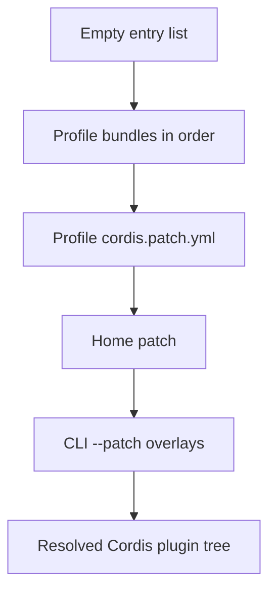
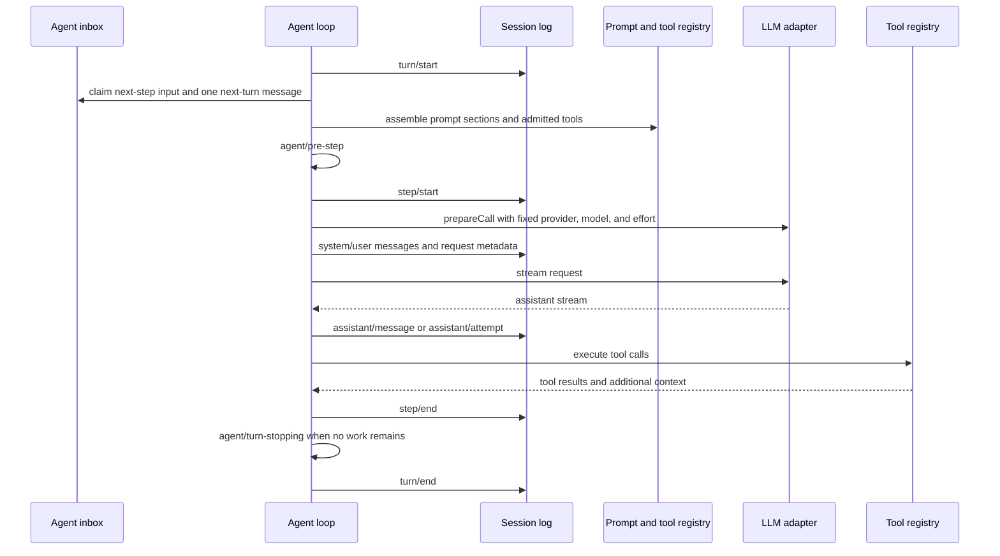
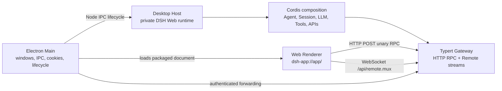
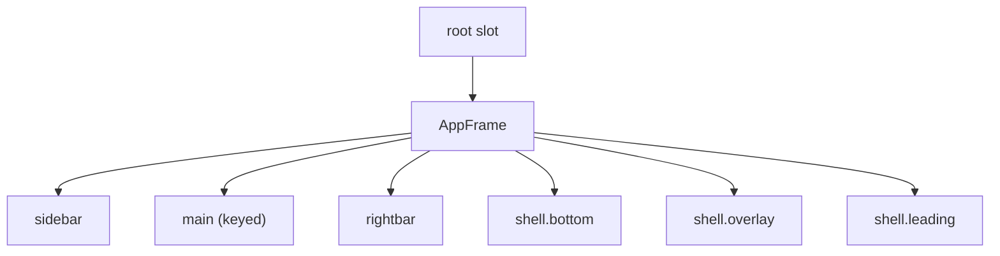

# Native Architecture Audit

English | [中文](NATIVE_ARCHITECTURE_AUDIT.zh.md)

## Summary

DeepSeekRuntime composes nearly every product capability as a Cordis plugin and keeps Host behavior behind one generated Typert Remote protocol. The Agent loop drives one append-only Session log, the Host and Web Client share typed unary calls and multiplexed streams, and Desktop separates Electron lifecycle from an unmodified Desktop Host. This audit identifies the source-owned extension points and the boundaries Workbench must preserve before it adds product behavior.

## Table of Contents

- [Evidence method](#evidence-method)
- [Cordis composition](#cordis-composition)
- [Profiles, bundles, patches, and HMR](#profiles-bundles-patches-and-hmr)
- [Agent turn execution](#agent-turn-execution)
- [Inbox, Session, and durable projection](#inbox-session-and-durable-projection)
- [Approval, questions, tools, and subagents](#approval-questions-tools-and-subagents)
- [Typert Host/Client API](#typert-hostclient-api)
- [Streams, recovery, authentication, and access](#streams-recovery-authentication-and-access)
- [Plugin Manager and client modules](#plugin-manager-and-client-modules)
- [Desktop process architecture](#desktop-process-architecture)
- [Client UI slots](#client-ui-slots)
- [Windows and WSL2 source boundary](#windows-and-wsl2-source-boundary)
- [Audit conclusions and open evidence](#audit-conclusions-and-open-evidence)
- [Further Exploration](#further-exploration)
- [Dev Note](#dev-note)

-----

## Evidence method

The audit prioritizes implementation files over introductory prose. Architecture documentation is used to orient a topic; conclusions are then traced to package source, package contracts, generated surfaces, or an executed Desktop path.

**Verified:** the baseline commit, dependency graph, Windows build, and Desktop launch process were executed. **Source-inferred:** lifecycle ordering, request-stream behavior, access checks, and UI ownership come from current source. **Not yet verified:** untested combinations of a custom Workbench bundle, a replaced root layout, privileged plugin operations, and a WSL Host remain proposals for later phases.

| Evidence owner | Purpose in this audit |
|---|---|
| `docs/architecture.md` | Cross-package map and current turn-flow overview |
| `packages/boot/app-boot` | Profile resolution and boot-layer composition |
| `packages/core/agent-loop` | Turn, step, inbox, request, stream, and tool execution |
| `packages/core/session` | Append-only event source and derived message surface |
| `packages/typert` and `packages/api/gateway` | Typed Remote calls, streams, and transport |
| `packages/boot/plugin-manager` and `packages/client/modules` | Host and client plugin lifecycle |
| `apps/desktop` and `apps/desktop-host` | Electron, Desktop Host, renderer, forwarding, and shutdown |
| `packages/client/ui-*` | UI registry, slots, and default layout ownership |

-----

## Cordis composition

Cordis supplies service discovery, dependency injection, typed event dispatch, and reversible effects. Product capabilities register services, listeners, tools, prompts, adapters, and UI objects into a shared context; unloading the owning plugin removes those registrations.

**Source-inferred:** a model adapter, tool registry, Session log, Agent loop, Web server, and client UI all participate as plugins. There is no product core that must be patched to add ordinary capability. The stable composition point is the Cordis context and its service/event contracts.

| Mechanism | Current contract | Source |
|---|---|---|
| Service key | `ctx.<key>` names a replaceable capability | [Cordis primer](../cordis-primer.md), lines 9-13 |
| Dependency | `inject` waits for required services | [Cordis primer](../cordis-primer.md), lines 11-12 |
| Event dispatch | `emit`, `waterfall`, `parallel`, `serial`, and `bail` have distinct ordering | [Cordis primer](../cordis-primer.md), lines 19-35 |
| Reversible registration | `ctx.effect()` and `ctx.on()` return or own disposal | [Cordis primer](../cordis-primer.md), lines 13, 45 |
| Product map | Every part of the product participates as a plugin | [architecture.md](../architecture.md), lines 9-11 |
| Core service keys | Session, prompt, tools, agents, loop, and LLM are separate services | [architecture.md](../architecture.md), lines 57-65 |

A waterfall listener must call `next()` when another listener should continue the decision. A policy listener may intentionally answer without `next()`. Workbench middleware must preserve this rule because a superficial observer can accidentally block prompt assembly, tool execution, or model calls.

The native registrations already expose the preferred extension boundary. A Workbench feature should first ask whether a `ctx.effect` registration, `ctx.on` listener, registry method, Typert namespace, or client slot can own the behavior. Changing a core package is the last choice and requires evidence that no documented registration reaches the same decision point.

-----

## Profiles, bundles, patches, and HMR

A profile is a named bootstrap composition under `$DSH_HOME/profiles/<name>`. It selects ordered bundles and user patches. A bundle is a distributable patch document with the plugin rows that compose a product profile. A patch selects a row by id and replaces its complete config, or inserts a new row.

The boot order is explicit: an empty list, ordered profile bundles, profile patch, home patch, and `--patch` overlays. A preset patch applies the same composition rule inside its declared `config.plugins`. Later layers can replace complete configs by row id; this makes product defaults and deployment overrides visible in one resolved tree.

| Concern | Current implementation | Source |
|---|---|---|
| Profile home | `$DSH_HOME/profiles/<name>` | [profile.ts](../../packages/boot/app-boot/src/profile.ts), lines 165-217 |
| Layer resolution | Bundles and patches compose to a final tree | [profile.ts](../../packages/boot/app-boot/src/profile.ts), lines 678-712 |
| Profile context | Resolved composition becomes plugin context | [profile-context.ts](../../packages/boot/app-boot/src/profile-context.ts), lines 68-84 |
| Base bundle | Shared model, tool, persistence, policy, and settings layer | [base/package.json](../../packages/bundle/base/package.json), lines 34-37 |
| Web bundle | Browser application layer above the base composition | [web-app/package.json](../../packages/bundle/web-app/package.json), lines 49-58 |
| HMR | YAML composition selects and configures `dsh-hmr` | [architecture.md](../architecture.md), line 27 |

**Source-inferred:** Workbench should own a bundle and profile composition rather than a full parallel application tree. The bundle can add Workbench Host and client rows, and a profile patch can replace a UI row when a genuine product variant requires it. HMR covers config-only reload according to the selected profile; a plugin implementation or client release change can still require restart or page reload.

-----

## Agent turn execution

The native loop is retained. A turn starts before its first input claim and closes when no request is owed. A step is one model request plus any tools it calls. Every model-visible input is committed to the Session log before the request reaches the provider.

Input is claimed into a `PreparedStep`; prompt assembly and model selection are captured there. `agent/pre-step` may accept, rewrite, or reject the claimed messages. A rejected or empty first claim closes a durable turn without spending a model call. Once execution enters the step, `agent/request` may adjust call controls but cannot change provider, model, or reasoning effort.

| Boundary | Current behavior | Source |
|---|---|---|
| Input and prompt admission | Claim inbox input, resolve tools, assemble prompt, dispatch `agent/pre-step` | [agent.ts](../../packages/core/agent-loop/src/agent.ts), lines 289-323 |
| Turn and step framing | Open turn, claim step, settle tool recovery, close step, run stopping hook | [agent.ts](../../packages/core/agent-loop/src/agent.ts), lines 332-405 |
| Model request | Bind the selected adapter before model-visible input is committed | [agent.ts](../../packages/core/agent-loop/src/agent.ts), lines 618-659 |
| Stream and tools | Settle assistant output, run tools, feed additional context into the next step | [agent.ts](../../packages/core/agent-loop/src/agent.ts), lines 441-615 |
| Model selection | Provider, model, and effort are fixed before request preparation | [agent types](../../packages/core/agent/src/types.ts), lines 88-122 |

**Source-inferred:** a custom tool belongs in the tool registry; a model route belongs in the LLM adapter/selection services; a behavior policy belongs in a documented event such as `agent/pre-step`, `agent/request`, `agent/turn-stopping`, a tool hook, or a Session projection. Replacing the `Agent` service itself is unnecessary for these cases and expands the maintenance surface across the entire Host and client UI.

-----

## Inbox, Session, and durable projection

The Session is the source of truth. It is an append-only typed event stream, and model history is a derived `Message[]`. Replacements and projections can change the active surface without deleting prior events. Persistence owns storage and recovery, while the Session service owns logical append validation and projection.

**Source-inferred:** Workbench activity timelines should subscribe to Session events and projections instead of maintaining a second mutable conversation store. The Host API already exposes Session listing, event following, and Session operations; the client should render the native log and derived surfaces.

| Concept | Current behavior | Source |
|---|---|---|
| Append-only source | Every model-visible fact is recorded and history derives from the log | [Session README](../../packages/core/session/README.md), lines 12, 44, 104 |
| Surface projection | `Message[]` is derived incrementally from committed events | [surface.ts](../../packages/core/session/src/surface.ts), lines 3, 114-137 |
| Event creation | Typed append validates and freezes payloads before commit | [Session index](../../packages/core/session/src/index.ts), lines 548, 853-912 |
| Persistence seam | A backend stores and restores logical Session events | [Session README](../../packages/core/session/README.md), lines 104, 128 |
| Inbox targets | Queued work targets `next-turn` or `next-step` | [inbox.ts](../../packages/core/agent-loop/src/inbox.ts), lines 19-64 |
| Inbox recovery | Pending input reconstructs from durable `agent/inbox/spliced` events | [inbox.ts](../../packages/core/agent-loop/src/inbox.ts), lines 29-51, 215-223 |

User input has three semantic roles. `followup` queues a new turn, `steer` changes the currently running work at an admitted boundary, and `inject` supplies context that waits for a waking message. The exact admission path and visible label must follow current client and Session contracts; Workbench should not invent a fourth durable input kind without a source-level design.

-----

## Approval, questions, tools, and subagents

Approval policy defaults to `ask`. A request can be approved or denied only by an answerer available to the current Host and client scope; unavailable answerers fail closed. The decision is recorded as an audit event, while the pending request itself is process-local. User questions may return a pending handle and receive an answer later.

**Source-inferred:** an Approval Center should display and answer native approval and question capabilities. It should not forward approvals through an unrelated RPC or keep the only approval state in the Workbench renderer. Host policy remains authoritative and every client path must respect it.

| Capability | Current boundary | Source |
|---|---|---|
| User approval | Default `ask`; unavailable answerers fail closed | [approval README](../../packages/interaction/user-approval/README.md), lines 12, 32, 47-53 |
| Approval durability | Decision is audited; pending request is process-local | [approval README](../../packages/interaction/user-approval/README.md), lines 82-90, 164-168 |
| User questions | Supports pending questions and later answers | [questions README](../../packages/interaction/user-questions/README.md), lines 27-40 |
| Tool execution | Typed call enters pre-execute, execute, post-execute, and result settlement | [architecture.md](../architecture.md), lines 101-108 |
| Subagent limits | Default maximum depth is 1 and maximum active subagents is 8 | [subagent README](../../packages/subagent/subagent/README.md), lines 49-53, 61 |
| Subagent behavior | Subagents use the same runtime contracts with bounded activation | [subagent README](../../packages/subagent/subagent/README.md), lines 96-127 |
| Host plugin trust | Host plugin code runs in-process outside the workspace sandbox | [Plugin Manager README](../../packages/boot/plugin-manager/README.md), lines 14, 31-56 |

Tools execute through `ctx.tools` after step admission. Tool schemas are resolved for the selected model and disposed with the step. A Workbench tool should be a normal plugin registration whose schema and execution use the existing scoped tool service. Direct invocation of shell commands from renderer code would bypass admission, approval, cancellation, and the workspace sandbox.

-----

## Typert Host/Client API

Typert turns declared Host methods into typed Remote methods. `@Remote` marks an ordinary service method; `@RemoteScope` marks a method whose receiver is resolved from a scoped Context. Generated descriptors carry codecs, schemas, invocation mode, result projection, and resource readers. The Gateway performs access checks before decoding arguments or resolving business objects.

**Source-inferred:** a Workbench Host feature should expose a Typert namespace only when native Session, Workspace, Terminal, filesystem, Job, Settings, credential, command, Skill, Plugin, or subagent APIs cannot express the operation. A product-specific state service may add one small namespace while continuing to use the native connection and access system.

The confirmed native namespaces below were traced through implementation and generated API declarations:

| Namespace | Workbench relevance |
|---|---|
| `session` | List, open, follow, control, input, and Session-scoped operations |
| `workspace` | Workspace discovery, ordering, and workspace-scoped behavior |
| `terminal` | Terminal session creation and interaction |
| `workspaceFiles` | Workspace file listing and operations |
| `job` | Durable or managed background jobs |
| `settings` | Product and profile settings |
| `credentials` | Credential state and management through policy |
| `commands` | Command discovery and execution surfaces |
| `skills` | Skill inventory and invocation-relevant metadata |
| `pluginInventory` | Installed and available plugin information |
| `pluginManager` | Privileged plugin lifecycle operations |
| `subagents` | Subagent inventory and controls |

The exact method set must be taken from the generated Typert catalog at the implementation commit. A namespace name does not guarantee every operation Workbench needs, and no name should be invented before its source declaration or generated descriptor exists.

-----

## Streams, recovery, authentication, and access

The browser uses HTTP POST for unary Remote calls. Remote streams share the authenticated `/api/remote.mux` WebSocket, with each stream holding its own logical identity and optional Client-to-Host uplink. The connection layer owns request correlation, transport, reconnection, and Host forwarding; API Gateway owns stream dispatch and validation.

| Concern | Current behavior | Source |
|---|---|---|
| Unary transport | Browser Remote unary calls use HTTP POST | [rpc.ts](../../packages/client/connection/src/client/rpc.ts), lines 47-52 |
| Shared stream carrier | Remote streams use `/api/remote.mux` | [connection README](../../packages/client/connection/README.md), lines 32-34 |
| Stream dispatch | Gateway mounts methods and streams from generated descriptors | [stream-client.ts](../../packages/api/gateway/src/client/stream-client.ts), lines 48-95 |
| Snapshot stream | One snapshot then ordered deltas | [snapshot-stream.ts](../../packages/api/gateway/src/client/snapshot-stream.ts), lines 26-90 |
| Journal stream | Supports follow, page, reconnect, and gap repair | [journal-stream.ts](../../packages/api/gateway/src/client/journal-stream.ts), lines 84-162 |
| Peer identity | A call carries an authenticated `PeerScope` and principal | [Typert protocol README](../../packages/typert/protocol/README.md), lines 12, 32, 49 |
| Admission | Host and origin checks run before authentication | [connection README](../../packages/client/connection/README.md), lines 32-34 |
| Resource policy | Remote access is decided per resource and principal | [remote-access README](../../packages/api/remote-access/README.md), lines 12, 27-48 |

A snapshot stream is appropriate for current collection state where the Host sends a baseline and later changes. A journal stream is appropriate when a reconnecting client can request missing event ranges. A Workbench client must preserve generation invalidation and reconnect semantics; treating every stream as an unbounded event emitter loses recovery and can duplicate or miss state.

The Desktop Host uses loopback, an OS-assigned port by default, a signed cookie outside the regular Electron session store, and Host/Origin/`Sec-Fetch-Site` checks. Remote-access policy remains active for non-owner principals. A future remote or WSL Host must preserve these checks and the peer principal path.

-----

## Plugin Manager and client modules

The Host Plugin Manager installs, removes, and updates plugin packages in a profile. It runs with Host privilege, so plugin lifecycle operations are materially more powerful than ordinary Agent tools. Agent-initiated plugin operations require full access or explicit approval. Git updates require a complete 40-character commit pin.

**Source-inferred:** Workbench should distinguish inventory browsing from privileged mutation. The Plugin UI can reuse `pluginInventory` and guarded `pluginManager` methods, but it must display the owning profile, requested version or commit, restart/reload effect, and approval state before mutation.

| Area | Current boundary | Source |
|---|---|---|
| Host execution | Plugin code is in-process and outside workspace sandbox | [Plugin Manager README](../../packages/boot/plugin-manager/README.md), lines 14, 31-56 |
| Git pin | Update requires a complete commit hash | [Plugin Manager README](../../packages/boot/plugin-manager/README.md), lines 723-741 |
| No-HMR result | Mutation can return `restart-required` | [Plugin Manager README](../../packages/boot/plugin-manager/README.md), lines 723-741 |
| Client declaration | Client code is declared by `dsh.client` | [client modules README](../../packages/client/modules/README.md), lines 45-59 |
| Boot loading | Client modules attach through the boot graph | [client modules README](../../packages/client/modules/README.md), lines 73-95 |
| Runtime load | Module registry activates a package in the client Cordis tree | [system.ts](../../packages/client/modules/src/client/system.ts), lines 92-249 |
| Release change | A changed Host release or bootstrap mismatch can require reload | [release-change.ts](../../packages/client/modules/src/client/release-change.ts), lines 27-72 |

A complete Workbench plugin can contain Host code and client code. The Host entry contributes services, APIs, tools, or policy. The package manifest declares the client entry, and the client module loads it into the renderer Cordis tree. Client effects must unload cleanly, and package versions must remain compatible with the active Host contract.

-----

## Desktop process architecture

The Desktop application deliberately uses three processes with different trust and lifecycle jobs. Electron Main owns native windows, application menu and shortcuts, IPC, cookies, update coordination, and forwarding. Desktop Host runs the unmodified DSH Web runtime through a profile. The renderer runs the standard Web client in the sandboxed Chromium page.

**Verified:** Electron Main, Desktop Host, and renderer started. The Host listened on loopback with a dynamic port, the renderer document was `dsh-app://app/`, and the client displayed the native session shell and task input.

| Authority | Owns | Source |
|---|---|---|
| Electron Main | Windows, lifecycle, IPC, HTTP/WS forwarding, cookies | [main.ts](../../apps/desktop/src/main.ts), lines 290-292, 547-555 |
| Desktop Host | The normal DSH profile runner and Web application | [Desktop Host index](../../apps/desktop-host/src/index.ts) |
| Host process | Dynamic port, Node IPC, readiness, fatal errors, shutdown | [host-process.ts](../../apps/desktop/src/host-process.ts), lines 157-224 |
| Web document | Packaged renderer assets and boot injections | [web-document.ts](../../apps/desktop/src/web-document.ts), lines 39-106 |
| Security | `nodeIntegration: false`, `contextIsolation: true`, `sandbox: true` | [main.ts](../../apps/desktop/src/main.ts), lines 846-856 |
| Update coordination | Download and update lifecycle owned by Main | [update-coordinator.ts](../../apps/desktop/src/update-coordinator.ts), lines 52-81 |

This split lets the standard Web product run inside a native shell without granting renderer Node access. Electron Main manages trusted operating-system operations, while Desktop Host owns the server and Runtime. Packing the entire Runtime into Electron Main would couple native lifecycle to provider and plugin execution, widen renderer-adjacent privilege, and make the same Host harder to reuse for Web, SDK, or a future execution world.

The normal shutdown sequence is IPC shutdown, a 10-second wait, `SIGTERM`, a 5-second wait, `SIGKILL`, and a final 5-second wait. **Verified:** a first Desktop launch exited through `app.quit()`. A later launch logged a timed-out quit and required batch interruption, leaving no process. See the [sync report](UPSTREAM_SYNC_REPORT.md#known-limitations) for the recorded diagnostic.

-----

## Client UI slots

The client Cordis tree owns UI registration as reversible effects. The built-in single `root` slot is occupied by `ui-layout`, which mounts `AppFrame`. `AppFrame` declares `sidebar`, keyed `main`, `rightbar`, `shell.bottom`, `shell.overlay`, and `shell.leading` as child slots.

**Source-inferred:** preserving `AppFrame` and registering Workbench occupants inside its child slots is the lower-risk customization. Replacing `root` shadows `AppFrame` and removes every slot it declares. A replacement layout must restore the layout service, slots, panel selection, renderer integration, scopes, locale, Session wiring, and any effects registered by native plugins.

| UI owner | Current behavior | Source |
|---|---|---|
| Renderer registry | UI objects attach through a Cordis registry | [registry.ts](../../packages/client/ui-renderer/src/client/registry.ts), lines 31-44 |
| Slot registry | `root` is built in; slot declarations create scoped child slots | [ui-slots index](../../packages/client/ui-slots/src/index.ts), lines 1038-1076, 1186-1367 |
| Default layout | `ui-layout` contributes `AppFrame` and its child occupants | [ui-layout index](../../packages/client/ui-layout/src/client/index.ts), lines 43-121, 192-205 |
| Theme | Native theme tokens remain available to plugin UI | `packages/client/ui-theme` |

Two product choices are viable:

| Option | Benefits | Costs |
|---|---|---|
| REUSE and EXTEND `AppFrame` | Native Session, Files, Terminal, Approval, settings, locale, and plugin wiring remain active; incremental delivery | Default layout structure limits radical shell changes |
| REPLACE client `root` | Complete control of window chrome and panel topology | Must rebuild or explicitly reattach every native layout and client behavior that depended on the removed slots |

The proposed Phase 1 choice is `REUSE` plus `EXTEND`. Workbench can make the shell distinctive through persistent left navigation, a custom Session center, a context right bar, an activity bottom panel, overlays, and theme tokens while retaining native `AppFrame`.

-----

## Windows and WSL2 source boundary

Windows Native is a first-class runtime target in the audited source. The platform packages include Windows process inspection and termination, Job Objects, ConPTY terminals, persistent PowerShell, DACL preservation, restricted-token ACL sandboxing, and Windows-specific atomic file publication.

**Source-inferred:** the Windows ACL sandbox enforces writes and deletes, while reads and network remain unrestricted. NTFS hard links can alias paths outside the nominal workspace. The sandbox reports partial enforcement and must not be described as a full filesystem or network boundary.

| Platform area | Current evidence | Source |
|---|---|---|
| Windows ACL sandbox | Restricted-token writes/deletes with known read/network/hard-link limits | [Windows ACL README](../../packages/sandbox/sandbox-windows-acl/README.md) |
| Local sandbox seam | Platform provider registers behind the shared sandbox service | [local sandbox README](../../packages/sandbox/sandbox-local/README.md) |
| Windows terminal | ConPTY and persistent PowerShell are supported paths | [terminal-bash README](../../packages/terminal/terminal-bash/README.md), lines 12, 34, 56, 170-171 |
| SSH helper | SSH providers are POSIX-only in the audited path | [ssh index](../../packages/ssh/ssh/src/index.ts), lines 90, 99 |
| SSH shell helper | Provider invokes POSIX shell behavior | [ssh helper](../../packages/ssh/ssh/src/helper.ts), line 57 |
| Renderer filesystem | Direct renderer file access is not the Host security model | [Desktop process architecture](#desktop-process-architecture) |

A WSL2 execution world should run a complete DSH Runtime inside the WSL distribution and connect to it through an authenticated remote Host protocol. It is not a Windows filesystem provider hidden behind the same renderer. Windows still controls environment discovery, session routing, UI lifecycle, and selection of the active execution world.

The audited WSL installation is `RockyLinux-9.8` on kernel `6.18.40.1-microsoft-standard-WSL2` with NAT networking. No native Node installation was confirmed, and commands resolved Windows installations under `/mnt/c`. A real WSL adapter therefore needs a provisioned Linux Node/runtime, endpoint discovery, authentication, path mapping, Host start/readiness, shutdown, logging, and crash recovery before it can become a supported execution environment.

-----

## Audit conclusions and open evidence

The native architecture supports a Workbench that adds product composition and UI without replacing the Agent, Session, API, or plugin foundations. The largest technical risks are not basic extensibility; they are lifecycle fidelity at the edges: UI root replacement, privileged plugin mutation, default-branch ambiguity, Desktop shutdown, and remote execution-world identity.

| Conclusion | Status | Consequence |
|---|---|---|
| Reuse the native Runtime, Agent loop, Session, and Typert transport | `源码推断` | Workbench work should begin in bundles, plugins, and client slots |
| Retain `AppFrame` and extend child slots | `源码推断` | Lower integration cost than replacing `root` |
| Begin with Windows Native acceptance | `已验证` for build and launch; `尚未验证` for full product flows | First milestone can build on working official Desktop |
| Add WSL as a separate execution world | `尚未验证` | Needs a Host adapter and complete endpoint/lifecycle design |
| Treat Plugin Manager as privileged | `源码推断` | UI and approvals must expose restart and security effects |
| Preserve `/api/remote.mux` and access checks | `源码推断` | No second RPC system is justified |

Open evidence includes the full Desktop shutdown path, the `dsh-desktop:mandatory-status` handler diagnostic, root-layout removal behavior under the actual Workbench bundle, plugin update/reload matrix, WSL distribution provisioning, Linux endpoint authentication, path mapping rules, and recovery after Host or WSL process loss.

-----

## Further Exploration

- [Workbench architecture](WORKBENCH_ARCHITECTURE.md) — turn these findings into a target composition and module classification.
- [Extension points](EXTENSION_POINTS.md) — choose the supported mechanism for a specific feature.
- [Platform compatibility](PLATFORM_COMPATIBILITY.md) — review Windows limits and the proposed WSL boundary.
- [Upstream sync report](UPSTREAM_SYNC_REPORT.md) — inspect the exact pin and execution evidence.

-----

## Dev Note

None.
