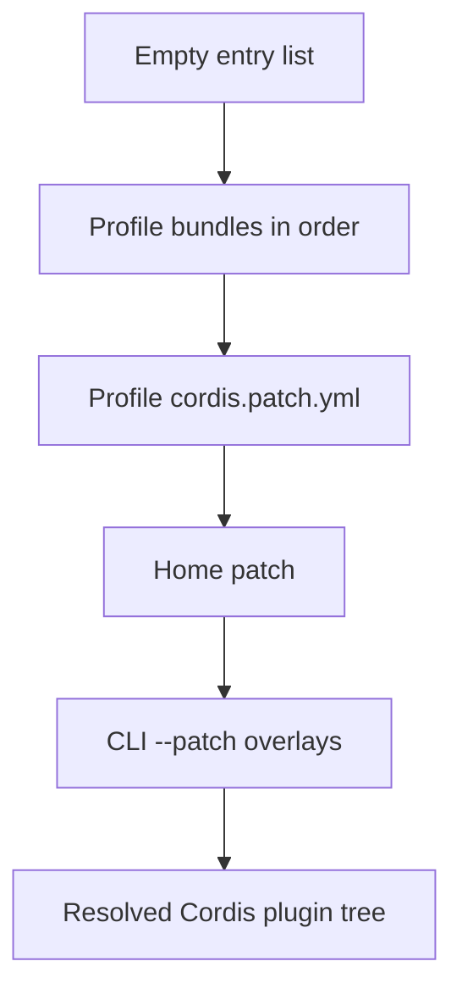
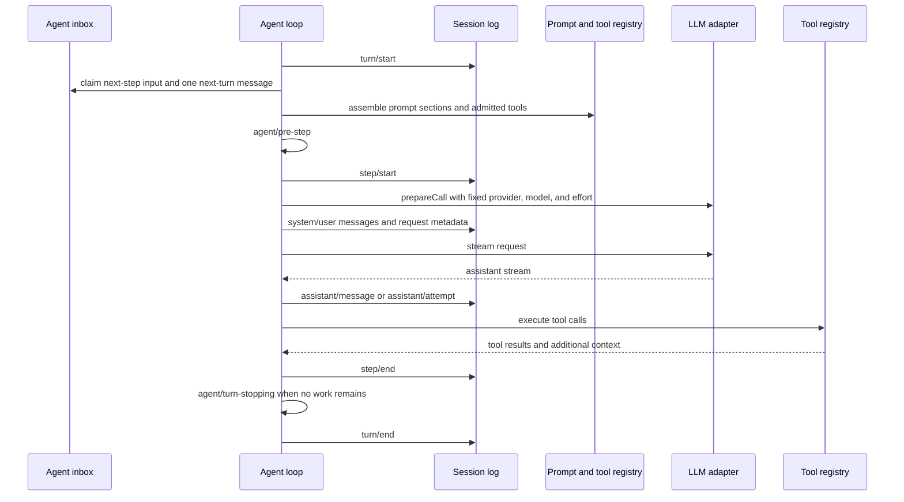
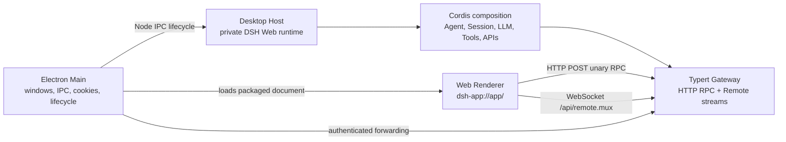
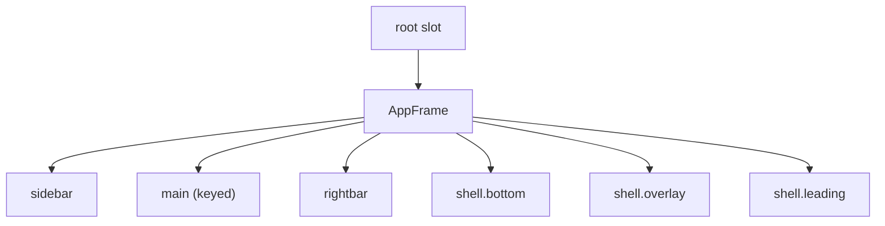

# 原生架构审计

[English](NATIVE_ARCHITECTURE_AUDIT.md) | 中文

## 摘要

DeepSeekRuntime 几乎把每个产品能力都组合为 Cordis 插件，并把 Host 行为保持在同一个生成的 Typert Remote 协议之后。Agent Loop 驱动唯一的追加式 Session 日志，Host 与 Web Client 共享类型化一元调用和多路复用流，Desktop 则把 Electron 生命周期与未修改的 Desktop Host 分开。本审计识别源码拥有的扩展点，以及 Workbench 在增加产品行为前必须保留的边界。

## 目录

- [证据方法](#evidence-method)
- [Cordis 组合](#cordis-composition)
- [Profile、Bundle、Patch 与 HMR](#profiles-bundles-patches-and-hmr)
- [Agent Turn 执行](#agent-turn-execution)
- [Inbox、Session 与持久投影](#inbox-session-and-durable-projection)
- [Approval、问题、工具与 Subagent](#approval-questions-tools-and-subagents)
- [Typert Host/Client API](#typert-hostclient-api)
- [流、恢复、认证与访问](#streams-recovery-authentication-and-access)
- [Plugin Manager 与客户端模块](#plugin-manager-and-client-modules)
- [Desktop 进程架构](#desktop-process-architecture)
- [客户端 UI Slot](#client-ui-slots)
- [Windows 与 WSL2 源码边界](#windows-and-wsl2-source-boundary)
- [审计结论与开放证据](#audit-conclusions-and-open-evidence)
- [进一步探索](#further-exploration)
- [开发备注](#dev-note)

-----

## 证据方法

审计优先使用实现文件，而非介绍性说明。架构文档用于定位主题；结论再追踪到包源码、包契约、生成表面或已执行的 Desktop 路径。

**已验证：**基线 Commit、依赖图、Windows 构建和 Desktop 启动进程均已执行。**源码推断：**生命周期顺序、请求流行为、访问检查与 UI 归属来自当前源码。**尚未验证：**自定义 Workbench Bundle、替换根布局、特权插件操作与 WSL Host 的未测试组合仍是后续阶段提议。

| 证据归属 | 本审计中的用途 |
|---|---|
| `docs/architecture.md` | 跨包地图与当前 Turn Flow 概览 |
| `packages/boot/app-boot` | Profile 解析与启动层组合 |
| `packages/core/agent-loop` | Turn、Step、Inbox、请求、流与工具执行 |
| `packages/core/session` | 追加式事件源与派生消息表面 |
| `packages/typert` 与 `packages/api/gateway` | 类型化 Remote 调用、流与传输 |
| `packages/boot/plugin-manager` 与 `packages/client/modules` | Host 与客户端插件生命周期 |
| `apps/desktop` 与 `apps/desktop-host` | Electron、Desktop Host、Renderer、转发与关闭 |
| `packages/client/ui-*` | UI Registry、Slot 与默认布局归属 |

-----

## Cordis 组合

Cordis 提供服务发现、依赖注入、类型化事件分发和可逆 Effect。产品能力把服务、监听器、工具、Prompt、Adapter 和 UI 对象注册到共享 Context；卸载所属插件会移除这些注册。

**源码推断：**模型 Adapter、工具 Registry、Session 日志、Agent Loop、Web 服务器和客户端 UI 均作为插件参与。无需为普通能力修改某个产品核心。稳定组合点是 Cordis Context 及其服务/事件契约。

| 机制 | 当前契约 | 源码 |
|---|---|---|
| 服务键 | `ctx.<key>` 命名一个可替换能力 | [Cordis 入门](../cordis-primer.zh.md)，第 9-13 行 |
| 依赖 | `inject` 等待必需服务 | [Cordis 入门](../cordis-primer.zh.md)，第 11-12 行 |
| 事件分发 | `emit`、`waterfall`、`parallel`、`serial` 和 `bail` 具有不同顺序 | [Cordis 入门](../cordis-primer.zh.md)，第 19-35 行 |
| 可逆注册 | `ctx.effect()` 与 `ctx.on()` 返回或持有 Disposal | [Cordis 入门](../cordis-primer.zh.md)，第 13、45 行 |
| 产品地图 | 产品每个部分均作为插件参与 | [architecture.md](../architecture.zh.md)，第 9-11 行 |
| 核心服务键 | Session、Prompt、Tools、Agents、Loop 与 LLM 为独立服务 | [architecture.md](../architecture.zh.md)，第 57-65 行 |

当其他监听器应继续处理决策时，Waterfall 监听器必须调用 `next()`。策略监听器可以有意不调用 `next()` 并直接作答。Workbench 中间件必须保留该规则，因为表面上的观察器也可能阻断 Prompt 组装、工具执行或模型调用。

原生注册已经呈现首选扩展边界。Workbench 功能应先判断 `ctx.effect` 注册、`ctx.on` 监听器、Registry 方法、Typert Namespace 或客户端 Slot 能否拥有行为。修改核心包是最后选择，并且需要证据表明没有已记录注册能够到达同一决策点。

-----

## Profile、Bundle、Patch 与 HMR

Profile 是 `$DSH_HOME/profiles/<name>` 下的命名启动组合。它选择有序 Bundle 与用户 Patch。Bundle 是包含产品 Profile Plugin Row 的可分发 Patch 文档。Patch 按 id 选择 Row 并替换其完整 Config，或插入新 Row。

启动顺序明确：空列表、按序 Profile Bundle、Profile Patch、Home Patch 与 `--patch` Overlay。Preset Patch 在其声明的 `config.plugins` 内应用相同组合规则。后续层可按 Row id 替换完整 Config；这使产品默认值和部署覆盖在同一解析树中可见。

| 关注点 | 当前实现 | 源码 |
|---|---|---|
| Profile Home | `$DSH_HOME/profiles/<name>` | [profile.ts](../../packages/boot/app-boot/src/profile.ts)，第 165-217 行 |
| 层解析 | Bundle 与 Patch 组合为最终树 | [profile.ts](../../packages/boot/app-boot/src/profile.ts)，第 678-712 行 |
| Profile Context | 解析后的组合成为 Plugin Context | [profile-context.ts](../../packages/boot/app-boot/src/profile-context.ts)，第 68-84 行 |
| Base Bundle | 共享的模型、工具、持久化、策略与设置层 | [base/package.json](../../packages/bundle/base/package.json)，第 34-37 行 |
| Web Bundle | Base 组合之上的浏览器应用层 | [web-app/package.json](../../packages/bundle/web-app/package.json)，第 49-58 行 |
| HMR | YAML 组合选择并配置 `dsh-hmr` | [architecture.md](../architecture.zh.md)，第 27 行 |

**源码推断：**Workbench 应拥有 Bundle 与 Profile 组合，而不是完整平行的应用树。Bundle 可以增加 Workbench Host 与客户端 Row；当真实产品变体需要时，Profile Patch 可以替换 UI Row。HMR 按所选 Profile 覆盖仅 Config 重载；插件实现或客户端 Release 变化仍可能要求重启或页面重载。

-----

## Agent Turn 执行

保留原生 Loop。Turn 在首次输入认领前开始，并在不再欠下请求时关闭。Step 是一次模型请求及其调用的全部工具。每个模型可见输入都要在请求到达 Provider 前提交到 Session 日志。

输入被认领为 `PreparedStep`；Prompt 组装与模型选择在此处捕获。`agent/pre-step` 可以接受、改写或拒绝已认领消息。被拒绝或为空的首轮认领会关闭持久 Turn，且不消耗模型调用。进入 Step 后，`agent/request` 可以调整调用控制项，但不能改变 Provider、模型或 Reasoning Effort。

| 边界 | 当前行为 | 源码 |
|---|---|---|
| 输入与 Prompt 准入 | 认领 Inbox、解析工具、组装 Prompt、分发 `agent/pre-step` | [agent.ts](../../packages/core/agent-loop/src/agent.ts)，第 289-323 行 |
| Turn 与 Step 框架 | 打开 Turn、认领 Step、结算工具恢复、关闭 Step、运行 Stopping Hook | [agent.ts](../../packages/core/agent-loop/src/agent.ts)，第 332-405 行 |
| 模型请求 | 在提交模型可见输入前绑定所选 Adapter | [agent.ts](../../packages/core/agent-loop/src/agent.ts)，第 618-659 行 |
| 流与工具 | 结算 Assistant 输出、运行工具、把额外 Context 送入下一 Step | [agent.ts](../../packages/core/agent-loop/src/agent.ts)，第 441-615 行 |
| 模型选择 | Provider、模型与 Effort 在请求准备前固定 | [Agent 类型](../../packages/core/agent/src/types.ts)，第 88-122 行 |

**源码推断：**自定义工具归属 Tool Registry；模型路由归属 LLM Adapter/Selection 服务；行为策略归属 `agent/pre-step`、`agent/request`、`agent/turn-stopping`、工具 Hook 或 Session Projection 等已记录事件。上述场景无需替换 `Agent` 服务；替换会扩大整个 Host 与客户端 UI 的维护表面。

-----

## Inbox、Session 与持久投影

Session 是事实来源。它是类型化事件的追加式日志，模型历史是由它派生的 `Message[]`。替换与 Projection 可以改变活动表面而不删除旧事件。持久化拥有存储与恢复，Session 服务拥有逻辑追加验证与 Projection。

**源码推断：**Workbench 活动时间线应订阅 Session Event 与 Projection，而不是维护第二个可变对话 Store。Host API 已暴露 Session 列表、事件跟随和 Session 操作；客户端应渲染原生日志与派生表面。

| 概念 | 当前行为 | 源码 |
|---|---|---|
| 追加式来源 | 每个模型可见事实都记录，历史由日志派生 | [Session README](../../packages/core/session/README.zh.md)，第 12、44、104 行 |
| 表面投影 | `Message[]` 从已提交事件增量派生 | [surface.ts](../../packages/core/session/src/surface.ts)，第 3、114-137 行 |
| 事件创建 | 类型化 Append 在提交前验证并冻结 Payload | [Session 入口](../../packages/core/session/src/index.ts)，第 548、853-912 行 |
| 持久化 Seam | Backend 存储并恢复逻辑 Session Event | [Session README](../../packages/core/session/README.zh.md)，第 104、128 行 |
| Inbox 目标 | 排队工作目标为 `next-turn` 或 `next-step` | [inbox.ts](../../packages/core/agent-loop/src/inbox.ts)，第 19-64 行 |
| Inbox 恢复 | 待处理输入从持久 `agent/inbox/spliced` 事件重建 | [inbox.ts](../../packages/core/agent-loop/src/inbox.ts)，第 29-51、215-223 行 |

用户输入有三种语义作用。`followup` 排队新 Turn，`steer` 在已准入边界改变当前工作，`inject` 提供等待唤醒消息的 Context。精确准入路径与可见标签必须遵循当前客户端和 Session 契约；Workbench 不得在没有源码级设计的情况下发明第四种持久输入。

-----

## Approval、问题、工具与 Subagent

Approval 策略默认 `ask`。只有当前 Host 与客户端 Scope 可用的 Answerer 才能批准或拒绝；不可用 Answerer 会 Fail Closed。决策记录为审计事件，待处理请求本身是进程本地状态。用户问题可以返回 Pending Handle 并在之后收到回答。

**源码推断：**Approval Center 应展示并回答原生 Approval 与 Question，不应通过无关 RPC 转发 Approval，也不应把唯一 Approval 状态留在 Workbench Renderer。Host 策略仍是权威来源，每条客户端路径都必须遵守。

| 能力 | 当前边界 | 源码 |
|---|---|---|
| 用户 Approval | 默认 `ask`；不可用 Answerer Fail Closed | [Approval README](../../packages/interaction/user-approval/README.zh.md)，第 12、32、47-53 行 |
| Approval 持久性 | 决策被审计；Pending Request 为进程本地状态 | [Approval README](../../packages/interaction/user-approval/README.zh.md)，第 82-90、164-168 行 |
| 用户问题 | 支持 Pending Question 与后续回答 | [Questions README](../../packages/interaction/user-questions/README.zh.md)，第 27-40 行 |
| 工具执行 | 类型化调用进入 Pre-execute、Execute、Post-execute 与 Result 结算 | [architecture.md](../architecture.zh.md)，第 101-108 行 |
| Subagent 限制 | 默认最大深度 1、最大活动 Subagent 8 | [Subagent README](../../packages/subagent/subagent/README.zh.md)，第 49-53、61 行 |
| Subagent 行为 | Subagent 使用相同 Runtime 契约并受有界 Activation | [Subagent README](../../packages/subagent/subagent/README.zh.md)，第 96-127 行 |
| Host 插件信任 | Host 插件代码在 Workspace Sandbox 之外的进程内运行 | [Plugin Manager README](../../packages/boot/plugin-manager/README.zh.md)，第 14、31-56 行 |

工具在 Step 准入后通过 `ctx.tools` 执行。Tool Schema 为所选模型解析，并随 Step 释放。Workbench 工具应是普通插件注册，其 Schema 与执行使用既有 Scope 工具服务。Renderer 代码直接调用 Shell 会绕过准入、Approval、取消和 Workspace Sandbox。

-----

## Typert Host/Client API

Typert 把声明的 Host 方法转换为类型化 Remote Method。`@Remote` 标记普通服务方法；`@RemoteScope` 标记 Receiver 由 Scope Context 解析的方法。生成 Descriptor 携带 Codec、Schema、Invocation Mode、Result Projection 与 Resource Reader。Gateway 在解码参数或解析业务对象前执行访问检查。

**源码推断：**只有当原生 Session、Workspace、Terminal、文件系统、Job、Settings、Credential、Command、Skill、Plugin 或 Subagent API 无法表达操作时，Workbench Host 功能才应暴露 Typert Namespace。产品专属状态服务可以增加一个小 Namespace，同时继续使用原生连接和访问系统。

以下已确认原生 Namespace 来自实现与生成 API 声明：

| Namespace | Workbench 关联 |
|---|---|
| `session` | 列表、打开、跟随、控制、输入和 Session Scope 操作 |
| `workspace` | Workspace 发现、排序与 Workspace Scope 行为 |
| `terminal` | Terminal Session 创建与交互 |
| `workspaceFiles` | Workspace 文件列表与操作 |
| `job` | 持久或受管理后台 Job |
| `settings` | 产品与 Profile 设置 |
| `credentials` | 经策略控制的 Credential 状态与管理 |
| `commands` | Command 发现与执行表面 |
| `skills` | Skill Inventory 与调用相关元数据 |
| `pluginInventory` | 已安装与可用 Plugin 信息 |
| `pluginManager` | 特权 Plugin 生命周期操作 |
| `subagents` | Subagent Inventory 与控制 |

精确方法集合必须取自实现 Commit 的生成 Typert Catalog。Namespace 名称不能保证 Workbench 需要的每个操作，源码声明或生成 Descriptor 不存在时，也不得发明名称。

-----

## 流、恢复、认证与访问

浏览器对一元 Remote 调用使用 HTTP POST。Remote Stream 共享认证的 `/api/remote.mux` WebSocket，每条流拥有独立逻辑身份与可选 Client-to-Host Uplink。Connection 层拥有请求关联、传输、重连与 Host 转发；API Gateway 拥有 Stream Dispatch 与 Validation。

| 关注点 | 当前行为 | 源码 |
|---|---|---|
| 一元传输 | 浏览器 Remote 一元调用使用 HTTP POST | [rpc.ts](../../packages/client/connection/src/client/rpc.ts)，第 47-52 行 |
| 共享流载体 | Remote Stream 使用 `/api/remote.mux` | [Connection README](../../packages/client/connection/README.zh.md)，第 32-34 行 |
| Stream Dispatch | Gateway 从生成 Descriptor 挂载 Method 与 Stream | [stream-client.ts](../../packages/api/gateway/src/client/stream-client.ts)，第 48-95 行 |
| Snapshot Stream | 一个 Snapshot 后发送有序 Delta | [snapshot-stream.ts](../../packages/api/gateway/src/client/snapshot-stream.ts)，第 26-90 行 |
| Journal Stream | 支持 Follow、Page、Reconnect 与 Gap Repair | [journal-stream.ts](../../packages/api/gateway/src/client/journal-stream.ts)，第 84-162 行 |
| Peer 身份 | 调用携带已认证 `PeerScope` 与 Principal | [Typert Protocol README](../../packages/typert/protocol/README.zh.md)，第 12、32、49 行 |
| 准入 | Host 与 Origin 检查在认证前运行 | [Connection README](../../packages/client/connection/README.zh.md)，第 32-34 行 |
| 资源策略 | Remote 访问按 Resource 与 Principal 决策 | [Remote Access README](../../packages/api/remote-access/README.zh.md)，第 12、27-48 行 |

Snapshot Stream 适合 Host 发送 Baseline 与后续变化的当前集合状态。Journal Stream 适合重连客户端请求缺失事件范围。Workbench 客户端必须保留 Generation Invalidation 与 Reconnect 语义；把所有流当作无边 Event Emitter 会失去恢复能力，并可能重复或遗漏状态。

Desktop Host 默认使用 Loopback 与操作系统分配端口，在常规 Electron Session Store 之外保存 Signed Cookie，并执行 Host、Origin、`Sec-Fetch-Site` 检查。非 Owner Principal 的 Remote Access Policy 仍有效。未来 Remote 或 WSL Host 必须保留这些检查和 Peer Principal 路径。

-----

## Plugin Manager 与客户端模块

Host Plugin Manager 在 Profile 中安装、删除和更新插件包。它以 Host 特权运行，因此 Plugin 生命周期操作远比普通 Agent 工具强大。Agent 发起的 Plugin 操作需要 Full Access 或显式 Approval。Git 更新要求完整 40 字符 Commit Pin。

**源码推断：**Workbench 应区分 Inventory 浏览与特权 Mutation。Plugin UI 可以复用 `pluginInventory` 和受保护的 `pluginManager` 方法，但必须在 Mutation 前展示所属 Profile、请求 Version 或 Commit、Restart/Reload 影响与 Approval 状态。

| 领域 | 当前边界 | 源码 |
|---|---|---|
| Host 执行 | Plugin 代码在进程内且位于 Workspace Sandbox 之外 | [Plugin Manager README](../../packages/boot/plugin-manager/README.zh.md)，第 14、31-56 行 |
| Git Pin | 更新要求完整 Commit Hash | [Plugin Manager README](../../packages/boot/plugin-manager/README.zh.md)，第 723-741 行 |
| No-HMR 结果 | Mutation 可以返回 `restart-required` | [Plugin Manager README](../../packages/boot/plugin-manager/README.zh.md)，第 723-741 行 |
| 客户端声明 | 客户端代码由 `dsh.client` 声明 | [客户端模块 README](../../packages/client/modules/README.zh.md)，第 45-59 行 |
| Boot 加载 | 客户端模块通过 Boot Graph 接入 | [客户端模块 README](../../packages/client/modules/README.zh.md)，第 73-95 行 |
| Runtime 加载 | Module Registry 在客户端 Cordis 树中激活包 | [system.ts](../../packages/client/modules/src/client/system.ts)，第 92-249 行 |
| Release 变化 | Host Release 变化或 Bootstrap 不匹配可能要求 Reload | [release-change.ts](../../packages/client/modules/src/client/release-change.ts)，第 27-72 行 |

完整 Workbench 插件可以同时包含 Host 与客户端代码。Host 入口贡献服务、API、工具或策略。Package Manifest 声明客户端入口，客户端模块将它加载到 Renderer Cordis 树。客户端 Effect 必须干净卸载，Package Version 必须与活动 Host 契约兼容。

-----

## Desktop 进程架构

Desktop 应用刻意使用三个具有不同信任与生命周期职责的进程。Electron Main 拥有原生窗口、应用菜单与快捷键、IPC、Cookie、更新协调和转发。Desktop Host 通过 Profile 运行未修改的 DSH Web Runtime。Renderer 在 Sandboxed Chromium 页面运行标准 Web Client。

**已验证：**Electron Main、Desktop Host 与 Renderer 启动。Host 使用动态端口监听 Loopback，Renderer 文档为 `dsh-app://app/`，客户端显示原生 Session Shell 与任务输入。

| 权威方 | 拥有 | 源码 |
|---|---|---|
| Electron Main | 窗口、生命周期、IPC、HTTP/WS 转发、Cookie | [main.ts](../../apps/desktop/src/main.ts)，第 290-292、547-555 行 |
| Desktop Host | 普通 DSH Profile Runner 与 Web 应用 | [Desktop Host 入口](../../apps/desktop-host/src/index.ts) |
| Host Process | 动态端口、Node IPC、Ready、Fatal Error 与 Shutdown | [host-process.ts](../../apps/desktop/src/host-process.ts)，第 157-224 行 |
| Web Document | 打包 Renderer 资源与 Boot Injection | [web-document.ts](../../apps/desktop/src/web-document.ts)，第 39-106 行 |
| 安全 | `nodeIntegration: false`、`contextIsolation: true`、`sandbox: true` | [main.ts](../../apps/desktop/src/main.ts)，第 846-856 行 |
| 更新协调 | 下载与更新生命周期由 Main 拥有 | [update-coordinator.ts](../../apps/desktop/src/update-coordinator.ts)，第 52-81 行 |

该拆分允许标准 Web 产品在原生壳中运行，而不向 Renderer 授予 Node 访问。Electron Main 管理可信操作系统操作，Desktop Host 拥有 Server 与 Runtime。把整个 Runtime 放入 Electron Main 会使原生生命周期与 Provider、Plugin 执行耦合，扩大 Renderer 相邻特权，并降低同一 Host 对 Web、SDK 或未来执行环境的复用性。

正常关闭顺序是 IPC Shutdown、等待 10 秒、`SIGTERM`、等待 5 秒、`SIGKILL`，再等待 5 秒。**已验证：**首次 Desktop 启动通过 `app.quit()` 退出。后续启动记录 Quit Timeout，并需要中断批处理；之后没有进程残留。记录诊断见[同步报告](UPSTREAM_SYNC_REPORT.zh.md#known-limitations)。

-----

## 客户端 UI Slot

客户端 Cordis 树把 UI 注册作为可逆 Effect 拥有。内置单一 `root` Slot 由 `ui-layout` 占据，后者挂载 `AppFrame`。`AppFrame` 声明 `sidebar`、带 Key 的 `main`、`rightbar`、`shell.bottom`、`shell.overlay` 与 `shell.leading` 作为子 Slot。

**源码推断：**保留 `AppFrame` 并在其子 Slot 注册 Workbench 占位者，是风险较低的定制方式。替换 `root` 会遮蔽 `AppFrame` 并移除它声明的全部 Slot。替代布局必须恢复 Layout Service、Slot、Panel Selection、Renderer 集成、Scope、Locale、Session Wiring，以及原生插件注册的 Effect。

| UI 归属 | 当前行为 | 源码 |
|---|---|---|
| Renderer Registry | UI 对象通过 Cordis Registry 挂载 | [registry.ts](../../packages/client/ui-renderer/src/client/registry.ts)，第 31-44 行 |
| Slot Registry | `root` 为内置；Slot Declaration 创建 Scope Child Slot | [UI Slots 入口](../../packages/client/ui-slots/src/index.ts)，第 1038-1076、1186-1367 行 |
| 默认布局 | `ui-layout` 贡献 `AppFrame` 及子 Slot 占位者 | [UI Layout 入口](../../packages/client/ui-layout/src/client/index.ts)，第 43-121、192-205 行 |
| Theme | 原生 Theme Token 可供插件 UI 使用 | `packages/client/ui-theme` |

有两种可行产品选择：

| 方案 | 收益 | 成本 |
|---|---|---|
| `REUSE` 并 `EXTEND` `AppFrame` | 原生 Session、Files、Terminal、Approval、设置、Locale 与 Plugin Wiring 保持活动；可增量交付 | 默认布局结构限制激进壳层变化 |
| `REPLACE` 客户端 `root` | 完整控制窗口 Chrome 与面板拓扑 | 必须重建或显式重接依赖被移除 Slot 的每项原生布局与客户端行为 |

第一阶段建议选择 `REUSE` 加 `EXTEND`。Workbench 可以通过持久左侧导航、自定义 Session 中心、Context 右栏、活动底部面板、Overlay 与 Theme Token 形成独特壳层，同时保留原生 `AppFrame`。

-----

## Windows 与 WSL2 源码边界

Windows Native 是受审计源码中的一等 Runtime 目标。平台包包含 Windows 进程检查与终止、Job Object、ConPTY Terminal、持久 PowerShell、DACL 保留、Restricted Token ACL Sandbox 和 Windows 专用原子文件发布。

**源码推断：**Windows ACL Sandbox 强制写入与删除，但读取和网络仍不受限。NTFS Hard Link 可以别名到名义 Workspace 之外。Sandbox 报告 Partial Enforcement，不能描述为完整文件系统或网络边界。

| 平台领域 | 当前证据 | 源码 |
|---|---|---|
| Windows ACL Sandbox | Restricted Token 写/删，并含已知读、网络、Hard Link 限制 | [Windows ACL README](../../packages/sandbox/sandbox-windows-acl/README.zh.md) |
| 本地 Sandbox Seam | 平台 Provider 注册在共享 Sandbox Service 后 | [Local Sandbox README](../../packages/sandbox/sandbox-local/README.zh.md) |
| Windows Terminal | 支持 ConPTY 与持久 PowerShell 路径 | [Terminal Bash README](../../packages/terminal/terminal-bash/README.zh.md)，第 12、34、56、170-171 行 |
| SSH Helper | 受审计路径中的 SSH Provider 仅支持 POSIX | [SSH 入口](../../packages/ssh/ssh/src/index.ts)，第 90、99 行 |
| SSH Shell Helper | Provider 调用 POSIX Shell 行为 | [SSH Helper](../../packages/ssh/ssh/src/helper.ts)，第 57 行 |
| Renderer 文件系统 | 直接 Renderer 文件访问不属于 Host 安全模型 | [Desktop 进程架构](#desktop-process-architecture) |

WSL2 执行环境应在 WSL Distro 内运行完整 DSH Runtime，并通过认证 Remote Host 协议连接。它不是为了同一 Renderer 而在背后隐藏 Windows 文件系统 Provider。Windows 仍控制环境发现、Session 路由、UI 生命周期与活动执行环境选择。

受审计 WSL 安装为 `RockyLinux-9.8`，内核 `6.18.40.1-microsoft-standard-WSL2`，使用 NAT 网络。没有确认原生 Node 安装，命令解析到 `/mnt/c` 下的 Windows 安装。真实 WSL Adapter 因此在成为受支持执行环境前，需要 Provisioned Linux Node/Runtime、Endpoint Discovery、Authentication、Path Mapping、Host Start/Readiness、Shutdown、Logging 与 Crash Recovery。

-----

## 审计结论与开放证据

原生架构支持 Workbench 增加产品组合与 UI，而无需替换 Agent、Session、API 或 Plugin 基础。最大技术风险不在基础可扩展性，而在边缘生命周期保真度：UI Root Replacement、特权 Plugin Mutation、默认分支歧义、Desktop Shutdown 与 Remote Execution-World Identity。

| 结论 | 状态 | 后果 |
|---|---|---|
| 复用原生 Runtime、Agent Loop、Session 与 Typert Transport | `源码推断` | Workbench 应从 Bundle、Plugin 与客户端 Slot 开始 |
| 保留 `AppFrame` 并扩展子 Slot | `源码推断` | 集成成本低于替换 `root` |
| 以 Windows Native 开始验收 | 构建与启动`已验证`；完整产品流`尚未验证` | 首个里程碑可建立在可工作的官方 Desktop 上 |
| 将 WSL 作为独立执行世界 | `尚未验证` | 需要 Host Adapter 以及完整 Endpoint/Lifecycle 设计 |
| 将 Plugin Manager 视为特权能力 | `源码推断` | UI 与 Approval 必须展示重启和安全影响 |
| 保留 `/api/remote.mux` 与访问检查 | `源码推断` | 没有理由建立第二套 RPC |

开放证据包括完整 Desktop Shutdown 路径、`dsh-desktop:mandatory-status` Handler 诊断、真实 Workbench Bundle 下 Root Layout Removal 行为、Plugin Update/Reload 矩阵、WSL Distro Provisioning、Linux Endpoint Authentication、Path Mapping 规则，以及 Host 或 WSL 进程丢失后的恢复。

-----

## 进一步探索

- [Workbench 架构](WORKBENCH_ARCHITECTURE.zh.md)——把发现转化为目标组合和模块分类。
- [扩展点](EXTENSION_POINTS.zh.md)——为具体功能选择受支持机制。
- [平台兼容性](PLATFORM_COMPATIBILITY.zh.md)——审核 Windows 限制与提议的 WSL 边界。
- [上游同步报告](UPSTREAM_SYNC_REPORT.zh.md)——检查精确 Pin 与执行证据。

-----

## 开发备注

无。
