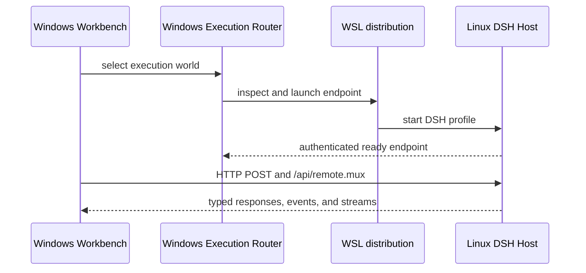

# Platform Compatibility

English | [中文](PLATFORM_COMPATIBILITY.zh.md)

## Summary

Windows Native is the verified first platform for DSH Workbench. The audited source already implements Windows process control, ConPTY terminals, persistent PowerShell, atomic file publication, and a restricted-token ACL sandbox with documented limits. WSL2 is a separate Linux execution world: it must run a complete DSH Host with Linux paths, lifecycle, authentication, and recovery. The current WSL installation was observed but a Linux Node runtime and end-to-end Workbench path were not verified.

## Table of Contents

- [Evidence and platform scope](#evidence-and-platform-scope)
- [Platform matrix](#platform-matrix)
- [Windows Native baseline](#windows-native-baseline)
- [Windows provider inventory](#windows-provider-inventory)
- [Windows sandbox limits](#windows-sandbox-limits)
- [POSIX and SSH boundaries](#posix-and-ssh-boundaries)
- [Observed WSL2 environment](#observed-wsl2-environment)
- [WSL2 target model](#wsl2-target-model)
- [SSH suitability](#ssh-suitability)
- [Paths and filesystems](#paths-and-filesystems)
- [Host lifecycle](#host-lifecycle)
- [Authentication and network](#authentication-and-network)
- [File operations and renderer access](#file-operations-and-renderer-access)
- [Provider support matrix](#provider-support-matrix)
- [Unverified gaps](#unverified-gaps)
- [Further Exploration](#further-exploration)
- [Dev Note](#dev-note)

-----

## Evidence and platform scope

The Windows conclusions include an executed dependency install, typecheck, lint, GUI tests, library build, Desktop build, primary Runtime preparation, and Electron launch. The WSL conclusions use static source inspection plus command-line observation of the installed distribution; they do not claim a working WSL Host.

| Status | Scope |
|---|---|
| `已验证` | Windows Desktop build, process start, renderer load, Host connection |
| `源码推断` | Windows process, terminal, sandbox, atomic file, and POSIX SSH behavior |
| `尚未验证` | Linux Node availability in WSL, WSL Host startup, cross-boundary auth, workbench flow on WSL |

The platform plan does not treat Windows and WSL as two views of one filesystem or one process tree. Each executes its own Host Runtime and exposes that Host's resources through the native remote API.

-----

## Platform matrix

The first acceptance path uses Windows for the complete Desktop and Host. WSL adds a second Host boundary only after the local product is stable.

| Capability | Windows Native | WSL2 future | Current evidence |
|---|---|---|---|
| Electron Main | Supported | Runs on Windows | Verified |
| Workbench Renderer | Supported | Runs on Windows | Verified standard renderer |
| DSH Host | Windows process | Linux process in WSL | Windows verified; WSL unverified |
| Agent and Session | Native Windows Host | Native Linux Host | Source-inferred |
| Terminal backend | ConPTY / PowerShell | Linux PTY / shell | Windows source; WSL unverified |
| Filesystem | Windows paths and providers | Linux paths in distro | Source-inferred split |
| Sandbox | Restricted-token ACL, partial | Linux provider path to verify | Windows source; WSL unverified |
| Desktop lifecycle | Verified launch, shutdown gap | Adapter design only | Partially verified |
| Authentication | Desktop loopback and signed cookie | Cross-boundary design required | Windows verified; WSL unverified |

-----

## Windows Native baseline

The official Windows Desktop launched from the pinned upstream worktree. Electron Main created the native shell, Desktop Host started the normal DSH Web runtime, the renderer loaded packaged assets at `dsh-app://app/`, and the client reached the authenticated local Host.

**Verified:** the accessibility tree contained `New session`, the workspace/session sidebar, account and Plugin controls, the task input, and model `DeepSeek-V4.1-Flash`. No credentials or model requests were used. A first run exited through `app.quit()`; a later run logged a shutdown timeout and required batch interruption with no process left behind.

The Desktop security settings remained `nodeIntegration: false`, `contextIsolation: true`, and `sandbox: true`. The Host used loopback on a dynamic port, and the signed Desktop cookie was not stored in the regular Electron session. These are the native trust boundaries a Workbench Desktop customization should retain.

-----

## Windows provider inventory

The source contains concrete Windows providers rather than emulation of a POSIX environment. These providers cover process execution, terminal interaction, file publication, and sandbox enforcement.

| Provider area | Windows implementation | Workbench consequence |
|---|---|---|
| Process trees | Job Objects and Windows process inspection | Child processes can be owned and terminated as a group |
| Forced termination | `taskkill` fallback | A wedged process has a platform recovery path |
| Terminal | ConPTY | Native terminal I/O and resize behavior |
| Shell | Persistent `pwsh` | Session commands can preserve shell state |
| File publication | Write-through and no-replace behavior in Windows-specific paths | Atomic publish must use native file helpers |
| ACL preservation | DACL-aware file operations | Product tools must not overwrite security descriptors casually |
| Sandbox | Restricted-token ACL provider | Writes and deletes can be denied for workspace policy |

Read the package READMEs under `packages/subprocess/`, `packages/fs/`, `packages/terminal/`, `packages/sandbox/`, and `native/system/` before adding a provider. A Workbench feature should use the Host service so it inherits the selected provider and its cancellation behavior.

-----

## Windows sandbox limits

The Windows ACL sandbox is a real protection layer with a partial contract. It enforces writes and deletes, but it does not create a complete filesystem or network security boundary.

| Limit | Current behavior |
|---|---|
| Reads | Remain unrestricted |
| Network | Remains unrestricted |
| Hard links | NTFS hard links can alias paths outside the nominal workspace |
| Enforcement report | Platform reports partial enforcement |
| Product implication | Approval and access policy must remain explicit |

Source: [`sandbox-windows-acl` README](../../packages/sandbox/sandbox-windows-acl/README.md) and [`sandbox-local` README](../../packages/sandbox/sandbox-local/README.md).

Workbench labels and approval copy must name the actual guarantee. A request to write outside the workspace should not be presented as fully isolated merely because a sandbox provider exists. If a future product needs a stronger boundary, it needs a separate provider design and cross-platform tests.

-----

## POSIX and SSH boundaries

The SSH provider source is POSIX-oriented. Its entry selection and shell helper use POSIX assumptions, so it is not a drop-in transport for every Windows or WSL execution topology.

| Area | Observation | Source |
|---|---|---|
| SSH provider selection | POSIX-only path in the audited source | [ssh index](../../packages/ssh/ssh/src/index.ts), lines 90, 99 |
| SSH shell helper | Invokes POSIX shell behavior | [ssh helper](../../packages/ssh/ssh/src/helper.ts), line 57 |
| Terminal provider | Adapts across ConPTY and POSIX terminal behavior | [terminal-bash README](../../packages/terminal/terminal-bash/README.md), lines 12, 34, 56, 170-171 |

The SSH provider is useful for a POSIX remote Host when its authentication, address, workspace, and lifecycle fit the product. It does not solve WSL distribution discovery, Windows-side routing, local endpoint readiness, or user-facing environment selection by itself.

-----

## Observed WSL2 environment

The local WSL installation was inspected without provisioning or modifying it. The observed distribution is not sufficient to run the current Host because no native Node installation was confirmed.

| Property | Observed value |
|---|---|
| Distribution | `RockyLinux-9.8` |
| Kernel | `6.18.40.1-microsoft-standard-WSL2` |
| Network mode | NAT |
| Localhost forwarding | No confirmed forwarding |
| Native Node | Not confirmed |
| Command resolution | Windows installations under `/mnt/c` |
| DSH Host launch | Not attempted; prerequisites absent |

**Not yet verified:** whether a supported Linux Node version can be installed in this distribution, whether the pnpm dependency graph builds on its libc and architecture, and whether the terminal, filesystem, sandbox, and native modules behave correctly there.

-----

## WSL2 target model

A WSL execution world runs a complete DSH Runtime inside the selected distribution. Windows runs Electron and the Workbench UI; it discovers the distribution, starts or connects to the Host, selects an endpoint, and routes Sessions. The Linux Host owns its Provider, Agent, Session, tools, terminal, filesystem, Skill inventory, and local processes.

**Not yet verified:** endpoint discovery, launch command, readiness protocol, cookie or token exchange, port forwarding, and recovery. The diagram defines responsibilities, not shipped behavior.

The WSL model must preserve the native `session`, `workspace`, `terminal`, `workspaceFiles`, `job`, `settings`, `credentials`, `commands`, `skills`, `pluginInventory`, `pluginManager`, and `subagents` semantics at the Linux Host. Workbench routes between Hosts; it does not copy those services into the Windows renderer.

-----

## SSH suitability

SSH is a candidate transport for a POSIX Host, but it is not the default WSL adapter. The product needs a stable authenticated DSH endpoint, not only a shell connection. SSH can provide shell access to a remote machine; the native Typert API still needs an HTTP/WebSocket endpoint or another supported carrier.

| Question | Evaluation |
|---|---|
| Can SSH reach a Linux Host? | Potentially, when the target has a supported Node and DSH installation |
| Does SSH discover local WSL distributions? | No |
| Does SSH own Windows-to-WSL forwarding? | No |
| Does SSH preserve native Remote access policy? | Only the HTTP/WebSocket Host path and peer auth can provide that |
| Is SSH a replacement for Desktop Host? | No |
| Is SSH useful for remote Linux acceptance? | Yes, after a focused transport and lifecycle design |

The first WSL adapter should use a WSL-specific discovery and endpoint boundary. SSH can remain an independent provider for a different remote environment.

-----

## Paths and filesystems

Windows and Linux paths are not interchangeable. `C:\project` and `/mnt/c/project` can name different access paths and have different case, permissions, symlink, and file-event behavior. A WSL Host should report its own Linux cwd, workspace roots, and file metadata.

The product model should store an execution-world identifier beside a workspace or Session path. It must not silently translate `\` to `/` and assume the same file identity. A Session whose Host is Windows uses Windows file APIs; a Session whose Host is WSL uses the Linux Host's APIs.

Cross-world transfer requires an explicit product operation with source, destination, conflict behavior, cancellation, and verification. The first phase does not implement automatic mount aliasing or bidirectional synchronization. Shared code edits should begin in the world that owns the project unless an explicit transfer feature is introduced.

-----

## Host lifecycle

A WSL Host has a longer lifecycle than a Renderer request. It needs discovery, launch, readiness, health, reconnect, shutdown, and crash recovery. The current Desktop Host is a useful model, but its loopback and Node IPC assumptions do not automatically cross the WSL boundary.

| Phase | Required product behavior | Native evidence to reuse |
|---|---|---|
| Discover | Identify distro, installation, version, and endpoint | Future adapter |
| Launch | Start the selected DSH profile in WSL | Desktop Host launch model |
| Ready | Receive Host boot injections and an authenticated endpoint | Node IPC and boot readiness model |
| Connect | Establish HTTP unary and Remote stream carrier | Native connection and Gateway |
| Recover | Detect disconnect, restart or reconnect, and reconcile Sessions | Native journal/snapshot reconnect |
| Shutdown | Request graceful stop, then enforce a timeout | Desktop Host shutdown sequence |
| Crash | Clean orphan processes and surface recoverable state | Process provider plus future supervisor |

Crash recovery must distinguish a lost renderer, a lost socket, a lost Host process, and a lost WSL VM. The Host Session log remains authoritative; pending client state is reconstructed from the new Host generation.

-----

## Authentication and network

A cross-boundary Host must preserve the native peer principal and Remote access checks. The endpoint must be private by default, use an authenticated cookie or equivalent credential, verify Host and Origin headers, and reject unauthenticated WebSocket upgrades.

The observed WSL NAT mode did not provide confirmed localhost forwarding. A future adapter should not publish the Host on an unrestricted `0.0.0.0` interface as a convenience. Candidate designs include a Windows-owned local forwarding path, a distribution-local endpoint with explicit port mapping, or a supervised IPC transport; each needs a threat model and an end-to-end test.

| Security requirement | Native owner or future owner |
|---|---|
| Browser origin verification | Native Connection |
| Peer authentication | Native Connection and Desktop carrier |
| Resource authorization | Native Remote Access |
| WebSocket upgrade admission | Native Connection and Gateway |
| WSL endpoint credentials | Future Workbench Host adapter |
| Distribution identity | Future Workbench Host adapter |
| Process ownership | Windows supervisor plus WSL process provider |

The owner principal remains distinct from a non-owner peer. A Windows renderer connected to WSL must not receive extra authority merely because it can start the distribution.

-----

## File operations and renderer access

Every file operation that can affect a Host workspace must pass through that Host's file service. Renderer code must not use Node `fs`, direct absolute paths, or a raw Chromium file handle to bypass workspace scope and platform policy.

The same rule covers WSL. A Windows renderer connected to a WSL Host asks the Linux `workspaceFiles` service to list, read, write, rename, or delete Linux paths. The Host applies scope checks, symlink behavior, permissions, cancellation, and audit. A native file picker can supply user intent, but the Host still validates the target.

Terminal and process operations use the active Host's Terminal/Subprocess services. A command typed in a WSL Session must not accidentally start from a Windows `cwd`; the session router must bind tool and terminal calls to the Linux Host endpoint.

A future WSL file bridge should be a Remote API and a product UI flow, with explicit transfer semantics. It should not expose the WSL filesystem to Windows renderer code as an ambient path.

-----

## Provider support matrix

The table separates current Windows evidence from work required for a WSL Host. A missing row is not evidence of support.

| Provider family | Windows evidence | WSL requirement |
|---|---|---|
| LLM adapters | Native package test and Desktop boot | Run Linux Host and verify provider network |
| Session persistence | Native Host profile | Verify Linux filesystem and lock behavior |
| Tool executor | Native Host | Verify process, sandbox, and work directory |
| Terminal | ConPTY and PowerShell source | Linux PTY and shell selection |
| Filesystem | Windows file and ACL providers | Linux permissions, symlinks, and atomic publish |
| Sandbox | Restricted-token ACL, partial | Linux provider and policy verification |
| Plugin Manager | Host-managed profile plugins | Linux pnpm and package lifecycle |
| Desktop shell | Electron on Windows | Windows-side adapter only |
| SSH remote | POSIX source path | Separate remote acceptance |

-----

## Unverified gaps

The following questions block a WSL claim and remain open after Phase 1:

| Gap | Why it matters |
|---|---|
| Linux Node and pnpm installation | Native code and package builds must match the distro |
| WSL localhost and port behavior | NAT observed without confirmed forwarding |
| Cross-boundary endpoint authentication | Native peer security cannot be assumed across VM boundary |
| Path and symlink policy | Windows and Linux file identities differ |
| WSL Host supervision | Launch, readiness, shutdown, and crashes span two process worlds |
| Linux sandbox provider behavior | Windows ACL behavior does not establish Linux enforcement |
| Workbench package compatibility | Client release and Host modules need Linux verification |
| Native module builds | Addons and platform-specific packages must exist for the distro |

No Workbench feature or WSL bridge was implemented in Phase 1. The first WSL milestone should start with a controlled acceptance matrix, not a product-wide “WSL support” claim.

-----

## Further Exploration

- [Native architecture audit](NATIVE_ARCHITECTURE_AUDIT.md) — connect platform providers to the Desktop and Agent architecture.
- [Workbench architecture](WORKBENCH_ARCHITECTURE.md) — review the Windows-first product composition.
- [Extension points](EXTENSION_POINTS.md) — choose the Host service for files, terminals, and jobs.
- [Development roadmap](DEVELOPMENT_ROADMAP.md) — see the separate WSL adapter phase.

-----

## Dev Note

None.
