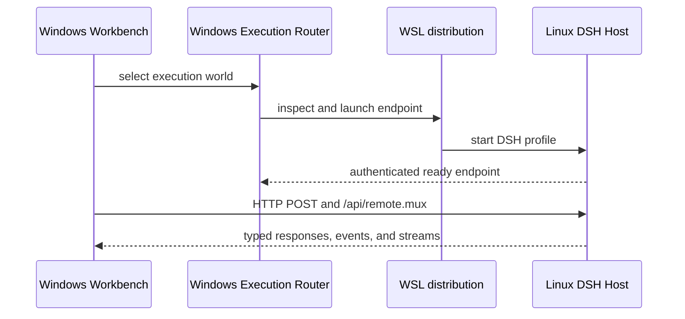

# 平台兼容性

[English](PLATFORM_COMPATIBILITY.md) | 中文

## 摘要

Windows Native 是 DSH Workbench 已验证的首个平台。受审计源码已经实现 Windows Process Control、ConPTY Terminal、Persistent PowerShell、Atomic File Publication，以及具有已记录限制的 Restricted-Token ACL Sandbox。WSL2 是独立 Linux 执行世界：它必须运行完整 DSH Host，并拥有自己的 Linux Path、Lifecycle、Authentication 与 Recovery。本次已观察当前 WSL 安装，但尚未验证 Linux Node Runtime 与端到端 Workbench 路径。

## 目录

- [证据与平台范围](#evidence-and-platform-scope)
- [平台矩阵](#platform-matrix)
- [Windows Native 基线](#windows-native-baseline)
- [Windows Provider Inventory](#windows-provider-inventory)
- [Windows Sandbox 限制](#windows-sandbox-limits)
- [POSIX 与 SSH 边界](#posix-and-ssh-boundaries)
- [已观察 WSL2 环境](#observed-wsl2-environment)
- [WSL2 目标模型](#wsl2-target-model)
- [SSH 适用性](#ssh-suitability)
- [Path 与文件系统](#paths-and-filesystems)
- [Host 生命周期](#host-lifecycle)
- [认证与网络](#authentication-and-network)
- [文件操作与 Renderer 访问](#file-operations-and-renderer-access)
- [Provider 支持矩阵](#provider-support-matrix)
- [未验证缺口](#unverified-gaps)
- [进一步探索](#further-exploration)
- [开发备注](#dev-note)

-----

## 证据与平台范围

Windows 结论包含已执行的依赖安装、Typecheck、Lint、GUI 测试、库构建、Desktop 构建、主 Runtime 准备与 Electron 启动。WSL 结论使用静态源码检查和已安装 Distribution 的命令行观察；它们不声称存在可工作的 WSL Host。

| 状态 | 范围 |
|---|---|
| `已验证` | Windows Desktop 构建、进程启动、Renderer 加载、Host 连接 |
| `源码推断` | Windows Process、Terminal、Sandbox、Atomic File 与 POSIX SSH 行为 |
| `尚未验证` | WSL 中 Linux Node 可用性、WSL Host 启动、跨边界认证、WSL Workbench 流程 |

平台计划不把 Windows 与 WSL 当作同一文件系统或同一进程树的两个视图。每个环境执行自己的 Host Runtime，并通过原生 Remote API 暴露该 Host 的资源。

-----

## 平台矩阵

首个验收路径使用 Windows 运行完整 Desktop 与 Host。只有在本地产品稳定后，WSL 才增加第二个 Host 边界。

| 能力 | Windows Native | WSL2 未来 | 当前证据 |
|---|---|---|---|
| Electron Main | 支持 | 在 Windows 运行 | 已验证 |
| Workbench Renderer | 支持 | 在 Windows 运行 | 已验证标准 Renderer |
| DSH Host | Windows Process | WSL 内 Linux Process | Windows 已验证；WSL 未验证 |
| Agent 与 Session | 原生 Windows Host | 原生 Linux Host | 源码推断 |
| Terminal Backend | ConPTY / PowerShell | Linux PTY / Shell | Windows 源码；WSL 未验证 |
| 文件系统 | Windows Path 与 Provider | Distro 内 Linux Path | 源码推断为分离 |
| Sandbox | Restricted-Token ACL，部分强制 | Linux Provider Path 待验证 | Windows 源码；WSL 未验证 |
| Desktop 生命周期 | 启动已验证，Shutdown 有缺口 | 仅 Adapter 设计 | 部分验证 |
| 认证 | Desktop Loopback 与 Signed Cookie | 需要跨边界设计 | Windows 已验证；WSL 未验证 |

-----

## Windows Native 基线

官方 Windows Desktop 从固定上游 Worktree 启动。Electron Main 创建原生壳层，Desktop Host 启动普通 DSH Web Runtime，Renderer 在 `dsh-app://app/` 加载打包资源，客户端到达已认证本地 Host。

**已验证：**辅助功能树包含 `New session`、工作区/会话侧栏、账户与 Plugin 控件、任务输入框和模型 `DeepSeek-V4.1-Flash`。本次未使用凭据或模型请求。首次运行通过 `app.quit()` 退出；后续运行记录 Shutdown Timeout，并需要中断批处理，且没有进程残留。

Desktop 安全设置保持 `nodeIntegration: false`、`contextIsolation: true` 与 `sandbox: true`。Host 使用动态端口上的 Loopback，Signed Desktop Cookie 未存入常规 Electron Session。这些是 Workbench Desktop 定制应保留的原生信任边界。

拟议视觉评审还覆盖 Windows 合成器和 GPU 成本、高 DPI、缩放，以及平台暴露时的减少动态和透明效果偏好。模糊不受支持或不适用时，玻璃材质必须回退到不透明语义表面；Workbench 的这些外观行为尚未验证。详见[材质指南](design/p1-shell/MATERIAL_GUIDELINES.zh.md)。

-----

## Windows Provider Inventory

源码包含具体 Windows Provider，而不是模拟 POSIX 环境。这些 Provider 覆盖进程执行、Terminal 交互、文件发布与 Sandbox Enforcement。

| Provider 领域 | Windows 实现 | Workbench 影响 |
|---|---|---|
| Process Tree | Job Object 与 Windows Process Inspection | 子进程可以按组拥有并终止 |
| Forced Termination | `taskkill` Fallback | 卡死进程存在平台恢复路径 |
| Terminal | ConPTY | 原生 Terminal I/O 与 Resize 行为 |
| Shell | Persistent `pwsh` | Session Command 可以保留 Shell State |
| File Publication | Windows 专属路径中的 Write-Through 与 No-Replace | Atomic Publish 必须使用原生 File Helper |
| ACL Preservation | DACL-Aware File Operation | 产品 Tool 不得随意覆盖 Security Descriptor |
| Sandbox | Restricted-Token ACL Provider | Workspace Policy 可以拒绝写入与删除 |

增加 Provider 前阅读 `packages/subprocess/`、`packages/fs/`、`packages/terminal/`、`packages/sandbox/` 与 `native/system/` 下的 README。Workbench 功能应使用 Host Service，以继承所选 Provider 及 Cancellation Behavior。

-----

## Windows Sandbox 限制

Windows ACL Sandbox 是具有部分契约的真实保护层。它强制写入与删除，但不构成完整文件系统或网络安全边界。

| 限制 | 当前行为 |
|---|---|
| 读取 | 仍不受限 |
| 网络 | 仍不受限 |
| Hard Link | NTFS Hard Link 可以别名到名义 Workspace 之外 |
| Enforcement Report | 平台报告部分强制 |
| 产品影响 | Approval 与 Access Policy 必须保持显式 |

源码：[`sandbox-windows-acl` README](../../packages/sandbox/sandbox-windows-acl/README.zh.md) 与 [`sandbox-local` README](../../packages/sandbox/sandbox-local/README.zh.md)。

Workbench Label 与 Approval Copy 必须命名真实保证。请求写入 Workspace 之外时，不应仅因存在 Sandbox Provider 就描述为完全隔离。如果未来产品需要更强边界，则需要独立 Provider Design 与跨平台测试。

-----

## POSIX 与 SSH 边界

SSH Provider 源码面向 POSIX。其 Entry Selection 与 Shell Helper 使用 POSIX 假设，因此不是每个 Windows 或 WSL 执行拓扑的即插即用 Transport。

| 领域 | 观察 | 源码 |
|---|---|---|
| SSH Provider Selection | 受审计源码中的 POSIX-Only Path | [SSH 入口](../../packages/ssh/ssh/src/index.ts)，第 90、99 行 |
| SSH Shell Helper | 调用 POSIX Shell 行为 | [SSH Helper](../../packages/ssh/ssh/src/helper.ts)，第 57 行 |
| Terminal Provider | 适配 ConPTY 与 POSIX Terminal Behavior | [Terminal Bash README](../../packages/terminal/terminal-bash/README.zh.md)，第 12、34、56、170-171 行 |

当其 Authentication、Address、Workspace 与 Lifecycle 符合产品时，SSH Provider 可用于 POSIX Remote Host。它自身不能解决 WSL Distribution Discovery、Windows 侧路由、本地 Endpoint Readiness 或用户可见环境选择。

-----

## 已观察 WSL2 环境

本次检查本地 WSL 安装，未进行 Provisioning 或修改。观察到的 Distribution 不足以运行当前 Host，因为没有确认原生 Node 安装。

| 属性 | 观察值 |
|---|---|
| Distribution | `RockyLinux-9.8` |
| Kernel | `6.18.40.1-microsoft-standard-WSL2` |
| Network Mode | NAT |
| Localhost Forwarding | 未确认转发 |
| Native Node | 未确认 |
| Command Resolution | `/mnt/c` 下 Windows Installation |
| DSH Host Launch | 未尝试；前置条件缺失 |

**尚未验证：**该 Distribution 是否能安装受支持 Linux Node 版本、pnpm 依赖图是否可在其 libc 与 architecture 上构建，以及 Terminal、File System、Sandbox 与 Native Module 在该环境是否行为正确。

-----

## WSL2 目标模型

WSL 执行世界在所选 Distribution 内运行完整 DSH Runtime。Windows 运行 Electron 与 Workbench UI；它发现 Distribution、启动或连接 Host、选择 Endpoint 并路由 Session。Linux Host 拥有其 Provider、Agent、Session、Tool、Terminal、File System、Skill Inventory 与本地进程。

**尚未验证：**Endpoint Discovery、Launch Command、Readiness Protocol、Cookie 或 Token Exchange、Port Forwarding 与 Recovery。该图定义职责，不是已交付行为。

WSL 模型必须在 Linux Host 保留原生 `session`、`workspace`、`terminal`、`workspaceFiles`、`job`、`settings`、`credentials`、`commands`、`skills`、`pluginInventory`、`pluginManager` 与 `subagents` 语义。Workbench 在 Host 之间路由，不把这些 Service 复制到 Windows Renderer。

-----

## SSH 适用性

SSH 是 POSIX Host 的候选 Transport，但不是默认 WSL Adapter。产品需要稳定认证的 DSH Endpoint，而不仅是 Shell Connection。SSH 可以提供到远端机器的 Shell Access；原生 Typert API 仍需 HTTP/WebSocket Endpoint 或其他受支持 Carrier。

| 问题 | 评估 |
|---|---|
| SSH 能否到达 Linux Host？ | 可能在目标具备受支持 Node 与 DSH Installation 时 |
| SSH 能否发现本地 WSL Distribution？ | 否 |
| SSH 是否拥有 Windows-to-WSL Forwarding？ | 否 |
| SSH 是否保留原生 Remote Access Policy？ | 只有 HTTP/WebSocket Host Path 与 Peer Auth 能提供 |
| SSH 是否替代 Desktop Host？ | 否 |
| SSH 对 Remote Linux Acceptance 是否有用？ | 是，在聚焦 Transport 与 Lifecycle Design 后 |

首个 WSL Adapter 应使用 WSL 专属 Discovery 与 Endpoint Boundary。SSH 可以作为不同 Remote Environment 的独立 Provider。

-----

## Path 与文件系统

Windows 与 Linux Path 不能互换。`C:\project` 与 `/mnt/c/project` 可以命名不同 Access Path，并具有不同 Case、Permission、Symlink 与 File-Event Behavior。WSL Host 应报告自己的 Linux CWD、Workspace Root 与 File Metadata。

产品模型应在 Workspace 或 Session Path 旁存储 Execution-World Identifier。它不得静默把 `\` 转换为 `/` 并假设相同 File Identity。Host 为 Windows 的 Session 使用 Windows File API；Host 为 WSL 的 Session 使用 Linux Host API。

跨世界 Transfer 需要显式产品操作，包含 Source、Destination、Conflict Behavior、Cancellation 与 Verification。第一阶段不实现自动 Mount Aliasing 或 Bi-Directional Synchronization。共享代码编辑应首先在拥有项目的世界进行，除非引入显式 Transfer 功能。

-----

## Host 生命周期

WSL Host 的生命周期长于 Renderer Request。它需要 Discovery、Launch、Readiness、Health、Reconnect、Shutdown 与 Crash Recovery。当前 Desktop Host 是有用模型，但其 Loopback 与 Node IPC 假设不会自动跨 WSL Boundary。

| 阶段 | 必需产品行为 | 可复用原生证据 |
|---|---|---|
| Discover | 标识 Distro、Installation、Version 与 Endpoint | 未来 Adapter |
| Launch | 在 WSL 启动所选 DSH Profile | Desktop Host Launch Model |
| Ready | 接收 Host Boot Injection 与认证 Endpoint | Node IPC 与 Boot Readiness Model |
| Connect | 建立 HTTP Unary 与 Remote Stream Carrier | 原生 Connection 与 Gateway |
| Recover | 检测断开、重启或重连并核对 Session | 原生 Journal/Snapshot Reconnect |
| Shutdown | 请求 Graceful Stop，然后执行 Timeout | Desktop Host Shutdown Sequence |
| Crash | 清理 Orphan Process 并暴露可恢复状态 | Process Provider 与未来 Supervisor |

Crash Recovery 必须区分 Renderer 丢失、Socket 丢失、Host Process 丢失与 WSL VM 丢失。Host Session Log 仍是权威来源；Pending Client State 从新的 Host Generation 重建。

-----

## 认证与网络

跨边界 Host 必须保留原生 Peer Principal 与 Remote Access Check。Endpoint 应默认私有，使用 Authenticated Cookie 或等价 Credential，验证 Host 与 Origin Header，并拒绝未认证 WebSocket Upgrade。

已观察 WSL NAT Mode 没有确认 Localhost Forwarding。未来 Adapter 不应为方便而把 Host 发布到不受限 `0.0.0.0` Interface。候选设计包括 Windows-Owned Local Forwarding Path、Distribution-Local Endpoint 与显式 Port Mapping，或受监督 IPC Transport；每种都需要 Threat Model 与 End-to-End Test。

| 安全要求 | 原生归属或未来归属 |
|---|---|
| Browser Origin Verification | 原生 Connection |
| Peer Authentication | 原生 Connection 与 Desktop Carrier |
| Resource Authorization | 原生 Remote Access |
| WebSocket Upgrade Admission | 原生 Connection 与 Gateway |
| WSL Endpoint Credential | 未来 Workbench Host Adapter |
| Distribution Identity | 未来 Workbench Host Adapter |
| Process Ownership | Windows Supervisor 与 WSL Process Provider |

Owner Principal 与非 Owner Peer 保持分离。Windows Renderer 不得仅因能够启动 Distribution 就获得额外权限。

-----

## 文件操作与 Renderer 访问

每个可能影响 Host Workspace 的文件操作都必须经过该 Host 的 File Service。Renderer Code 不得使用 Node `fs`、直接 Absolute Path 或 Raw Chromium File Handle 绕过 Workspace Scope 与 Platform Policy。

WSL 也遵循该规则。连接到 WSL Host 的 Windows Renderer 请求 Linux `workspaceFiles` Service 来列出、读取、写入、重命名或删除 Linux Path。Host 应用 Scope Check、Symlink Behavior、Permission、Cancellation 与 Audit。Native File Picker 可以提供 User Intent，但 Host 仍验证 Target。

Terminal 与 Process Operation 使用活动 Host 的 Terminal/Subprocess Service。WSL Session 中输入的 Command 不得意外从 Windows `cwd` 启动；Session Router 必须把 Tool 与 Terminal Call 绑定到 Linux Host Endpoint。

未来 WSL File Bridge 应是 Remote API 与显式 Transfer 产品流，具有明确 Transfer Semantics。它不应把 WSL File System 作为 Ambient Path 暴露给 Windows Renderer Code。

-----

## Provider 支持矩阵

下表分开当前 Windows 证据与 WSL Host 所需工作。缺失 Row 不是支持证据。

| Provider Family | Windows 证据 | WSL 要求 |
|---|---|---|
| LLM Adapter | 原生包测试与 Desktop Boot | 运行 Linux Host 并验证 Provider Network |
| Session Persistence | 原生 Host Profile | 验证 Linux File System 与 Lock Behavior |
| Tool Executor | 原生 Host | 验证 Process、Sandbox 与 Work Directory |
| Terminal | ConPTY 与 PowerShell Source | Linux PTY 与 Shell Selection |
| File System | Windows File 与 ACL Provider | Linux Permission、Symlink 与 Atomic Publish |
| Sandbox | Restricted-Token ACL，部分强制 | Linux Provider 与 Policy Verification |
| Plugin Manager | Host-Managed Profile Plugin | Linux pnpm 与 Package Lifecycle |
| Desktop Shell | Windows Electron | 仅 Windows-Side Adapter |
| SSH Remote | POSIX Source Path | 独立 Remote Acceptance |

-----

## 未验证缺口

以下问题阻止 WSL 声明，并在第一阶段后保持开放：

| 缺口 | 为什么重要 |
|---|---|
| Linux Node 与 pnpm Installation | Native Code 与 Package Build 必须匹配 Distribution |
| WSL Localhost 与 Port Behavior | 已观察 NAT，但未确认 Forwarding |
| Cross-Boundary Endpoint Authentication | 不能跨 VM Boundary 假设 Native Peer Security |
| Path 与 Symlink Policy | Windows 与 Linux File Identity 不同 |
| WSL Host Supervision | Launch、Readiness、Shutdown 与 Crash 跨越两个 Process World |
| Linux Sandbox Provider Behavior | Windows ACL 行为不能证明 Linux Enforcement |
| Workbench Package Compatibility | Client Release 与 Host Module 需要 Linux Verification |
| Native Module Build | Addon 与 Platform-Specific Package 必须存在于 Distribution |

第一阶段没有实现 Workbench 功能或 WSL Bridge。首个 WSL 里程碑应从受控 Acceptance Matrix 开始，而不是给出产品级“WSL Supported”声明。

-----

## 进一步探索

- [原生架构审计](NATIVE_ARCHITECTURE_AUDIT.zh.md)——把 Platform Provider 连接到 Desktop 与 Agent 架构。
- [Workbench 架构](WORKBENCH_ARCHITECTURE.zh.md)——审核 Windows-First 产品组合。
- [扩展点](EXTENSION_POINTS.zh.md)——为 File、Terminal 与 Job 选择 Host Service。
- [开发路线图](DEVELOPMENT_ROADMAP.zh.md)——查看独立 WSL Adapter 阶段。

-----

## 开发备注

无。
