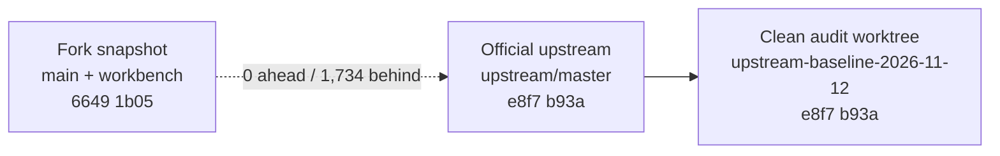

# Upstream Sync and Build Baseline

English | [中文](UPSTREAM_SYNC_REPORT.zh.md)

## Summary

The DSH Workbench fork is preserved, while a separate clean worktree pins the latest official DeepSeekRuntime baseline that was available on 2026-11-12. The research folder now sits beside the project root, and all eleven Google Docs were exported to `.docx` while retaining their `.gdoc` records. This report records repository identity, branch topology, the source delta from the older fork snapshot, the research export, and the commands and outcomes used to establish the Windows build baseline.

## Table of Contents

- [Repository identity](#repository-identity)
- [Preserved fork and isolated worktree](#preserved-fork-and-isolated-worktree)
- [Pinned upstream baseline](#pinned-upstream-baseline)
- [Baseline topology](#baseline-topology)
- [Delta from the fork snapshot](#delta-from-the-fork-snapshot)
- [Research folder and Google Docs](#research-folder-and-google-docs)
- [Toolchain and dependency installation](#toolchain-and-dependency-installation)
- [Verification results](#verification-results)
- [Windows Desktop evidence](#windows-desktop-evidence)
- [Reproduction commands](#reproduction-commands)
- [Known limitations](#known-limitations)
- [Further Exploration](#further-exploration)
- [Dev Note](#dev-note)

-----

<a id="repository-identity"></a>
## Repository identity

GitHub identifies the project as a real fork of `deepseek-ai/deepseek-harness`, with the requested repository name and a different default branch.

| Field | Observed value |
|---|---|
| Fork | `Yeecean/DSH-workbench` |
| Fork URL | `https://github.com/Yeecean/DSH-workbench` |
| Fork parent | `deepseek-ai/deepseek-harness` |
| Fork default branch | `main` |
| Upstream default branch | `master` |
| `origin` | `https://github.com/Yeecean/DSH-workbench.git` |
| `upstream` | `https://github.com/deepseek-ai/deepseek-harness.git` |

**Verified:** `gh repo view` reports `isFork: true`, with `deepseek-ai/deepseek-harness` as the parent. The local remote URLs match the GitHub repositories above.

The fork-default difference is operationally significant. `upstream/HEAD` resolves to `upstream/master`, while the local symbolic reference `origin/HEAD` resolves to `origin/master`. GitHub still serves `main` as the fork default. Workbench commands must name the remote branch explicitly; this phase did not alter the GitHub default.

-----

<a id="preserved-fork-and-isolated-worktree"></a>
## Preserved fork and isolated worktree

The original checkout remains at `E:\GH projects\DSH workbench`. The clean upstream audit and build baseline lives in a nested Git worktree at `E:\GH projects\DSH workbench\workbench\upstream-baseline-2026-11-12`.

No `git reset --hard`, `git clean`, destructive rebase, force push, branch deletion, or tag deletion was used. The original `main` and `workbench` branches remain at the same commit, and the new worktree was added from `upstream/master` without rewriting either branch.

| Checkout | Branch | Commit | Tracking |
|---|---|---|---|
| Main project root | `workbench` | `6649 1b05 e3f0 5ad3 5bcd d4f6 cd7e d260 41d9 e3db` | `origin/workbench` |
| Main project root | `main` | `6649 1b05 e3f0 5ad3 5bcd d4f6 cd7e d260 41d9 e3db` | `origin/main` |
| Main project root | `master` | `e8f7 b93a 3449 64de 3dca 1ace 9e72 b6e4 d6de 87cb` | `origin/master` |
| Audit worktree | `upstream-baseline-2026-11-12` | `e8f7 b93a 3449 64de 3dca 1ace 9e72 b6e4 d6de 87cb` | `upstream/master` |

**Verified:** `main` and `workbench` have zero commits ahead of and 1,734 commits behind `upstream/master`. They contain no fork-specific commit. The main checkout currently has `workbench` checked out; the preserved `main` ref and tag `dsh-v0.2.2-rc.1` still point to `6649 1b05 e3`. Commit identifiers are grouped in four-character blocks to satisfy the repository reference policy; remove the spaces to obtain the exact SHA.

The required branch roles now separate cleanly:

- The original fork snapshot remains available through `main` and `workbench`.
- `master` is synchronized to the current upstream default branch.
- `upstream-baseline-2026-11-12` is a clean, dedicated branch for source audit and reproducible builds.
- Workbench product commits do not yet exist and were not pushed.

-----

<a id="pinned-upstream-baseline"></a>
## Pinned upstream baseline

The Phase 1 baseline is the official `master` tip observed during this task, not the stale fork branch. It is also 166 commits after the `dsh-v0.2.2-rc.2` tag as reported by `git describe`, so the package version alone does not identify the exact source state.

| Property | Baseline |
|---|---|
| Commit | `e8f7 b93a 3449 64de 3dca 1ace 9e72 b6e4 d6de 87cb` |
| Commit subject | `Merge pull request #8278 ... sync release dsh 0.2.2-rc.2 to master` |
| Package version | `0.2.2-rc.2` |
| `git describe` | Tag `dsh-v0.2.2-rc.2`, 166 commits later, short commit `e8f7 b93a 34` |
| Worktree status before documentation | Clean |
| Worktree status after documentation | Seven uncommitted bilingual document triplets |

The branch pin is the exact SHA. Future work should record the same SHA in build metadata and compare against a newly fetched `upstream/master` before rebasing or changing the Workbench base.

-----

<a id="baseline-topology"></a>
## Baseline topology

The topology keeps the old fork state and the clean upstream baseline visible at the same time. The arrow names the comparison, not a direct one-commit ancestry edge.



The fork's `master` and `origin/master` also point to `e8f7 b93a`. The local `origin/HEAD` still names `origin/master`, which conflicts with the fork's GitHub default of `main`. A future maintenance step may repair the symbolic ref with `git remote set-head origin -a`, but that command was not run during Phase 1.

-----

<a id="delta-from-the-fork-snapshot"></a>
## Delta from the fork snapshot

The source difference is large enough that the old fork should not be rebased over or treated as the development baseline. The comparison below uses `main...upstream/master`, where `main` is the preserved fork snapshot.

| Delta measure | Result |
|---|---:|
| Files changed | 4,912 |
| Insertions | 181,439 |
| Deletions | 60,057 |
| `packages/experimental` files | 710 |
| `packages/client` files | 700 |
| Session snapshot files | 530 |
| `apps/desktop` files | 171 |
| `packages/api` files | 107 |
| `packages/core` files | 78 |

**Verified:** the file and line aggregates come from the recorded commit range. **Source-inferred:** the change concentration supports using the fresh worktree for Workbench extension design and re-auditing Desktop, API, client UI, and experimental plugin boundaries before implementation.

-----

<a id="research-folder-and-google-docs"></a>
## Research folder and Google Docs

The research folder is parallel to the project folder, preserving the requested filesystem relationship:

```text
E:\GH projects\
├── DSH workbench\
│   └── workbench\
│       └── upstream-baseline-2026-11-12\
└── DeepSeekRuntime Research\
    ├── 00-研究总览\
    ├── 01-官方功能与版本\
    ├── 02-插件生态\
    ├── 03-安装配置与实操\
    ├── 04-竞品对比\
    └── 05-研究资料与归档\
```

**Verified:** the Google Drive plugin exported eleven Google Docs through a secondary connected account. The primary account returned an empty folder result. The destination contains eleven readable `.docx` exports and eleven matching `.gdoc` records across the copied directory structure.

| Export result | Observed value |
|---|---:|
| Recursive file count | 22 |
| `.docx` files | 11 |
| `.gdoc` records | 11 |
| Aggregate bytes | 416,951 |
| Source Drive folder ID | `11N7lPnxgvQ8N8eoE7ZOB_OLvcW9fN0_V` |

Text extraction from all eleven `.docx` files succeeded into a temporary analysis directory. The extracted text supplied the product decisions used by the architecture pages; it is not committed because the original exports and research folder remain the sources.

**Environment limitation:** late checks showed intermittent `Test-Path` failures for the long research-directory name in the current PowerShell host. Recursive enumeration succeeded through the Windows short path `E:\GH projects\DEEPSE~1`, which displayed the original long child paths and the 22 files above. This is a path-resolution defect in the verification shell, not evidence that the copied content is absent.

-----

<a id="toolchain-and-dependency-installation"></a>
## Toolchain and dependency installation

The repository requires Node `>=24.9.0` and declares pnpm `11.28.5`. The verified environment met both requirements.

| Tool | Version or requirement |
|---|---|
| Node | `24.16.0` |
| pnpm | `11.28.5` |
| Node engine requirement | `>=24.9.0` |
| Electron | `44.7.0`, resolved from the lockfile |
| Package manager | `pnpm@11.28.5` |

`corepack pnpm install --frozen-lockfile` initially timed out while fetching one package. The same frozen lockfile install completed with bounded network concurrency and retry settings:

```powershell
corepack pnpm install --frozen-lockfile --network-concurrency=4 --fetch-retries=5 --fetch-timeout=120000
```

The retry did not change `pnpm-lock.yaml` or resolve a different version set.

-----

<a id="verification-results"></a>
## Verification results

The complete source and GUI gates produced strong coverage with two timing-sensitive failures. Both failures passed when rerun in isolation, so this report does not classify them as confirmed product regressions.

| Check | Outcome | Evidence |
|---|---|---|
| `pnpm run typecheck` | Passed | 5 of 5 gates in 363.36 seconds |
| `pnpm run lint` | Passed with warning | One unused `oxlint-disable` directive at `packages/experimental/client-ui-cot-translation/src/index.ts:82:9` |
| `pnpm run test:gui` | Partial | 13,634 passed, 2 failed, 7 skipped |
| `binary-rpc.host.spec.ts:24` rerun | Passed | 43 of 43 tests |
| `review-tab.client.spec.tsx:358` rerun | Passed | 12 of 12 tests |
| `pnpm run build:lib:host` | Passed | Built workspace libraries and generated 39 Typert artifacts |
| `pnpm run build:desktop` | Passed | Built Desktop main, preload, and welcome renderer bundles |
| `pnpm run prepare:primary-runtime` | Passed | Python, Office, document round trips, and pnpm checks |
| `pnpm run dev:desktop` | Passed | Electron, Desktop Host, renderer, and Web application started |

The two full-suite GUI failures were both five-second timeouts under full concurrency. Their isolated pass rates show the affected paths work, but they do not prove the full suite is timing-stable.

The first clean Desktop build exposed an ordering dependency: `@deepseek-ai/dsh-atomic-write` had no built workspace `lib/` output. The successful sequence is `corepack pnpm run build:lib:host`, then `corepack pnpm run build:desktop`. A clean worktree therefore needs the host-library build before the filtered Desktop build.

-----

<a id="windows-desktop-evidence"></a>
## Windows Desktop evidence

**Verified:** the official Desktop flow started Electron Main, the private Desktop Host, a loopback Host server on a dynamic port, and the standard Web renderer at `dsh-app://app/`. The accessibility tree exposed `New session`, the workspace/session sidebar, account and Plugin controls, the task input, and model `DeepSeek-V4.1-Flash`.

No real account login, credential, model request, or unauthorized external action was used. The first launch exited through `app.quit()`.

The second launch exposed two limitations that remain open:

- `app.quit()` logged `desktop quit: task inspection unavailable ... timed out`; the batch was stopped with Ctrl-C and no test process remained.
- A nonfatal missing IPC handler was logged for `dsh-desktop:mandatory-status`.

The Electron binary initially failed to download and was installed through `$env:ELECTRON_MIRROR='https://npmmirror.com/mirrors/electron/'`. The primary Python runtime archive initially failed to download from GitHub; it was fetched through `gh-proxy.com`, verified against the repository's SHA-256, and cached under the desktop build downloads directory. The package lockfile continued to pin Electron `44.7.0`.

Port `9222` was occupied by Chrome during the first DevTools attempt. Port `9223` allowed normal renderer inspection. This is a local environment conflict, not a Desktop defect.

-----

<a id="reproduction-commands"></a>
## Reproduction commands

Use the audit worktree and name remote branches explicitly because the local `origin/HEAD` and GitHub fork default disagree.

```powershell
Set-Location 'E:\GH projects\DSH workbench\workbench\upstream-baseline-2026-11-12'
git fetch upstream --prune
git rev-parse HEAD
git describe --tags --always
git rev-list --left-right --count main...upstream/master
git diff --shortstat main...upstream/master
corepack pnpm install --frozen-lockfile --network-concurrency=4 --fetch-retries=5 --fetch-timeout=120000
corepack pnpm run typecheck
corepack pnpm run lint
corepack pnpm run test:gui
corepack pnpm run build:lib:host
corepack pnpm run build:desktop
corepack pnpm run dev:desktop
```

These commands reproduce the checks, not a release. The Desktop launch may still require the package-manager supply-chain checks described by the repository and may be affected by the open shutdown and missing-IPC observations.

-----

<a id="known-limitations"></a>
## Known limitations

- The local `origin/HEAD` names `origin/master` while GitHub serves `main` as the fork default; branch automation must not infer the default from the local symbolic ref.
- The full GUI suite had two concurrent timeouts, even though both focused reruns passed.
- Electron and primary-runtime binary downloads required local mirrors or proxies; checksum verification covered the Python archive, and the Electron version stayed lockfile-pinned.
- The second Desktop shutdown did not complete cleanly through `app.quit()`.
- The `dsh-desktop:mandatory-status` missing handler is an observed startup diagnostic with unresolved product impact.
- The long research-directory name intermittently failed in PowerShell path checks; the short Windows path remained enumerable.
- The repository remains uncommitted and unpushed by design; no Workbench feature or WSL adapter exists in this baseline.

No unresolved item above is resolved by association with the architecture proposal. They remain verification and maintenance work for later phases.

-----

<a id="further-exploration"></a>
## Further Exploration

- [Native architecture audit](NATIVE_ARCHITECTURE_AUDIT.md) — connect the verified baseline to the actual Runtime, API, Desktop, and UI source.
- [Workbench architecture](WORKBENCH_ARCHITECTURE.md) — review the composition that follows from this baseline.
- [Platform compatibility](PLATFORM_COMPATIBILITY.md) — inspect Windows limits and the separate WSL2 design.
- [Development roadmap](DEVELOPMENT_ROADMAP.md) — see where reproducibility and release checks repeat.

-----

<a id="dev-note"></a>
## Dev Note

None.
