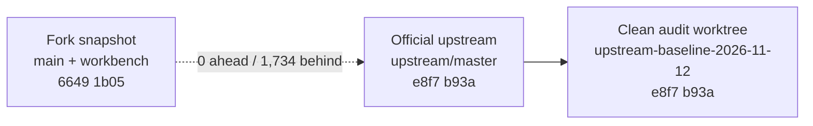

# 上游同步与构建基线

[English](UPSTREAM_SYNC_REPORT.md) | 中文

## 摘要

DSH Workbench Fork 已得到保留，同时用独立干净 Worktree 固定 2026-11-12 可用的最新 DeepSeekRuntime 官方基线。研究文件夹已与项目根目录平行存放，十一份 Google 文档均已导出为 `.docx`，并保留对应 `.gdoc` 记录。本报告记录仓库身份、分支拓扑、相对旧 Fork 快照的源码差异、研究资料导出，以及建立 Windows 构建基线所用命令和结果。

## 目录

- [仓库身份](#repository-identity)
- [保留 Fork 与隔离 Worktree](#preserved-fork-and-isolated-worktree)
- [固定的上游基线](#pinned-upstream-baseline)
- [基线拓扑](#baseline-topology)
- [相对 Fork 快照的差异](#delta-from-the-fork-snapshot)
- [研究文件夹与 Google 文档](#research-folder-and-google-docs)
- [工具链与依赖安装](#toolchain-and-dependency-installation)
- [验证结果](#verification-results)
- [Windows Desktop 证据](#windows-desktop-evidence)
- [复现命令](#reproduction-commands)
- [已知限制](#known-limitations)
- [进一步探索](#further-exploration)
- [开发备注](#dev-note)

-----

<a id="repository-identity"></a>
## 仓库身份

GitHub 将该仓库识别为 `deepseek-ai/deepseek-harness` 的真实 Fork，并记录了要求的仓库名与不同的默认分支。

| 字段 | 观察值 |
|---|---|
| Fork | `Yeecean/DSH-workbench` |
| Fork URL | `https://github.com/Yeecean/DSH-workbench` |
| Fork 父仓库 | `deepseek-ai/deepseek-harness` |
| Fork 默认分支 | `main` |
| 上游默认分支 | `master` |
| `origin` | `https://github.com/Yeecean/DSH-workbench.git` |
| `upstream` | `https://github.com/deepseek-ai/deepseek-harness.git` |

**已验证：**`gh repo view` 报告 `isFork: true`，父仓库为 `deepseek-ai/deepseek-harness`。本地远程 URL 与上述 GitHub 仓库一致。

Fork 默认分支差异具有操作影响。`upstream/HEAD` 解析到 `upstream/master`，而本地符号引用 `origin/HEAD` 解析到 `origin/master`。GitHub 仍把 `main` 作为 Fork 默认分支。因此 Workbench 命令必须明确命名远程分支；本阶段没有改变 GitHub 默认值。

-----

<a id="preserved-fork-and-isolated-worktree"></a>
## 保留 Fork 与隔离 Worktree

原始检出仍在 `E:\GH projects\DSH workbench`。干净的上游审计与构建基线位于嵌套 Git Worktree：`E:\GH projects\DSH workbench\workbench\upstream-baseline-2026-11-12`。

本次没有使用 `git reset --hard`、`git clean`、破坏性 Rebase、Force Push、删除分支或删除 Tag。原始 `main` 与 `workbench` 分支仍位于同一 Commit，新 Worktree 从 `upstream/master` 添加，没有改写任一分支。

| 检出位置 | 分支 | Commit | 跟踪 |
|---|---|---|---|
| 主项目根目录 | `workbench` | `6649 1b05 e3f0 5ad3 5bcd d4f6 cd7e d260 41d9 e3db` | `origin/workbench` |
| 主项目根目录 | `main` | `6649 1b05 e3f0 5ad3 5bcd d4f6 cd7e d260 41d9 e3db` | `origin/main` |
| 主项目根目录 | `master` | `e8f7 b93a 3449 64de 3dca 1ace 9e72 b6e4 d6de 87cb` | `origin/master` |
| 审计 Worktree | `upstream-baseline-2026-11-12` | `e8f7 b93a 3449 64de 3dca 1ace 9e72 b6e4 d6de 87cb` | `upstream/master` |

**已验证：**`main` 与 `workbench` 相对 `upstream/master` 领先零个、落后 1,734 个 Commit。它们没有 Fork 专属 Commit。当前主检出已切换到 `workbench`；保留的 `main` Ref 与 Tag `dsh-v0.2.2-rc.1` 仍指向 `6649 1b05 e3`。Commit 标识按四字符分组，以满足仓库引用策略；移除空格即可得到精确 SHA。

要求的分支职责现已清楚分开：

- 原始 Fork 快照仍可通过 `main` 与 `workbench` 使用。
- `master` 已同步到当前上游默认分支。
- `upstream-baseline-2026-11-12` 是用于源码审计和可复现构建的干净专用分支。
- Workbench 产品 Commit 尚不存在，也未 Push。

-----

<a id="pinned-upstream-baseline"></a>
## 固定的上游基线

第一阶段基线是本次任务观察到的官方 `master` 顶端，而不是陈旧的 Fork 分支。`git describe` 还显示它位于 `dsh-v0.2.2-rc.2` Tag 之后 166 个 Commit，因此仅凭包版本不能识别精确源码状态。

| 属性 | 基线 |
|---|---|
| Commit | `e8f7 b93a 3449 64de 3dca 1ace 9e72 b6e4 d6de 87cb` |
| Commit 标题 | `Merge pull request #8278 ... sync release dsh 0.2.2-rc.2 to master` |
| 包版本 | `0.2.2-rc.2` |
| `git describe` | Tag `dsh-v0.2.2-rc.2`，之后 166 个 Commit，短 Commit `e8f7 b93a 34` |
| 文档创建前 Worktree 状态 | 干净 |
| 文档创建后 Worktree 状态 | 七组未提交中英文档 |

分支固定点是精确 SHA。后续工作应将同一 SHA 写入构建元数据，并在 Rebase 或更换 Workbench 基线之前，与新获取的 `upstream/master` 比较。

-----

<a id="baseline-topology"></a>
## 基线拓扑

该拓扑同时保留旧 Fork 状态与干净上游基线。箭头表示比较关系，不表示单个 Commit 的直接父边。



Fork 的 `master` 与 `origin/master` 同样指向 `e8f7 b93a`。本地 `origin/HEAD` 仍命名 `origin/master`，这与 Fork 的 GitHub 默认分支 `main` 冲突。后续维护可用 `git remote set-head origin -a` 修复符号 Ref，但本阶段没有执行该命令。

-----

<a id="delta-from-the-fork-snapshot"></a>
## 相对 Fork 快照的差异

源码差异规模足以说明不能把旧 Fork 直接 Rebase 到新基线上，也不能将其视为开发基线。以下比较使用 `main...upstream/master`，其中 `main` 是保留的 Fork 快照。

| 差异指标 | 结果 |
|---|---:|
| 变更文件 | 4,912 |
| 插入 | 181,439 |
| 删除 | 60,057 |
| `packages/experimental` 文件 | 710 |
| `packages/client` 文件 | 700 |
| Session Snapshot 文件 | 530 |
| `apps/desktop` 文件 | 171 |
| `packages/api` 文件 | 107 |
| `packages/core` 文件 | 78 |

**已验证：**文件数与行数聚合来自记录的 Commit 范围。**源码推断：**变化集中于 Desktop、API、客户端 UI 和实验插件边界，因此在实现前应使用新 Worktree 重新设计 Workbench 扩展。

-----

<a id="research-folder-and-google-docs"></a>
## 研究文件夹与 Google 文档

研究文件夹与项目文件夹平行，符合要求的文件系统关系：

```text
E:\GH projects\
├── DSH workbench\
│   └── workbench\
│       └── upstream-baseline-2026-11-12\
└── DeepSeekRuntime Research\
    ├── 00-研究总览\
    ├── 01-官方功能与版本\
    ├── 02-插件生态\
    ├── 03-安装配置与实操\
    ├── 04-竞品对比\
    └── 05-研究资料与归档\
```

**已验证：**Google Drive 插件通过一个已连接的次要账户导出了十一份 Google 文档。主账户返回了空文件夹结果。目标位置在复制的目录结构中包含十一份可读取 `.docx` 导出与十一份匹配 `.gdoc` 记录。

| 导出结果 | 观察值 |
|---|---:|
| 递归文件数 | 22 |
| `.docx` 文件 | 11 |
| `.gdoc` 记录 | 11 |
| 总字节数 | 416,951 |
| 源 Drive 文件夹 ID | `11N7lPnxgvQ8N8eoE7ZOB_OLvcW9fN0_V` |

十一份 `.docx` 的文本提取均成功，输出到临时分析目录。提取文本为架构页面提供产品决策；由于原始导出和研究文件夹仍是来源，提取结果未提交。

**环境限制：**后续检查中，当前 PowerShell Host 对研究目录长名称的 `Test-Path` 出现间歇失败。通过 Windows 短路径 `E:\GH projects\DEEPSE~1` 的递归枚举成功，显示原始长子路径和上述 22 个文件。这是验证 Shell 的路径解析缺陷，不表示复制内容缺失。

-----

<a id="toolchain-and-dependency-installation"></a>
## 工具链与依赖安装

仓库要求 Node `>=24.9.0`，并声明 pnpm `11.28.5`。验证环境满足两个要求。

| 工具 | 版本或要求 |
|---|---|
| Node | `24.16.0` |
| pnpm | `11.28.5` |
| Node Engine 要求 | `>=24.9.0` |
| Electron | `44.7.0`，由 Lockfile 解析 |
| 包管理器 | `pnpm@11.28.5` |

`corepack pnpm install --frozen-lockfile` 首次因下载一个包超时。同一冻结 Lockfile 使用受限网络并发和重试设置后完成：

```powershell
corepack pnpm install --frozen-lockfile --network-concurrency=4 --fetch-retries=5 --fetch-timeout=120000
```

重试没有改变 `pnpm-lock.yaml`，也没有解析出不同版本集合。

-----

<a id="verification-results"></a>
## 验证结果

完整源码与 GUI 检查提供了较强覆盖，同时出现两个时序敏感失败。两者定向重跑均通过，因此本报告不将它们归类为已确认产品回归。

| 检查 | 结果 | 证据 |
|---|---|---|
| `pnpm run typecheck` | 通过 | 363.36 秒内通过 5/5 项 |
| `pnpm run lint` | 通过但有警告 | `packages/experimental/client-ui-cot-translation/src/index.ts:82:9` 有一个未使用 `oxlint-disable` 指令 |
| `pnpm run test:gui` | 部分通过 | 13,634 通过、2 失败、7 跳过 |
| `binary-rpc.host.spec.ts:24` 重跑 | 通过 | 43/43 测试 |
| `review-tab.client.spec.tsx:358` 重跑 | 通过 | 12/12 测试 |
| `pnpm run build:lib:host` | 通过 | 构建工作区库并生成 39 个 Typert Artifact |
| `pnpm run build:desktop` | 通过 | 构建 Desktop Main、Preload 和 Welcome Renderer Bundle |
| `pnpm run prepare:primary-runtime` | 通过 | Python、Office、文档往返与 pnpm 检查完成 |
| `pnpm run dev:desktop` | 通过 | Electron、Desktop Host、Renderer 与 Web 应用启动 |

完整 GUI 套件的两个失败都是在全并发下的五秒超时。它们的定向通过率证明受影响路径可工作，但不能证明完整套件在时序上稳定。

首次干净 Desktop 构建暴露出顺序依赖：`@deepseek-ai/dsh-atomic-write` 没有已构建的工作区 `lib/` 输出。成功顺序是先运行 `corepack pnpm run build:lib:host`，再运行 `corepack pnpm run build:desktop`。因此干净 Worktree 必须在过滤后的 Desktop 构建前先构建 Host 库。

-----

<a id="windows-desktop-evidence"></a>
## Windows Desktop 证据

**已验证：**官方 Desktop 流程启动了 Electron Main、私有 Desktop Host、位于动态端口上的 Loopback Host Server，以及位于 `dsh-app://app/` 的标准 Web Renderer。辅助功能树显示 `New session`、工作区/会话侧栏、账户与 Plugin 控件、任务输入框和模型 `DeepSeek-V4.1-Flash`。

本次未使用真实账户登录、凭据、模型请求或未经授权的外部操作。首次启动通过 `app.quit()` 退出。

第二次启动暴露两个仍未关闭的限制：

- `app.quit()` 记录 `desktop quit: task inspection unavailable ... timed out`；随后用 Ctrl-C 停止批处理，且没有测试进程残留。
- 日志出现 `dsh-desktop:mandatory-status` 的非致命缺失 IPC Handler。

Electron 二进制首次下载失败，随后通过 `$env:ELECTRON_MIRROR='https://npmmirror.com/mirrors/electron/'` 安装。主 Python Runtime Archive 首次从 GitHub 下载失败；随后通过 `gh-proxy.com` 获取，按仓库 SHA-256 验证，并缓存到 Desktop 构建下载目录。Package Lockfile 仍固定 Electron `44.7.0`。

首次 DevTools 尝试时，端口 `9222` 被 Chrome 占用。端口 `9223` 允许正常 Renderer 检查。这是本地环境冲突，不是 Desktop 缺陷。

-----

<a id="reproduction-commands"></a>
## 复现命令

使用审计 Worktree，并明确命名远程分支，因为本地 `origin/HEAD` 与 GitHub Fork 默认分支不一致。

```powershell
Set-Location 'E:\GH projects\DSH workbench\workbench\upstream-baseline-2026-11-12'
git fetch upstream --prune
git rev-parse HEAD
git describe --tags --always
git rev-list --left-right --count main...upstream/master
git diff --shortstat main...upstream/master
corepack pnpm install --frozen-lockfile --network-concurrency=4 --fetch-retries=5 --fetch-timeout=120000
corepack pnpm run typecheck
corepack pnpm run lint
corepack pnpm run test:gui
corepack pnpm run build:lib:host
corepack pnpm run build:desktop
corepack pnpm run dev:desktop
```

这些命令复现检查，不构成 Release。Desktop 启动仍可能要求仓库描述的包管理器供应链检查，并可能受未关闭的退出和缺失 IPC 观察影响。

-----

<a id="known-limitations"></a>
## 已知限制

- 本地 `origin/HEAD` 命名 `origin/master`，而 GitHub 将 Fork 默认分支设为 `main`；分支自动化不能从本地符号 Ref 推断默认值。
- 完整 GUI 套件出现两个并发超时，尽管两个定向重跑均通过。
- Electron 与主 Runtime 二进制下载需要本地镜像或代理；Python Archive 已做校验和验证，Electron 版本仍由 Lockfile 固定。
- 第二次 Desktop 退出没有通过 `app.quit()` 正常完成。
- `dsh-desktop:mandatory-status` 缺失 Handler 是已观察的启动诊断，其产品影响尚未确认。
- 研究目录长名称在 PowerShell 路径检查中曾间歇失败；Windows 短路径仍可枚举。
- 按设计，仓库仍未 Commit 或 Push；此基线中没有 Workbench 功能或 WSL Adapter。

上述未解决项不会因为被列入架构提议而自动解决。它们仍是后续阶段的验证与维护工作。

-----

<a id="further-exploration"></a>
## 进一步探索

- [原生架构审计](NATIVE_ARCHITECTURE_AUDIT.zh.md)——把已验证基线连接到实际 Runtime、API、Desktop 和 UI 源码。
- [Workbench 架构](WORKBENCH_ARCHITECTURE.zh.md)——审核由此基线推导的目标组合。
- [平台兼容性](PLATFORM_COMPATIBILITY.zh.md)——检查 Windows 限制和独立 WSL2 设计。
- [开发路线图](DEVELOPMENT_ROADMAP.zh.md)——查看可复现性与 Release 检查在后续阶段的位置。

-----

<a id="dev-note"></a>
## 开发备注

无。
