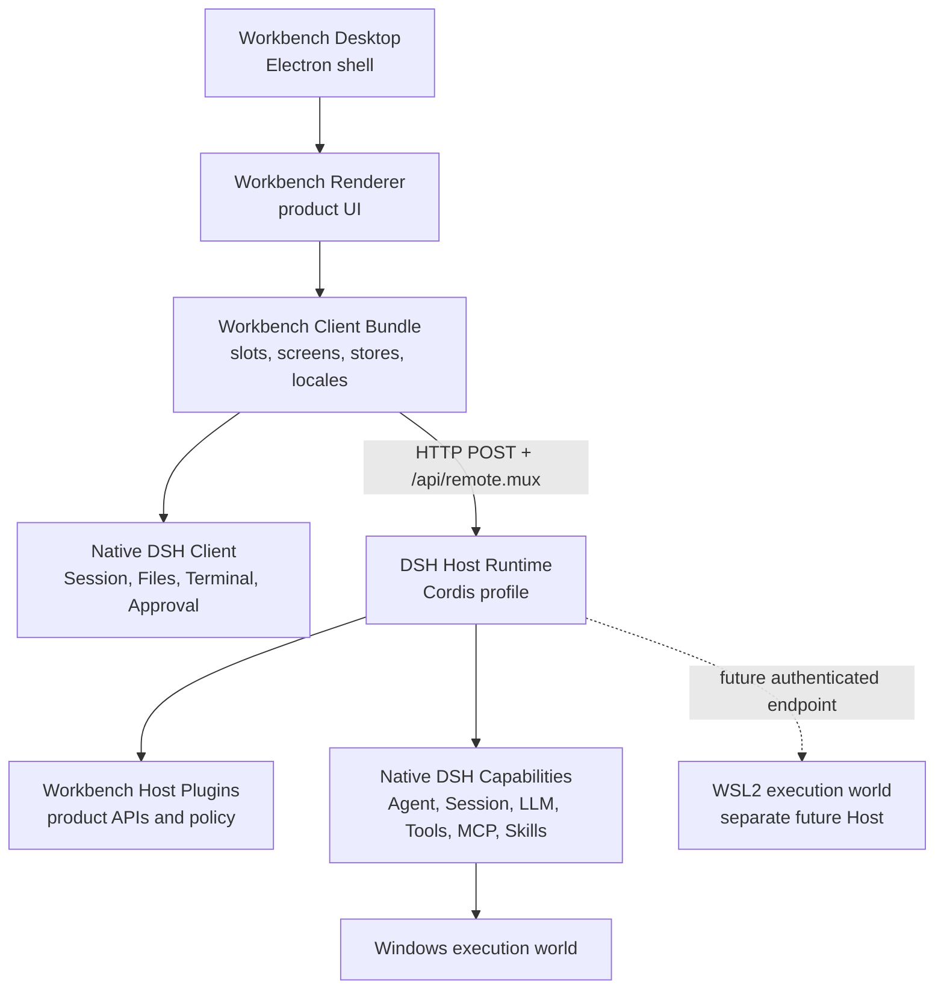

# Workbench Architecture Proposal

English | [中文](WORKBENCH_ARCHITECTURE.zh.md)

## Summary

DSH Workbench should remain a product composition over the native DeepSeekRuntime Host. The proposal keeps the official Agent, Session, LLM provider, tool, MCP, Skill, Plugin, Typert transport, access, terminal, filesystem, and job implementations, then adds a Workbench bundle, client plugins, product screens, and execution-world selection. The first acceptance platform is Windows Native; WSL2 becomes a complete remote Runtime world in a later phase.

## Table of Contents

- [Design principles](#design-principles)
- [Target composition](#target-composition)
- [Runtime ownership](#runtime-ownership)
- [Workbench renderer ownership](#workbench-renderer-ownership)
- [Work and Code modes](#work-and-code-modes)
- [UI architecture decision](#ui-architecture-decision)
- [Module classification](#module-classification)
- [Repository composition plan](#repository-composition-plan)
- [Execution environments](#execution-environments)
- [API and state boundaries](#api-and-state-boundaries)
- [Security and lifecycle](#security-and-lifecycle)
- [Phase 1 non-goals](#phase-1-non-goals)
- [Review decisions](#review-decisions)
- [Further Exploration](#further-exploration)
- [Dev Note](#dev-note)

-----

## Design principles

The proposal uses the narrowest native extension that can own a product behavior. Direct reuse wins when a native contract already provides the operation. A Cordis registration or slot wins when behavior needs a product policy or presentation. Replacing a native implementation requires a concrete contract mismatch and a migration plan for every consumer.

The research synthesis selected Work × Code as one product with shared Agent, models, MCP, Skills, projects, files, tasks, and permissions. The two modes can present different surfaces and defaults, but they should not create two Agent runtimes or two Session histories for the same task.

The product boundary is also explicit. Workbench owns the shell, Work/Code orchestration, activity and approval presentation, file/editor workspace, execution-world selection, and product onboarding. DeepSeekRuntime remains the owner of model execution, Agent turns, durable Session semantics, tool admission, plugin lifecycle, and Host/Client transport.

-----

## Target composition

The Workbench shell adds client and Host product layers while the native DSH layer continues to own runtime behavior. A complete WSL execution world appears as a separate Host endpoint behind the same product-level routing.

**Source-inferred:** the native bundle, profile, client module, and UI slot mechanisms can compose this structure without replacing `packages/core` or creating a second Web application. **Not yet verified:** the exact Workbench package graph, route names, client contribution boundaries, and WSL Host endpoint have not been implemented.

-----

## Runtime ownership

The Host remains a normal DSH profile. Its base bundle supplies the official provider, Agent, Session, tool, persistence, sandbox, approval, settings, credential, and telemetry rows. The Workbench bundle adds product Host plugins and can select a Workbench profile layer.

| Runtime capability | Proposed owner | Composition |
|---|---|---|
| Agent interface and loop | Native `packages/core/agent` and `agent-loop` | `REUSE` |
| Session event source and persistence | Native `packages/core/session` and persistence providers | `REUSE` |
| LLM providers and routing | Native `packages/llm` adapters plus `agent.model.select()` policy | `REUSE` and `EXTEND` |
| Tools, MCP, and Skills | Native registries and official plugins | `REUSE` and `EXTEND` |
| Approval and questions | Native interaction services | `REUSE`; Workbench UI `BUILD` |
| Plugin lifecycle | Native Plugin Manager | `REUSE`; product presentation `BUILD` |
| Typert API and access | Native Gateway, connection, and Remote access policy | `REUSE` |
| Terminal, filesystem, jobs | Native services and providers | `REUSE`; product UI `BUILD` |
| Workbench product state | New Host plugin only where native state has no owner | `BUILD` |

The Workbench Host bundle should add rows instead of copying the native configuration into a hand-maintained plugin list. It can inherit `dsh-base`, add Workbench rows through its bundle patch, and use a profile patch for true product defaults. This preserves upstream changes to the native bundle.

Product Host plugins should expose only product-specific operations. Examples include saved Workbench panel state, an execution-world registry, or a product workflow definition. Session history, Agent execution, approval decisions, file operations, terminal state, and plugin transactions continue through their existing owners.

-----

## Workbench renderer ownership

The renderer is still a standard DSH Web Client. The Workbench client bundle contributes product UI through the client Cordis tree, client modules, UI slots, theme tokens, and generated Remote APIs. Native Session, Files, Terminal, Approval, Settings, and Plugin clients remain available where the proposal reuses their surfaces.

The proposed renderer surfaces are:

| Surface | Product responsibility | Native capability beneath it |
|---|---|---|
| Workbench shell | Persistent navigation, environment switcher, active mode, command entry | Client Cordis, slots, theme, shortcuts |
| Session center | Conversation, attachments, model, Active Agent context | `session` API, Session UI, Agent events |
| Agent activity | Steps, tool calls, streaming states, subagents, jobs | Session events, `job`, `subagents` |
| File workspace | Project navigation, viewer/editor, tabs, changed files | `workspace`, `workspaceFiles`, file routes |
| Terminal panel | Terminal tabs and task-linked sessions | `terminal` |
| Approval center | Pending approvals and questions, audit context | Approval and question services |
| Plugin center | Inventory, installation, update, restart state | `pluginInventory`, `pluginManager` |
| Settings | Providers, model policy, project and platform settings | `settings`, `credentials` |
| Execution environment | Windows or future WSL endpoint and session routing | Future product Host API |

Client stores should be scoped to the relevant Host resource. A Session store must subscribe to Session events and dispose with its Session scope. A workspace store must follow Workspace changes and observe access policy. Product containers should not copy durable Host state into long-lived renderer state and treat that copy as authority.

-----

## Work and Code modes

Work and Code are product compositions over one runtime. Work can emphasize documents, tasks, approvals, and activity comprehension. Code can emphasize repositories, files, terminal, diffs, and tool execution. Both modes use the same Session event source, Agent loop, model providers, MCP servers, Skills, project identity, file API, Task/Job service, and permission policy.

**Source-inferred:** a mode can be a renderer profile that selects panels, routes, prompt presets, tool admission, and default layouts. A mode switch within a Session should preserve the Session identity and durable history. Starting a fresh Session is a separate product action with its own recovery and audit trail.

The Host may receive a mode value for defaults and tool policy, but client-supplied mode text must not grant authority. Approval and sandbox policy remain Host decisions. A Work mode view that hides a terminal does not remove terminal permission; a Code mode view that shows file buttons does not bypass `workspaceFiles` access.

The first milestone should validate one shared Session path across both presentations. Only after that evidence should the product add mode-specific task templates, panel placement, or prompt presets. This avoids forking the runtime before the shared behavior is stable.

-----

## UI architecture decision

The client currently has one built-in `root` slot occupied by `AppFrame`. `AppFrame` owns the layout service and declares `sidebar`, keyed `main`, `rightbar`, `shell.bottom`, `shell.overlay`, and `shell.leading`.

| Option | Advantages | Disadvantages | Recommendation |
|---|---|---|---|
| Retain `AppFrame`, extend child slots | Native Session, Files, Terminal, Approval, locale, scopes, and plugin wiring stay active; incremental migration | Window chrome and panel relationships follow the native layout | Recommended for V1 |
| Replace client `root` | Full control of shell topology, keyboard ownership, and panel composition | Must restore native layout ownership and every removed child-slot behavior; high regression surface | Consider after a concrete limitation is proven |

P1 retains `AppFrame`, but the native Session rightbar hides on a global Home panel. The requested persistent Home context therefore needs a layout extension or a changed requirement; implementation is paused pending that decision. See the [Slot audit](APPFRAME_SLOT_AUDIT.md).

If a future proposal replaces `root`, its acceptance must cover Session scope and switching, panel selection, route reconstruction, locale, tooltips, focus order, terminal reconnect, file actions, approval answering, plugin transactions, and the native effects registered into each child slot. The roadmap treats that work as a separate architecture change.

-----

## Module classification

The table below assigns a primary label. A module may use a second label for a narrow product layer, but its native owner remains unambiguous.

| Label | Module | Source | Reason |
|---|---|---|---|
| `REUSE` | Agent interface and loop | `packages/core/agent`, `packages/core/agent-loop` | Native turn, stream, cancellation, recovery, and tool execution |
| `REUSE` | Session source and projection | `packages/core/session` | Append-only event source and derived message semantics |
| `REUSE` | Session persistence | `packages/session/*` | Durable logs, recovery, and format migration |
| `REUSE` | LLM providers | `packages/llm/*` | Provider adapters, streaming, model metadata, and replay |
| `REUSE` | Tool, MCP, and Skill runtime | `packages/*` native registries | Scoped schemas, admission, execution, and inventory |
| `REUSE` | Typert transport and Gateway | `packages/typert/*`, `packages/api/gateway` | Typed calls, streams, cancellation, and multiplexing |
| `REUSE` | Connection and Remote access | `packages/client/connection`, `packages/api/remote-access` | Reconnect, authentication, peer identity, and resource policy |
| `REUSE` | Desktop Host | `apps/desktop-host` | Runs the standard DSH Web runtime |
| `REUSE` | Terminal, filesystem, jobs | Native `terminal`, `fs`, `workspaceFiles`, `job` packages | Privileged Host operations and platform providers |
| `EXTEND` | Workbench bundle and profile | Proposed bundle over `packages/bundle/base` | Compose product rows without copying native defaults |
| `EXTEND` | Custom tools and model policy | `ctx.tools`, `ctx.llm`, Agent events | Native registration and event boundaries |
| `EXTEND` | Host/Client plugin pair | `packages/boot/plugin-manager`, `packages/client/modules` | Package shape supports both Host and client faces |
| `EXTEND` | Workbench UI slots | `packages/client/ui-slots`, `ui-layout`, `ui-renderer` | Add product occupants and routes |
| `EXTEND` | Theme and localization | `packages/client/ui-theme` and locale owners | Product tokens and copy through native mechanisms |
| `REPLACE` | Desktop branding and release policy | `apps/desktop` | A product-branded shell may change icons, package identity, and update distribution |
| `REPLACE` | Client root layout | `ui-layout` | Only with a proven limitation and complete native behavior restoration |
| `BUILD` | Workbench shell and navigation | New client plugin | Product-specific composition over native components |
| `BUILD` | Work/Code surfaces | New client plugins | Product route, panel, and workflow behavior |
| `BUILD` | Activity and Approval Center | New client plugin | Product presentation over native events and interaction APIs |
| `BUILD` | File/editor workspace | New client plugin | Product integration over `workspaceFiles` and editor components |
| `BUILD` | Execution-world selector | New Host and client plugins | Product routing that native single-Host APIs do not own |
| `BUILD` | WSL Host adapter | New Host adapter and endpoint design | A complete Linux Runtime requires new discovery and lifecycle |

`REPLACE` is not a synonym for preference. The V1 plan replaces only brand shell metadata that needs a distinct product package identity. The client `root` remains retained unless review presents concrete behavior that `AppFrame` slots cannot express.

-----

## Repository composition plan

The implementation should prefer package boundaries that can be reviewed and versioned independently. Final package names must follow repository naming and grouping rules when implementation starts.

| Proposed unit | Responsibility | Host or client |
|---|---|---|
| Workbench bundle | Ordered profile patch for product Host and client rows | Host package metadata |
| Workbench Host state | Execution-world registry and product-only durable settings | Host |
| Workbench client shell | Product navigation, modes, command entry, locales | Client |
| Workbench Session surface | Session center and Active Agent presentation | Client |
| Workbench workspace | Files, editor, changes, environment context | Client |
| Workbench activity | Tool, request, job, subagent, and approval timeline | Client |
| Desktop product layer | Product branding, packaging, and release identity | Electron |

The bundle should consume native packages as workspace dependencies at the repository level. If it is distributed as a plugin package, its manifest and client entry must satisfy the native plugin shape. Product code should not be copied into `packages/core` merely to avoid package composition work.

-----

## Execution environments

Windows Native is the first product execution world because the official Desktop build and launch path are verified and the native platform providers already support Windows process, terminal, sandbox, and file behavior. The first product acceptance should run the complete Workbench flow locally on Windows.

A WSL execution world runs a complete DSH Host in a selected WSL distribution. Windows owns environment discovery, endpoint selection, Session routing, readiness, reconnect, and shutdown. WSL owns its Host Runtime, tools, terminal, filesystem, Skill inventory, providers, and local processes.

| Decision | Windows Native | WSL2 future |
|---|---|---|
| First acceptance | Yes | No |
| Electron and Workbench UI | Windows | Windows |
| DSH Host | Windows | Linux inside WSL |
| Agent and Session | Native Windows Host | Native Linux Host |
| Filesystem identity | Windows paths | Linux paths from the WSL Host |
| Endpoint | Private loopback Desktop Host | Authenticated cross-boundary Host |
| Lifecycle | Desktop Host process | WSL discovery, launch, readiness, recovery |
| Phase 1 implementation | Verified baseline | Design only |

The execution-world selector should identify a Host endpoint and a logical environment. It should not imply that a Windows Session and a WSL Session share one filesystem. A cross-world task requires an explicit transfer or shared-protocol design after the two Host models are stable.

-----

## API and state boundaries

The native API carrier remains the only Remote RPC system. The renderer uses HTTP POST for unary calls and `/api/remote.mux` for Remote streams. A Workbench product API is a Typert namespace mounted in the same Gateway and subject to the same peer, resource, and reconnect behavior.

| State | Authority | Client behavior |
|---|---|---|
| Session events and messages | Host Session | Follow streams and derived projections |
| Agent status and stream | Host Agent loop | Observe live events; reconcile from Session |
| Approval and questions | Host interaction services | Answer through native APIs; show audit result |
| Workspace and files | Host Workspace/filesystem | Read and mutate through native routes |
| Terminal | Host terminal service | Attach and reconnect to native sessions |
| Plugin inventory and mutation | Host Plugin Manager | Inventory and guarded mutation through Typert |
| Product panel state | Workbench Host plugin or scoped client preference | Persist only non-authoritative convenience state |
| Execution-world registry | Proposed Workbench Host plugin | Route explicit endpoints; preserve per-world principal |

Product UI may cache query results for responsiveness. It must identify the Host generation, resource, and Session that produced a cache entry. Reconnect or access policy changes invalidate product projections rather than allowing stale data to answer a privileged action.

-----

## Security and lifecycle

Host plugins run in-process outside the workspace sandbox. Plugin Manager mutations are privileged and can change code that runs in the Host. The Workbench Plugin Center should require an explicit operation review that names the profile, package, source, version or full commit, requested capability, restart effect, and approval path.

The Electron renderer keeps `nodeIntegration: false`, `contextIsolation: true`, and `sandbox: true`. Native OS operations remain behind preload IPC or Host APIs. A UI requirement does not justify exposing raw Node or unrestricted filesystem access to the renderer.

The Windows ACL sandbox provides partial enforcement: writes and deletes are restricted, while reads, network, and hard-link aliases have limits described in the platform page. Product UI must describe the actual policy; an approval prompt for shell or file mutation must not imply a stronger sandbox guarantee.

Every client plugin and Host plugin must own disposal. Listeners, stores, working-directory grants, terminal handles, stream handles, and process watchers should unload in reverse dependency order. A Desktop restart or Host release change can invalidate client modules; the Workbench must show a recoverable reload state and avoid retaining stale product state.

-----

## Phase 1 non-goals

This proposal does not implement an Apps Center, full Swarm orchestration, a custom Office editor, a complete IDE, a second RPC stack, a replacement Agent runtime, or a WSL bridge. It also does not install unaudited third-party plugins or grant the renderer direct OS privileges.

The first implementation phase should prove the general Workbench shell, one shared Session path for Work and Code, one native File/Terminal/Approval integration path, and a Windows build/release loop. Feature breadth follows after those product foundations are reviewable.

-----

## Review decisions

Review should approve or reject four concrete decisions before implementation:

| Decision | Recommendation |
|---|---|
| Runtime composition | Reuse the native Host, Agent, Session, API, and plugin systems |
| Client layout | Retain `AppFrame` and extend its child slots for V1 |
| Execution order | Ship Windows Native first; design WSL as a separate Host world |
| Plugin safety | Treat installation and update as privileged operations with explicit impact |

Approval is not implementation authorization for later phases. It establishes the architecture against which each phase must produce runnable evidence.

-----

## Further Exploration

- [Native architecture audit](NATIVE_ARCHITECTURE_AUDIT.md) — inspect the source behavior behind these ownership decisions.
- [Extension points](EXTENSION_POINTS.md) — map features to exact contracts and source locations.
- [Platform compatibility](PLATFORM_COMPATIBILITY.md) — separate Windows delivery from WSL2 design.
- [Development roadmap](DEVELOPMENT_ROADMAP.md) — review phase order, prerequisites, and acceptance conditions.

-----

## Dev Note

None.
