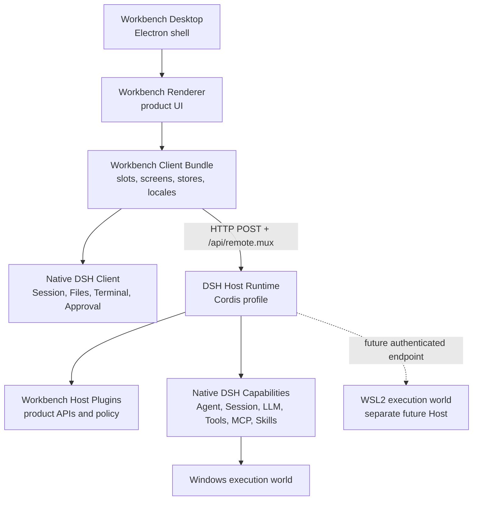

# Workbench 架构提议

[English](WORKBENCH_ARCHITECTURE.md) | 中文

## 摘要

DSH Workbench 应保持为原生 DeepSeekRuntime Host 之上的产品组合。提议保留官方 Agent、Session、LLM Provider、Tool、MCP、Skill、Plugin、Typert 传输、访问控制、Terminal、文件系统和 Job 实现，再增加 Workbench Bundle、客户端插件、产品页面与执行环境选择。首个验收平台是 Windows Native；WSL2 在后续阶段成为完整的 Remote Runtime 世界。

## 目录

- [设计原则](#design-principles)
- [目标组合](#target-composition)
- [Runtime 归属](#runtime-ownership)
- [Workbench Renderer 归属](#workbench-renderer-ownership)
- [Work 与 Code 模式](#work-and-code-modes)
- [UI 架构决策](#ui-architecture-decision)
- [模块分类](#module-classification)
- [仓库组合计划](#repository-composition-plan)
- [执行环境](#execution-environments)
- [API 与状态边界](#api-and-state-boundaries)
- [安全与生命周期](#security-and-lifecycle)
- [第一阶段非目标](#phase-1-non-goals)
- [评审决策](#review-decisions)
- [进一步探索](#further-exploration)
- [开发备注](#dev-note)

-----

## 设计原则

提议使用能够拥有产品行为的最窄原生扩展。当原生契约已经提供操作时，直接复用优先。当行为需要产品策略或呈现时，Cordis 注册或 Slot 优先。替换原生实现需要具体的契约不匹配，以及覆盖每个消费方的迁移计划。

研究综合选择 Work × Code 作为同一产品，共享 Agent、模型、MCP、Skills、项目、文件、任务与权限。两个模式可以呈现不同表面与默认值，但同一任务不应创建两个 Agent Runtime 或两条 Session 历史。

产品边界同样明确。Workbench 拥有壳层、Work/Code 编排、活动与 Approval 呈现、文件/编辑器工作区、执行环境选择和产品引导。DeepSeekRuntime 继续拥有模型执行、Agent Turn、持久 Session 语义、工具准入、插件生命周期与 Host/Client 传输。

-----

## 目标组合

Workbench 壳层增加客户端与 Host 产品层，同时原生 DSH 层继续拥有 Runtime 行为。完整 WSL 执行世界作为独立 Host Endpoint 出现在同一产品路由之后。

**源码推断：**原生 Bundle、Profile、客户端模块和 UI Slot 机制能够组合该结构，无需替换 `packages/core` 或创建第二套 Web 应用。**尚未验证：**精确 Workbench Package Graph、Route 名称、客户端 Contribution 边界与 WSL Host Endpoint 尚未实现。

-----

## Runtime 归属

Host 仍是普通 DSH Profile。其 Base Bundle 提供官方 Provider、Agent、Session、Tool、Persistence、Sandbox、Approval、Settings、Credential 和 Telemetry Row。Workbench Bundle 增加产品 Host Plugin，并可选择 Workbench Profile Layer。

| Runtime 能力 | 提议归属 | 组合 |
|---|---|---|
| Agent Interface 与 Loop | 原生 `packages/core/agent` 与 `agent-loop` | `REUSE` |
| Session 事件源与持久化 | 原生 `packages/core/session` 与 Persistence Provider | `REUSE` |
| LLM Provider 与路由 | 原生 `packages/llm` Adapter，加 `agent.model.select()` 策略 | `REUSE` 与 `EXTEND` |
| Tools、MCP 与 Skills | 原生 Registry 与官方 Plugin | `REUSE` 与 `EXTEND` |
| Approval 与 Question | 原生 Interaction Service | `REUSE`；Workbench UI `BUILD` |
| Plugin 生命周期 | 原生 Plugin Manager | `REUSE`；产品呈现 `BUILD` |
| Typert API 与访问 | 原生 Gateway、Connection 与 Remote Access Policy | `REUSE` |
| Terminal、文件系统、Job | 原生 Service 与 Provider | `REUSE`；产品 UI `BUILD` |
| Workbench 产品状态 | 仅在原生状态无归属时新增 Host Plugin | `BUILD` |

Workbench Host Bundle 应增加 Row，而不是把原生 Config 复制到手写 Plugin 列表。它可以继承 `dsh-base`，通过 Bundle Patch 增加 Workbench Row，并用 Profile Patch 表达真实产品默认值。这会保留上游对原生 Bundle 的变化。

产品 Host Plugin 只应暴露产品专属操作，例如保存 Workbench Panel State、Execution-World Registry 或 Product Workflow Definition。Session History、Agent Execution、Approval Decision、File Operation、Terminal State 与 Plugin Transaction 继续通过既有归属处理。

-----

## Workbench Renderer 归属

Renderer 仍是标准 DSH Web Client。Workbench 客户端 Bundle 通过客户端 Cordis 树、客户端模块、UI Slot、Theme Token 和生成 Remote API 贡献产品 UI。提案复用其页面的原生 Session、Files、Terminal、Approval、Settings 与 Plugin Client 仍保持可用。

提议 Renderer 页面包括：

| 页面 | 产品职责 | 其下原生能力 |
|---|---|---|
| Workbench 壳层 | 持久导航、环境选择、活动模式、Command Entry | 客户端 Cordis、Slot、Theme、Shortcut |
| Session 中心 | 对话、附件、模型、Active Agent Context | `session` API、Session UI、Agent Event |
| Agent 活动 | Step、Tool Call、Streaming State、Subagent、Job | Session Event、`job`、`subagents` |
| 文件工作区 | 项目导航、Viewer/Editor、Tab、Changed File | `workspace`、`workspaceFiles`、File Route |
| Terminal 面板 | Terminal Tab 与任务关联 Session | `terminal` |
| Approval 中心 | Pending Approval、Question、Audit Context | Approval 与 Question Service |
| Plugin 中心 | Inventory、Install、Update、Restart State | `pluginInventory`、`pluginManager` |
| Settings | Provider、Model Policy、Project 与 Platform Setting | `settings`、`credentials` |
| 执行环境 | Windows 或未来 WSL Endpoint 与 Session Routing | 未来 Product Host API |

客户端 Store 应 Scope 到相关 Host Resource。Session Store 必须订阅 Session Event 并随 Session Scope 释放。Workspace Store 必须跟随 Workspace 变化并观察 Access Policy。产品容器不应把持久 Host State 复制到长期 Renderer State，并把该副本当作权威来源。

-----

## Work 与 Code 模式

Work 与 Code 是同一 Runtime 之上的产品组合。Work 可以强调文档、任务、Approval 与活动理解。Code 可以强调仓库、文件、Terminal、Diff 与工具执行。两个模式使用同一 Session Event Source、Agent Loop、Model Provider、MCP Server、Skill、Project Identity、File API、Task/Job Service 与 Permission Policy。

**源码推断：**模式可以是 Renderer Profile，用于选择面板、Route、Prompt Preset、Tool Admission 与默认布局。Session 内模式切换应保留 Session Identity 与持久 History。新建 Session 是独立产品操作，拥有自己的恢复与审计轨迹。

Host 可以接收 Mode Value 用于默认值与 Tool Policy，但客户端提交的 Mode Text 不得授予权限。Approval 与 Sandbox Policy 仍是 Host 决策。隐藏 Terminal 的 Work 视图不会移除 Terminal Permission；显示 File Button 的 Code 视图不会绕过 `workspaceFiles` Access。

首个里程碑应在两个呈现之间验证一条共享 Session 路径。只有获得该证据后，产品才应增加 Mode 专属 Task Template、Panel Placement 或 Prompt Preset。这样可避免在共享行为稳定前 Fork Runtime。

-----

## UI 架构决策

客户端当前有单一内置 `root` Slot，由 `AppFrame` 占据。`AppFrame` 拥有 Layout Service，并声明 `sidebar`、带 Key 的 `main`、`rightbar`、`shell.bottom`、`shell.overlay` 与 `shell.leading`。

| 方案 | 优势 | 劣势 | 建议 |
|---|---|---|---|
| 保留 `AppFrame` 并扩展布局 | 可以保留原生 Session、Files、Terminal、Approval、Locale、Scope 与插件接线；保留效果需要验证 | 全局右栏需要布局仲裁和新增扩展点 | 推荐评审 |
| 替换客户端 `root` | 完整控制壳层拓扑、键盘归属与面板组合 | 必须恢复原生布局归属与全部被移除的子 Slot 行为；回归面高 | P1 不采用 |

P1 保留 `AppFrame`，但原生 Session 右栏在全局 Home 面板上隐藏。要求的常驻 Home Context 因此需要布局扩展或调整需求；实现暂停，等待决定。详见 [Slot 审计](APPFRAME_SLOT_AUDIT.zh.md)与[全局右栏 ADR](GLOBAL_RIGHTBAR_ADR.zh.md)。

P1 不授权替换 `root`、替换整个原生右栏或将 `shell.overlay` 作为布局列。原生能力保留必须在 Windows Desktop 上验证。

-----

## 模块分类

下表为每项分配主要标签。模块可以使用第二标签覆盖窄产品层，但原生归属仍保持唯一。

| 标签 | 模块 | 源码 | 理由 |
|---|---|---|---|
| `REUSE` | Agent Interface 与 Loop | `packages/core/agent`、`packages/core/agent-loop` | 原生 Turn、Stream、Cancellation、Recovery 与 Tool Execution |
| `REUSE` | Session Source 与 Projection | `packages/core/session` | 追加式事件源与派生消息语义 |
| `REUSE` | Session Persistence | `packages/session/*` | 持久日志、恢复与格式迁移 |
| `REUSE` | LLM Provider | `packages/llm/*` | Provider Adapter、Streaming、Model Metadata 与 Replay |
| `REUSE` | Tool、MCP 与 Skill Runtime | 原生 `packages/*` Registry | Scoped Schema、Admission、Execution 与 Inventory |
| `REUSE` | Typert Transport 与 Gateway | `packages/typert/*`、`packages/api/gateway` | 类型化调用、Stream、Cancellation 与 Multiplexing |
| `REUSE` | Connection 与 Remote Access | `packages/client/connection`、`packages/api/remote-access` | Reconnect、Authentication、Peer Identity 与 Resource Policy |
| `REUSE` | Desktop Host | `apps/desktop-host` | 运行标准 DSH Web Runtime |
| `REUSE` | Terminal、文件系统、Job | 原生 `terminal`、`fs`、`workspaceFiles`、`job` 包 | 特权 Host Operation 与 Platform Provider |
| `EXTEND` | Workbench Bundle 与 Profile | 基于 `packages/bundle/base` 的提议 Bundle | 组合产品 Row，且不复制原生默认值 |
| `EXTEND` | 自定义 Tool 与 Model Policy | `ctx.tools`、`ctx.llm`、Agent Event | 原生注册与事件边界 |
| `EXTEND` | Host/Client Plugin Pair | `packages/boot/plugin-manager`、`packages/client/modules` | 包形状支持 Host 与 Client 两面 |
| `EXTEND` | Workbench UI Slot | `packages/client/ui-slots`、`ui-layout`、`ui-renderer` | 增加产品占位者与 Route |
| `EXTEND` | Theme 与 Localization | `packages/client/ui-theme` 与 Locale Owner | 通过原生机制提供产品 Token 与 Copy |
| `REPLACE` | Desktop Branding 与 Release Policy | `apps/desktop` | 产品品牌壳层可以改变 Icon、Package Identity 与 Update Distribution |
| `REPLACE` | Client Root Layout | `ui-layout` | 仅在证明具体限制并完整恢复原生行为时使用 |
| `BUILD` | Workbench 壳层与导航 | 新客户端 Plugin | 基于原生产品组件的产品专属组合 |
| `BUILD` | Work/Code 页面 | 新客户端 Plugin | 产品 Route、Panel 与 Workflow 行为 |
| `BUILD` | Activity 与 Approval Center | 新客户端 Plugin | 基于原生 Event 与 Interaction API 的产品呈现 |
| `BUILD` | File/Editor Workspace | 新客户端 Plugin | 基于 `workspaceFiles` 与 Editor Component 的产品集成 |
| `BUILD` | Execution-World Selector | 新 Host 与 Client Plugin | 原生单 Host API 不拥有的产品路由 |
| `BUILD` | WSL Host Adapter | 新 Host Adapter 与 Endpoint Design | 完整 Linux Runtime 需要新 Discovery 与 Lifecycle |

`REPLACE` 不是偏好的同义词。V1 计划只替换需要独立产品 Package Identity 的 Brand Shell Metadata。即使需要新的布局扩展，P1 仍保留客户端 `root`。

-----

## 仓库组合计划

实现应优先使用可独立审核与版本化的 Package Boundary。实现开始时，最终 Package Name 必须遵循仓库命名与分组规则。

| 提议单元 | 职责 | Host 或 Client |
|---|---|---|
| Workbench Bundle | 产品 Host 与 Client Row 的有序 Profile Patch | Host Package Metadata |
| Workbench Host State | Execution-World Registry 与产品专属持久设置 | Host |
| Workbench Client Shell | 产品导航、模式、Command Entry、Locale | Client |
| Workbench Session Surface | Session 中心与 Active Agent 呈现 | Client |
| Workbench Workspace | Files、Editor、Changes、Environment Context | Client |
| Workbench Activity | Tool、Request、Job、Subagent 与 Approval Timeline | Client |
| Desktop Product Layer | 产品 Branding、Packaging 与 Release Identity | Electron |

Bundle 应在仓库内以 Workspace Dependency 消费原生包。如果作为 Plugin Package 分发，其 Manifest 与 Client Entry 必须满足原生 Plugin Shape。产品代码不应仅为避免 Package Composition 工作而复制到 `packages/core`。

-----

## 执行环境

Windows Native 是首个产品执行世界，因为官方 Desktop 构建与启动路径已验证，原生 Platform Provider 已支持 Windows Process、Terminal、Sandbox 与 File Behavior。首个产品验收应在 Windows 本地运行完整 Workbench Flow。

WSL 执行世界在所选 WSL Distro 内运行完整 DSH Host。Windows 拥有环境发现、Endpoint 选择、Session Routing、Readiness、Reconnect 与 Shutdown。WSL 拥有其 Host Runtime、Tool、Terminal、文件系统、Skill Inventory、Provider 与本地进程。

| 决策 | Windows Native | WSL2 未来 |
|---|---|---|
| 首次验收 | 是 | 否 |
| Electron 与 Workbench UI | Windows | Windows |
| DSH Host | Windows | WSL 内 Linux |
| Agent 与 Session | 原生 Windows Host | 原生 Linux Host |
| 文件系统身份 | Windows Path | WSL Host 暴露的 Linux Path |
| Endpoint | 私有 Loopback Desktop Host | 认证的跨边界 Host |
| 生命周期 | Desktop Host Process | WSL Discovery、Launch、Readiness、Recovery |
| 第一阶段实现 | 已验证基线 | 仅设计 |

Execution-World Selector 应标识 Host Endpoint 与逻辑环境。它不应暗示 Windows Session 与 WSL Session 共享一个文件系统。跨世界任务需要显式 Transfer 或共享协议设计，并要在两个 Host 模型稳定后进行。

-----

## API 与状态边界

原生 API Carrier 是唯一 Remote RPC 系统。Renderer 对一元调用使用 HTTP POST，对 Remote Stream 使用 `/api/remote.mux`。Workbench 产品 API 是挂载在同一 Gateway 中的 Typert Namespace，并受相同 Peer、Resource 与 Reconnect 行为约束。

| 状态 | 权威来源 | 客户端行为 |
|---|---|---|
| Session Event 与 Message | Host Session | 跟随 Stream 与派生 Projection |
| Agent Status 与 Stream | Host Agent Loop | 观察 Live Event；从 Session 对账 |
| Approval 与 Question | Host Interaction Service | 通过原生 API 回答；展示 Audit Result |
| Workspace 与 File | Host Workspace/File System | 通过原生 Route 读取与修改 |
| Terminal | Host Terminal Service | 附着并重连原生 Session |
| Plugin Inventory 与 Mutation | Host Plugin Manager | 通过 Typert 执行 Inventory 与受保护 Mutation |
| 产品 Panel State | Workbench Host Plugin 或 Scoped Client Preference | 只持久化非权威便利状态 |
| Execution-World Registry | 提议 Workbench Host Plugin | 路由显式 Endpoint；保留每个世界 Principal |

产品 UI 可以缓存查询结果以改善响应性。它必须标识产生 Cache Entry 的 Host Generation、Resource 与 Session。Reconnect 或 Access Policy 变化会使产品 Projection 失效，避免陈旧数据回答特权操作。

-----

## 安全与生命周期

Host Plugin 在 Workspace Sandbox 之外的进程中运行。Plugin Manager Mutation 属于特权操作，并可以改变 Host 内运行的代码。Workbench Plugin Center 应为每次操作提供显式审核，展示 Profile、Package、Source、Version 或完整 Commit、请求能力、Restart Effect 与 Approval Path。

Electron Renderer 保持 `nodeIntegration: false`、`contextIsolation: true` 与 `sandbox: true`。原生 OS 操作留在 Preload IPC 或 Host API 之后。UI 需求不能成为向 Renderer 暴露原始 Node 或不受限文件系统的理由。

Windows ACL Sandbox 提供部分强制：限制写入与删除，同时读取、网络与 Hard Link 别名存在平台页面所述限制。产品 UI 必须描述真实策略；Shell 或 File Mutation 的 Approval Prompt 不能暗示更强 Sandbox 保证。

每个客户端与 Host Plugin 都必须拥有 Disposal。Listener、Store、Working Directory Grant、Terminal Handle、Stream Handle 与 Process Watcher 应按依赖逆序卸载。Desktop Restart 或 Host Release Change 可能使客户端模块失效；Workbench 必须显示可恢复 Reload State，并避免保留陈旧产品状态。

-----

## 第一阶段非目标

本提议不实现 Apps Center、完整 Swarm Orchestration、自定义 Office Editor、完整 IDE、第二 RPC Stack、替代 Agent Runtime 或 WSL Bridge。它也不安装未经审计的第三方 Plugin，或不向 Renderer 授予直接 OS 特权。

首个实现阶段应证明通用 Workbench Shell、Work 与 Code 的共享 Session 路径、一条原生 File/Terminal/Approval 集成路径，以及 Windows 构建/发布循环。在上述产品基础可审核后，再扩展功能广度。

-----

## 评审决策

实现前，评审应批准或拒绝四个具体决策：

| 决策 | 建议 |
|---|---|
| Runtime 组合 | 复用原生 Host、Agent、Session、API 与 Plugin 系统 |
| 客户端布局 | V1 保留 `AppFrame` 并扩展子 Slot |
| 执行顺序 | 先交付 Windows Native；将 WSL 设计为独立 Host 世界 |
| Plugin 安全 | 将安装与更新视为带显式影响的特权操作 |

批准不构成后续阶段的实现授权。它确立架构，后续每阶段必须针对该架构产出可运行证据。

-----

## 进一步探索

- [原生架构审计](NATIVE_ARCHITECTURE_AUDIT.zh.md)——检查归属决策背后的源码行为。
- [扩展点](EXTENSION_POINTS.zh.md)——把功能映射到精确契约与源码位置。
- [平台兼容性](PLATFORM_COMPATIBILITY.zh.md)——分开 Windows 交付与 WSL2 设计。
- [开发路线图](DEVELOPMENT_ROADMAP.zh.md)——审核阶段顺序、前置条件与验收条件。

-----

## 开发备注

无。
