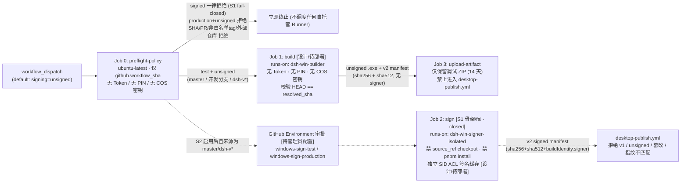

# 工作报告｜2026-11-14-p8-s1-signing-isolation

- Status: CONDITIONAL（S1 代码整改与离线/单测验证 **PASS**；真实 Runner 隔离部署、GitHub 管理端配置与 S2 硬件签名联调 **NOT_RUN / BLOCKED**）
- Baseline ref / starting point: `main`（起点为 `origin/main` 当时的提交；按 2026-11-15 报告路径追溯规则，本报告不保留 commit 编号）
- Actual branch: `feature/p8-s1-windows-release-security`
- Related instruction: [INSTRUCTION.md](../../docs/workbench/instructions/2026-11-14-p8-s1-signing-isolation/INSTRUCTION.md)
- Related architecture / ADR / milestone: [WORKBENCH_ARCHITECTURE.zh.md](../../docs/workbench/WORKBENCH_ARCHITECTURE.zh.md) · [DEVELOPMENT_ROADMAP.zh.md](../../docs/workbench/DEVELOPMENT_ROADMAP.zh.md)（P8）
- PR URL: `PENDING`（分支已推送至 `origin/feature/p8-s1-windows-release-security`，本机 `gh pr create` 因 token 缺少 `CreatePullRequest` 权限未自动建单；可于 https://github.com/Yeecean/DSH-workbench/pull/new/feature/p8-s1-windows-release-security 创建 PR）
- Report update date: 2026-11-14

## 目标、边界与授权

本轮完成 **P8-S1 Windows 发布链路安全整改** 的代码实现、策略抽离、Manifest v2 完整性与溯源校验、发布硬阻断及单元测试/工作流静态与 PowerShell 回归修复：

- **允许范围**：`windows-package.yml` 策略与多 Job 隔离改造、`windows-package-policy.mjs`、`prepare-windows-ci.mjs`、`retain-desktop-ci.ts`、`desktop-release-store.ts`（v2 schema）、`desktop-upload-plan.ts`、`desktop-website-installer.ts`、`desktop-publish-route.ts`、`publish-desktop-ci.ts`、`publish-desktop-rollout-ci.ts`、`resolve-retained-desktop-publish-ci.ts` 及对应测试与文档。
- **严格禁止且未触碰**：未调用硬件 EV Token / PIN；未修改/运行 `windows-sign.cmd` 进行真实签名；未写入生产或测试 COS；未创建仓内 `apps/desktop/.env.windows`；未安装或卸载宿主机客户端；未修改 Agent Loop、Session、Host/Client RPC 或 Renderer 安全边界；未合并至 `main` / `master`。

## 提交与变更映射

| 提交主题 | 变更目的 | 主要文件（项目相对路径） | 验证 |
| --- | --- | --- | --- |
| `test/security(desktop): add fail-closed Windows packaging authorization policy` | 抽离共享来源授权矩阵与 S1 `signed` fail-closed 策略并接入 `prepare-windows-ci.mjs` | `apps/desktop/scripts/windows-package-policy.mjs`、`apps/desktop/scripts/windows-package-policy.d.mts`、`apps/desktop/scripts/prepare-windows-ci.mjs`、`apps/desktop/scripts/windows-package-policy.spec.ts` | `vitest` 19/19 PASS |
| `ci(desktop): split windows-package workflow into preflight, keyless builder, and fail-closed signer` | 将 `windows-package.yml` 拆分为 `preflight-policy`、无密钥 `build`、隔离 `sign` 骨架与 `upload-artifact` | `.github/workflows/windows-package.yml` | `windows-package-workflow.spec.ts` PASS |
| `security/release(desktop): enforce manifest v2 dual-hash, build identity, and S1 fail-closed retention` | Manifest 升级至 `schemaVersion: 2`（SHA-256 + SHA-512 + `buildIdentity`），v1 仅可读不可发布，发布端校验指纹与双哈希 | `desktop-release-store.ts`、`desktop-upload-plan.ts`、`desktop-website-installer.ts`、`desktop-publish-route.ts`、`retain-desktop-ci.ts`、`publish-desktop-ci.ts`、`publish-desktop-rollout-ci.ts`、`resolve-retained-desktop-publish-ci.ts` | `vitest` + `typecheck` + `build` PASS |
| `test(desktop): update workflow, v2 release store, upload plan, and S1 fail-closed tests` | 更新多 Job 工作流单测并修复 `pwsh` 9x 冷启动超时；补齐 v2/双哈希/v1 拒绝/S1 禁用签名测试 | `scripts/windows-package-workflow.spec.ts`、`desktop-publish-workflow.spec.ts`、`desktop-archive-workflow-test.ts`、`apps/desktop/tests/*.spec.ts` | `vitest` 12 files 180/180 + `typecheck` 5/5 + `oxlint` PASS |
| `docs(workbench): add P8-S1 trust boundary, call chain, and work report` | 调用链、信任边界图、运维前置条件、工作报告及索引 | `workbench-reports/2026-11-14-p8-s1-signing-isolation/WORK_REPORT.md`、`docs/workbench/instructions/README.zh.md`、`workbench-reports/README.zh.md` | `git diff --check` PASS |

**说明**：提交主题用于识别变更目的，改动范围以「主要文件（项目相对路径）」为准；提交与本报告的对应关系由提交信息的 `Report:` 行与 `git log -- workbench-reports/2026-11-14-p8-s1-signing-isolation/` 双向确定，不记录 commit 编号。主题按当前术语归一（`buildIdentity`）。

## 实际调用链与信任边界

### 实际调用链台账

| 节点 | 执行文件 / Job | 可访问 Runner | 凭据 / 密钥 | 产物 / 状态 | 代码来源 |
| --- | --- | --- | --- | --- | --- |
| 0. 入口策略门禁 | `windows-package.yml` → `preflight-policy` (`windows-package-policy.mjs`) | `ubuntu-latest`（托管无状态） | 仅只读 `GITHUB_TOKEN`（用于解析 branch/tag）；**无 EV Token、PIN、COS 密钥** | 输出 `allowed` / `signing=unsigned` / `resolved_sha` | 仅 `github.workflow_sha` 稀疏检出 `apps/desktop/scripts` |
| 1. 无密钥打包 | `windows-package.yml` → `build` (`prepare-windows-ci.mjs`, `package-target.ts --unsigned`, `retain-desktop-ci.ts`) | `dsh-win-builder`（**设计/待部署**：标准非特权账户，无 Token/PIN/COS 写密钥） | **零签名凭据、零 COS 写凭据**；`PACKAGE_SIGNING` 硬编码为 `unsigned` | `deepseek-harness-*-win-x64-unsigned.exe` + v2 `manifest.json` (`qualification: unsigned`) | `inputs.source_ref`（校验 `HEAD == resolved_sha`）；辅助脚本锁定 `github.workflow_sha` |
| 2. 隔离签名接口 | `windows-package.yml` → `sign`（S1 骨架） | `dsh-win-signer-isolated`（**设计/待部署**：独立账户与专属签名缓存 ACL） | `environment: windows-sign-test / windows-sign-production`（**设计/待部署**） | S1 阶段 `if` 不可达且脚本内 `exit 1` fail-closed；**不调用 `windows-sign.cmd`** | 仅 `github.workflow_sha` 稀疏检出 `apps/desktop/scripts`；**禁止检出 `inputs.source_ref` 或运行 `pnpm install`** |
| 3. 调试产物归档 | `windows-package.yml` → `upload-artifact` (`archive-desktop-ci.ts`) | `[self-hosted, needs.build.outputs.runner]` | 无发布凭据 | `windows-x64-unsigned-*.zip`（14 天保留，**无通往 `desktop-publish.yml` 的路径**） | 默认分支 `artifact-archiver` |
| 4. 发布前路由校验 | `desktop-publish.yml` → `route` (`preflight-desktop-publish.mjs`, `resolve-desktop-publish-ci.ts`) | `ubuntu-latest` | 仅只读 `GITHUB_TOKEN`；要求 `refs/heads/master` 触发 | 校验非调试产物名并锁定 `package` attempt | 默认分支（`master`） |
| 5. 本地校验与审批摘要 | `desktop-publish.yml` → `prepare` (`preflight-desktop-publish-local.mjs`, `resolve-retained-desktop-publish-ci.ts`, `publish-desktop-ci.ts --check`) | `[self-hosted, needs.route.outputs.runner]` | **无 upload secrets**（`--check` 不读取 COS/App 私钥） | `assertPublishableDesktopManifest` 拒绝 v1/`unsigned`/缺 `signer`；`desktop-upload-plan.ts` 校验磁盘 SHA-256 + SHA-512 + size；校验发布证书指纹 | `master` |
| 6. 审批后发布与官网上传 | `desktop-publish.yml` → `publish` / `upload-website-installer` / `purge-website-installer` | `[self-hosted, needs.route.outputs.runner]` | `environment: desktop-test / desktop-production`；COS 凭据 & GitHub App key | 再次核验 `DESKTOP_APPROVED_PACKAGE`、双哈希、Authenticode 与指纹后上传 | `master` |

### 信任边界图（设计/待部署标注）

## 安全风险前后状态与 S2 待办清单

| 风险项 | 整改前状态 | P8-S1 整改后状态 | S2 / 管理员待办条件 |
| --- | --- | --- | --- |
| `windows-package.yml` 默认 `signed` 且对开发分支开放 | `default: signed`；`test` 允许任意分支在 `dsh-win-package-trial` 触发 EV Token 签名 | `default: unsigned`；`preflight-policy` 在 `ubuntu-latest` 拦截所有 `signed` 请求、`production+unsigned` 及非法来源 | S2 需先完成以下管理员前置项后再评估放开 `master`/`dsh-v*` 的 `signed` 门禁 |
| 构建与签名共用单台 Runner | `dsh-win-package-trial` 同机执行 `inputs.source_ref` `pnpm install` 与硬件签名 | `build`（`dsh-win-builder`）与 `sign`（`dsh-win-signer-isolated`）在工作流层拆分；`sign` 禁 `source_ref` 与 `pnpm install` 且 S1 fail-closed | **BLOCKED / NOT_VERIFIED**：需管理员在 GitHub/宿主机配置独立 OS 账户、`dsh-win-builder` 与 `dsh-win-signer-isolated` Runner 标签、隔离 `.pnpm-store` 与签名缓存 SID ACL |
| `windows-sign.cmd` 命令行 `/kc` 明文 PIN | `/kc "[{}]=%keyContainer%"` 暴露于进程创建审计 | **遗留风险，S1 未修改该脚本**；S1 可达路径完全禁止触发 `windows-sign.cmd`，单测如实保留遗留断言 | **S2 专项整改**：须取得硬件 Token 实机测试授权后改造为无 CLI PIN 方案并验证 Event ID 4688 零明文 PIN |
| Manifest v1 仅 SHA-512 且无构建身份记录 | `schemaVersion: 1` 仅记录 `sha512`，无 `sha256` 及构建/签名身份记录 | 新写入强制 `schemaVersion: 2`（`sha256` + `sha512` + `buildIdentity`）；v1 仅可读审计，所有发布入口拒绝 v1/`unsigned`/缺 `signer`/证书指纹不匹配 | S2 实机联调时验证真实 Authenticode 与证书指纹一致性 |
| GitHub 分支保护与 Environment 审批 | 仓内无法验证 `master` 保护与 Environment reviewers 是否已配置 | 代码侧已写入 `environment: windows-sign-test / windows-sign-production` | **BLOCKED / NOT_VERIFIED**：需仓库管理员核实并开启 `master` 分支保护规则、`windows-sign-*` 与 `desktop-*` Environment 必需审批人 |

## 验证证据

| 类别 | 环境 / 命令 | 实际结果 | 证据 / 说明 |
| --- | --- | --- | --- |
| 空白与格式检查 | Win32 x64 · `git diff --check` | PASS（exit `0`） | 无尾随空白或冲突标记 |
| 代码风格与静态规则 | Win32 x64 · `pnpm exec oxlint --fix ...` + `lefthook pre-commit` | PASS（exit `0`） | 所有修改的 `.ts` / `.mjs` / `.spec.ts` 零错误 |
| 类型检查 | Win32 x64 · `pnpm run typecheck` | PASS（`5 passed, 0 failed, 0 skipped`，耗时 `41.11s`） | 含 `Host Typert`、`host compiler`、`client compiler`、`client/host aggregate check` |
| 桌面端构建 | Win32 x64 · `pnpm --filter @deepseek-ai/dsh-desktop run build` | PASS（exit `0`） | `tsc -b` + `tsdown` + `vite` 全量构建通过 |
| 工作流与 PowerShell 稳定性复测 | Win32 x64 · `pnpm exec vitest run scripts/windows-package-workflow.spec.ts scripts/desktop-publish-workflow.spec.ts`（及单独 2 次复跑） | PASS：Run 1 `16/16` (`4.61s`)；Run 2 `10/10` (`5.39s`)；Run 3 `10/10` (`6.38s`) | 通过单进程 `pwsh` harness 合并 9 次冷启动，未调高 5000ms 超时且全部通过 |
| P8-S1 核心安全与发布单测集 | Win32 x64 · `pnpm exec vitest run`（12 个测试文件） | PASS（`12 passed (12)`，`180 passed (180)`，耗时 `13.05s`） | 覆盖 `windows-package-policy`、`windows-package-workflow`、`desktop-publish-workflow`、`desktop-release-store`、`desktop-upload-plan`、`windows-sign`、`desktop-publish-route`、`retain-desktop-ci`、`desktop-publication-preflight`、`desktop-rollout`、`publish-website-ci`、`desktop-package-selection` |
| 真实硬件 EV 签名 / COS 上传 / OTA | 真实硬件 Token / 生产 COS / GitHub Runner | **NOT_RUN — S2 / 未授权** | 按 P8-S1 禁令未连接真实 Token、未运行 `windows-sign.cmd`、未触发真实签名工作流或发布 |

### 最低负例矩阵核对

- 开发分支 + `signed`：已测试并拒绝（`windows-package-policy.spec.ts`、`desktop-publish-route.spec.ts`）。
- `master` + `signed`：已测试并拒绝（S1 fail-closed，`windows-package-policy.spec.ts`）。
- `production` + `unsigned`：已测试并拒绝（`windows-package-policy.spec.ts`、`desktop-release-store.spec.ts`）。
- 伪造 tag / raw SHA / PR ref / 外部仓库：已测试并拒绝（`windows-package-policy.spec.ts`）。
- 被篡改 installer（含同大小字节篡改）：已测试并拒绝（`desktop-release-store.spec.ts`、`desktop-upload-plan.spec.ts`）。
- 仅篡改 manifest `qualification`（缺 `signer` 或 `unsigned` 伪装）：已测试并拒绝（`desktop-release-store.spec.ts`、`desktop-publish-route.spec.ts`）。
- 不匹配 `runId` / `attempt` / `sha256`：已测试并拒绝（`desktop-release-store.spec.ts`、`desktop-upload-plan.spec.ts`）。
- 无审批环境 / 无专用签名机：工作流静态测试验证 `sign` 绑定 `windows-sign-test` / `windows-sign-production` 且隔离于 `dsh-win-signer-isolated`，真实 GitHub 配置标记 `BLOCKED / NOT_VERIFIED`。

## 验收结论

- **S1 代码整改状态**：**PASS**（策略、工作流隔离、Manifest v2、双哈希/溯源校验、发布硬阻断及回归测试全部完成并通过本地验证）。
- **是否允许真实 signed**：**NO**（S1 保持 fail-closed；需完成 S2 无 CLI PIN 改造、物理签名机隔离部署、Environment 审批与硬件实机联调后另行授权）。
- **是否允许发布**：**NO**（禁止直接合并或触发生产发布；待人工审查 PR 并在 S2 就绪前维持 `signed` 禁用）。
