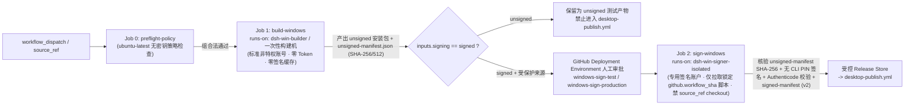

# DSH Workbench 下一阶段工作成果、签名安全整改设计与验收汇报

> 文档基线：分支 `workbench-p1-work-code-ux-spec`，基线版本 `0.2.2-rc.2`，报告生成时间 `2026-11-14`。
> 边界与安全声明：全过程未进入 P7，未连接真实硬件 EV Token 或执行代码签名，未创建仓内 `apps/desktop/.env.windows`，完整保留 `workbench/` 未跟踪目录及宿主机既有桌面安装（`E:\dshDesktop`、`1bf39983-50d0-5fe0-9ef4-cece76f67c5e`、用户目录及桌面/开始菜单快捷方式）。
> 事实分层原则：本报告严格区分 **1）代码修复**、**2）测试通过（Lint / 类型检查 / 单元测试 / 原生安装器测试 / 本地 Qualification Harness）**、**3）真实环境验收（外部配置无签名 NSIS 打包、隔离安装、首次启动、配置冷重启持久化、卸载及宿主机零污染）** 与 **4）未完成项**，并如实披露失败或条件跳过用例。

---

## 1. 工作成果总览与四维度边界确认

| 维度 | 核心成果与状态结论 | 对应证据与边界 |
| --- | --- | --- |
| **签名安全整改设计（审前方案）** | 围绕 `windows-package.yml` 组合门禁、Builder/Signer 四维隔离、`windows-sign.cmd` 去 CLI PIN 改造及产物来源/SHA-256 发布授权形成完整可实施设计方案（阶段 S1/S2）。 | 见第 2 节；未改动生产签名与工作流代码，等待审批后落地。 |
| **代码修复（18 个追踪文件）** | 完成 `695+ / 69-` 改动，涵盖：`ui-workbench` `glassBlur` 映射与校验修复（Stage A）；原生安装器 `render-test.exe` GDI 分阶段诊断与预热收尾修复；`windows-signature-cache-directory.mjs` 进程内 `koffi` Win32 API 安全重构（根除 `5006ms` 超时）；自动更新 `main.ts`/`update-attention.ts`/`mandatory-update-window.ts` 运行期动态语言修复；三大 Qualification Harness 阻塞修复（未改生产错误分类）。 | `git diff --check` 退出 `0`；完整文件列表见第 6 节。 |
| **测试通过（全部在最终代码后复测）** | `oxlint`、`apps/desktop run build`、`pnpm run typecheck`（`5/5`）全部通过；Vitest 通过 `desktop-updates`（`32` 文件 `534/534`）、`signing-installer`（`11` 文件 `127/127`，其中 `windows-signature-cache-directory.spec.ts` `11/11` 测试耗时 `73ms`/总耗时 `446ms`）、`mandatory-attention`（`2` 文件 `34/34`）、`ui-workbench`（`4` 文件 `24/24`）、`ui-settings-general`（`10` 文件 `114/114`）、`installed-updates`（`11` 文件 `184 passed \| 1 skipped`）；4 个自动更新 Harness 与原生 `test:installer` / `--uninstall-only` 全部退出 `0`。 | 如实披露：`scripts/windows-package-workflow.spec.ts:133` 耗时 `5224ms > 5000ms` 超时失败（未跳过/未改超时阈值）；`installed-update-signature.spec.ts:45` 按 `non-win32` 条件跳过。 |
| **真实环境验收（无签名隔离闭环）** | 通过 `DSH_PACKAGING_CONFIG_DIR` + `DSH_PACKAGING_PRESET=test` 外部隔离配置打包出 `deepseek-harness-0.2.2-rc.2-win-x64-unsigned.exe`（`334,095,902` 字节）与 `.blockmap`（`346,821` 字节）；完成隔离 `/S` 安装（测试卸载键 `181d450b-...`）、首次启动界面写入 `glassBlur: "18px"` 并落盘 `cordis.patch.yml`、二次冷重启自动恢复、静默卸载及宿主机 4 目录/注册表/快捷方式 `.lnk` SHA-256 零污染校验。 | `package-win-unsigned.log`、`isolated-installer-lifecycle.log`；宿主机正式安装与工作区完全无损。 |
| **未完成项（明确挂起边界）** | 1. 签名安全整改 S1 代码实施与 S2 真实硬件 EV Token 受控干跑（待审批与授权）； 2. 携带真实签名与隔离 COS 写凭据的端到端 `Real-OTA`（`v1 -> v2`）升级及防火墙脚本实测； 3. `scripts/windows-package-workflow.spec.ts:133` 跨进程 `pwsh` 超时治理（联动 S1 工作流单测处理）； 4. P7 后续阶段工作。 | 见第 5.2 节与授权前提说明。 |

---

## 2. 签名安全整改可实施设计方案（未修改生产代码，等待审批）

> 设计约束：按照审查要求第 1 项，先输出可直接落地的工程方案。在方案获准及明确获权连接真实硬件 EV Token 前，未修改 [windows-package.yml](../../.github/workflows/windows-package.yml)、[windows-sign.cmd](../../apps/desktop/scripts/windows-sign.cmd)、[desktop-publish.yml](../../.github/workflows/desktop-publish.yml)、[desktop-release-store.ts](../../apps/desktop/scripts/desktop-release-store.ts) 与 [desktop-upload-plan.ts](../../apps/desktop/scripts/desktop-upload-plan.ts)。

### 2.1 `windows-package.yml` 中 `test` preset、任意分支与 `signed` 模式组合限制

**源码审计发现的现状缺口**：

- 在 [.github/workflows/windows-package.yml](../../.github/workflows/windows-package.yml) 中，`workflow_dispatch` 将 `inputs.preset` 默认设为 `test`（第 14–16 行）、`inputs.signing`（`PACKAGE_SIGNING`）默认设为 `signed`（第 45–50 行）；单个 `package` 作业（第 73 行）运行在 `runs-on: dsh-win-package-trial` 且缺少 GitHub `environment` 人工审批门，第 123–127 行允许 `preset === 'test'` 匹配仓内任意 `source_ref`。因此任意拥有分支写权限的开发者可向未审合开发分支发起 `preset=test` + `signing=signed`，直接触发自托管机器上的 EV Token 签名。
- 在 [prepare-windows-ci.mjs](../../apps/desktop/scripts/prepare-windows-ci.mjs) 与 [desktop-release-store.ts](../../apps/desktop/scripts/desktop-release-store.ts#L28) 中，`preset === 'test'` 当前放行任意 `sourceRef`，尚未对 `qualification === 'signed'` 施加来源分支收敛规则。

**组合矩阵收敛设计**：

| `source_ref` 来源类别 | `preset=test` + `signing=unsigned` | `preset=test` + `signing=signed` | `preset=production` + `signing=unsigned` | `preset=production` + `signing=signed` |
| --- | --- | --- | --- | --- |
| **仓内任意开发分支（如 `feat/*`、`fix/*`、`workbench-*`）** | **允许**（仅无密钥构建机运行） | **禁止**（Preflight 失败退出 `1`） | **禁止** | **禁止** |
| **受保护主分支 `master` 或显式白名单发布 Tag/分支** | **允许** | **条件允许**：强制经 GitHub `environment: windows-sign-test` 人工审批后进入签名机 | **建议禁用**（避免与正式包混淆） | **允许**：强制绑定 `environment: windows-sign-production` 人工审批 |

**工程落地点**：

- 将 `windows-package.yml` 中 `inputs.signing` 的 `default` 由 `signed` 降级为 `unsigned`。
- 在入口新增无密钥 `preflight-policy` 作业，在拉起任何 Windows 自托管 Runner 前校验 `(preset, signing, source_ref)` 组合矩阵与 `github.event.pull_request`/派发者权限边界，拦截“非受保护分支 + `signed`”。
- 在 `prepare-windows-ci.mjs` 与 `desktop-release-store.ts` 的 `refine()` 中强制要求：当 `qualification === 'signed'` 时，即使 `preset === 'test'` 也仅允许受保护主分支或白名单签发 Tag，并在 `scripts/windows-package-workflow.spec.ts` 与 `apps/desktop/tests/` 增补对应护栏单测。

### 2.2 普通构建 Runner 与签名 Runner 的账户、凭据、工作区与缓存隔离

**现状缺口**：现有 `windows-package.yml` 由单台 `dsh-win-package-trial` 同时承担不受信任的 `inputs.source_ref` 代码检出、`pnpm install` 编译打包、硬件 EV Token 访问与 `DSH_PACKAGING_CONFIG_DIR` 凭据挂载。

**四维隔离实施方案**：

| 隔离维度 | 普通构建 Runner（`dsh-win-builder`） | 隔离签名 Runner（`dsh-win-signer-isolated`） |
| --- | --- | --- |
| **OS 账户与 Runner 组** | 普通标准非管理员账户，无智能卡 / USB Token 访问权；Runner 组按仓内工作流需要开放。 | 独立受限专用服务账户及专属 Runner 标签/组；严禁与 `ci-windows.yml`、`cua-helper-package-windows.yml`、`unsigned` 构建共用主机或账号。 |
| **凭据与代码边界** | **零签名凭据、零 Token PIN、零 COS 写密钥**；允许正常检出 `inputs.source_ref` 并运行 `pnpm install` 与 `electron-builder --unsigned`。 | 仅挂载 `DSH_PACKAGING_CONFIG_DIR` 与硬件 Token；**严禁检出 `inputs.source_ref` 或运行待测分支 `pnpm install` / 构建脚本**；所有签名辅助脚本严格锁定 `ref: ${{ github.workflow_sha }}` 检出受信任基线。 |
| **工作区隔离** | 每次 Run 使用一次性独立工作目录或云销毁环境，前后清扫 `.desktop-build`。 | 每次签名创建当前用户独占 SID ACL 保护的临时验签工作区（不持久化业务源码），签名并校验证书后立即粉碎临时副本。 |
| **缓存与锁隔离** | 仅维护构建专用 `.pnpm-store`，无权读取或创建签名缓存路径。 | 签名缓存目录与 `%USERPROFILE%\.dsh-desktop-signing` 状态锁限定于签名账户固定盘符，沿用本轮重构的 `windows-signature-cache-directory.mjs`（进程内 `koffi` Win32 ACL 校验：禁重解析点、强制当前用户 Owner、禁止其它普通账户 Allow ACE）。 |

### 2.3 消除 `windows-sign.cmd` 中 Token PIN 暴露于 SignTool 命令行

**风险实证**：[windows-sign.cmd](../../apps/desktop/scripts/windows-sign.cmd#L5-L16) 当前将 `%DSH_DESKTOP_WINDOWS_TOKEN_PIN%` 拼接到 `signtool` 参数：`/kc "[{}]=%keyContainer%"`。一旦 `CreateProcessW` 拉起进程，明文 PIN 即已进入子进程 PEB、Windows 进程创建审计事件（Event ID `4688`）与主机进程监控视图，批处理末尾的环境变量置空无法撤回进程启动命令行暴露。

**无 CLI PIN 替代实现路径**：

- **主选方案 2a（受控托管原生 helper + 匿名管道 `stdin` 传 PIN + `SignerSignEx2`）**：参照仓库既有 [windows-token-public-key.cs](../../apps/desktop/scripts/windows-token-public-key.cs) 编译校验模式新增 `windows-token-signer.cs`，由 `windows-sign.mjs` 在零 CLI PIN 参数、经 `scrubWindowsSigningEnvironment()` 净化环境块的前提下启动子进程，通过匿名管道 `stdin` 单次传入 PIN 字节并在读入后立即调用 `CryptProtectMemory` 保护与 `ZeroMemory` 清零。辅助程序经 `CryptAcquireContextW` / `NCryptOpenStorageProvider` 绑定 `eToken Base Cryptographic Provider`，调用 **`CryptSetProvParam(..., PP_SIGNATURE_PIN / PP_KEYEXCHANGE_PIN, ...)`** 完成会话 PIN 注入并直接调用 `mssign32.dll` **`SignerSignEx2`** 施加纯哈希 `SHA-256` Authenticode 签名；网络时间戳重试与签名标准化（`normalizeWindowsSignature()`）继续由 [windows-timestamp.mjs](../../apps/desktop/scripts/windows-timestamp.mjs#L23-L91) 与硬件令牌完全解耦。
- **备选方案 2b（SafeNet SAC CSP 单点登录会话兜底）**：若安全硬件策略显式禁用 `PP_SIGNATURE_PIN` 编程解锁，则由受控签名会话提前完成 Token 解锁，执行不带 PIN 占位符的 `signtool.exe sign /v /fd sha256 /f "<cer>" /csp "eToken Base Cryptographic Provider" /kc "<keyContainer>"`，确保任何命令行与环境块均零 PIN 出现（将在 S2 获准连接 Token 时实机二选一定稿）。
- **测试护栏同步**：更新 [windows-sign.spec.ts](../../apps/desktop/tests/windows-sign.spec.ts)，移除旧 `/kc "[{}]..."` 断言，替换为反回归安全性断言，明确禁止任何签名子进程 argv 或环境块包含 PIN 原文或模板占位。

### 2.4 签名产物来源验证、`sha256` 校验与发布授权闭环

**现状缺口**：[desktop-release-store.ts](../../apps/desktop/scripts/desktop-release-store.ts#L30-L35)（`schemaVersion: 1`）与 [desktop-upload-plan.ts](../../apps/desktop/scripts/desktop-upload-plan.ts#L116-L152) 目前仅存储并核对 `sha512`（Base64），缺乏 `sha256` 校验与“构建源 -> 签名人 -> 发布通道”的链路溯源。

**防篡改与发布授权闭环**：

- **构建 -> 签名交接校验（`unsigned-manifest.json`）**：`build-windows` 产出待签二进制集合并随附记录逐文件 `fileName`、`size`、`sha256`（64 位小写十六进制）、`sha512`、`sourceRef`、`commitSha`、`workflowRunId`、`preset` 的 `unsigned-manifest.json`。`sign-windows` 下载后先逐字节重算 `sha256` 与 `size` 验证一致性，仅签名白名单可执行文件/安装器，并通过 `normalizeWindowsSignature()` 与 [windows-runtime-signature.mjs](../../apps/desktop/scripts/windows-runtime-signature.mjs#L16-L30) 的 `inspectWindowsRuntimeSignature()` 验证签名证书状态与指纹。
- **Release Store 升级至 `schemaVersion: 2`**：每个存档制品条目强制同时携带 **`sha256`**（`/^[a-f0-9]{64}$/u`）与 `sha512`、`size`，新增 **`buildIdentity`** 构建身份记录块（含 `builderRunner`、`builderRunId`、`unsignedSha256`、`signerRunner`、`signerRunId`、`workflowSha`、`certificateThumbprint`、`signedAt`）。
- **发布前双重核验与 `unsigned` 硬阻断**：`desktop-upload-plan.ts` 生成上传计划时同步核对本地磁盘 `sha256`、`sha512` 与 `size`，Windows 正式发布通道校验主安装器 Authenticode `Status === Valid` 与预期发布证书指纹；同时延续 [desktop-publish.yml](../../.github/workflows/desktop-publish.yml) 在 `prepare`（第 108 行 `--check`）与 `environment` 审批后的 `publish`（第 145/168 行 `--check`/`--publish`）对 `unsigned` 制品的硬阻断。

### 2.5 分步推进与待授权门禁

- **阶段 S1（方案获批后可先于硬件联调开发与单测）**：改造 `windows-package.yml` 双作业架构与来源矩阵门禁、`prepare-windows-ci.mjs`、`desktop-release-store.ts` v2 schema、`desktop-upload-plan.ts` `sha256` 校验及 `desktop-publish.yml` 溯源验证，并一并治理 `scripts/windows-package-workflow.spec.ts:133` 的 9 次 `pwsh` 性能测试。
- **阶段 S2（须获明确硬件授权后在隔离签名机实测）**：实现无 CLI PIN 的 `windows-token-signer` 并仅执行 1 次受控测试预设干跑，验证 Event ID `4688` 零明文 PIN、Authenticode 状态与时间戳重试。

---

## 3. Windows 安装器阻塞解决与隔离全生命周期验收（对应审查要求第 2 项）

### 3.1 独立外部配置注入（严格禁用混合 `.env.windows`）

- 核实工作区严格不存在 `apps/desktop/.env.windows`。
- 参照 [test.env.example](../../apps/desktop/config/windows-packaging/test.env.example) 在对话外部 scratch 目录建立独立配置文件，通过环境变量 `DSH_PACKAGING_CONFIG_DIR` 与 `DSH_PACKAGING_PRESET=test` 注入打包流程，使用独立测试应用标识 `com.deepseek.harness.test`（派生测试卸载 GUID `181d450b-e875-56b7-8287-82cdb99557ca`，完全隔离于宿主机正式线 `1bf39983-50d0-5fe0-9ef4-cece76f67c5e`）与有效测试 HTTPS Origin，不混入任何生产凭据。

### 3.2 `render-test.exe` GDI 计数 `10 -> 45` 根因确认与修复

- **根因查明（拒绝删减资源断言）**：核查 [window-frame.cpp](../../apps/desktop/installer/window-frame.cpp#L144-L151) 确认 `~ProgressPage()` 已完整释放窗口、画刷、字体等页级 GDI 对象，不存在持续泄漏。但在 [windows-installer-render.cpp](../../apps/desktop/tests/windows-installer-render.cpp) 中，原有预热窗口 `warmup` 在销毁前未执行 `InstallerFinishProgress(warmup)`，导致受测正式窗口首次进入 finish/绘制阶段时触发进程级字体与绘制缓存首次驻留，引发 `gdi_before=10 -> gdi_after=45` 的测量基准偏差。
- **代码修复与 8 阶段诊断**：在 [windows-installer-render.cpp](../../apps/desktop/tests/windows-installer-render.cpp#L74) 预热收尾显式调用 `InstallerFinishProgress(warmup)`，保持 **`finalGdi <= initialGdi`** 断言不变，并输出 `gdi_init`、`gdi_before`、`gdi_created`、`gdi_caption`、`gdi_restored`、`gdi_frames`、`gdi_finished`、`gdi_after` 全周期计数。
- **修复后 `render-results.log` 四组实测全绿（每组 300 帧）**：

| 测试条件 | `gdi_init` | `gdi_before`（基准） | `gdi_created`（峰值） | `gdi_frames` | `gdi_after`（销毁后） | 帧耗时统计 |
| --- | --- | --- | --- | --- | --- | --- |
| `dpi=96 dark=0` | `3` | `45` | `49` | `49` | **`43`**（`<= 45`） | `mean=0.819ms p50=0.626ms p95=2.353ms max=3.686ms` |
| `dpi=96 dark=1` | `3` | `45` | `49` | `47` | **`43`**（`<= 45`） | `mean=1.320ms p50=1.319ms p95=2.318ms max=3.554ms` |
| `dpi=192 dark=0` | `3` | `45` | `49` | `47` | **`43`**（`<= 45`） | `mean=1.633ms p50=1.434ms p95=3.042ms max=5.666ms` |
| `dpi=192 dark=1` | `3` | `45` | `49` | `47` | **`43`**（`<= 45`） | `mean=1.639ms p50=1.446ms p95=3.316ms max=6.092ms` |

### 3.3 `test:installer`、无签名 NSIS 打包与隔离端到端生命周期实测

- **`test:installer` 全通**（`test-installer.log`，输出目录 `apps/desktop/.desktop-build/installer-tests/run-284v3k`，退出 `0`）：覆盖 `en_US`、`de_DE`、`es_ES`、`fr_FR`、`ja_JP`、`pt_BR`、`ru_RU`、`zh_CN` 共 **8 种语言 × 16 项断言/语言** 以及 4 组 `render-test.exe` 用例全部 `PASS`。
- **卸载专项全通**（`test-installer-uninstall-only.log`，输出目录 `apps/desktop/.desktop-build/installer-tests/run-iJENAg`，退出 `0`）：**8 种语言 × 5 项用例/语言**（`interactive`、`silent`、`upgrade`、`replaced`、`home-inside`）全部 `passed`。
- **无签名 NSIS 完整打包通过**（`package-win-unsigned.log`，退出 `0`）：通过 `DSH_PACKAGING_CONFIG_DIR` + `DSH_PACKAGING_PRESET=test` 完成完整组装与运行态 Office 文档往返/CLI 插件安装冒烟，产出 `deepseek-harness-0.2.2-rc.2-win-x64-unsigned.exe`（`334,095,902` 字节，`SHA256=F54E673F4799FB0E73714DB527E36FB302B2DC0D9E2C1A55E7817604B8C5F782`）与 `.blockmap`（`346,821` 字节，`SHA256=507A9B22835963E49DD3C6A35BA5023166D574F937BA65C4F80F9ADEB08734FF`）。
- **隔离安装 -> 首次启动 -> 数据持久化 -> 卸载与宿主机零污染验收**（`isolated-installer-lifecycle.log`，沙盒 `dsh-isolated-nsis-0daf3407`，退出 `0`）：
  - **隔离安装**：使用上述 `.exe` 静默安装 `/S /D=...` 到隔离临时目录，生成 `DeepSeek Harness.exe` 与 `Uninstall DeepSeek Harness.exe`，注册表仅新增独立测试键 `181d450b-e875-56b7-8287-82cdb99557ca`。
  - **首次启动与配置写入（`Launch 1`）**：以隔离 `--user-data-dir`、`DSH_HOME`、`DSH_DESKTOP_UPDATE_JOURNAL_DIR` 启动已安装客户端，通过真实 UI（`Settings -> General`）应用 `glassBlur: "18px"`，实时验证 `--wb-blur: 18px`、`--wb-glass-backdrop: blur(var(--wb-blur)) saturate(185%) contrast(103%)`、`accent="custom"` 及隔离 `profiles\desktop\cordis.patch.yml` 落盘，随后优雅退出（退出码 `0`）。
  - **冷重启持久化验证（`Launch 2`）**：二次启动该已安装程序，无需干预即自动恢复 `dshWorkbench="1"`、`wbBlur="18px"`、`accent="custom"`（与磁盘持久化配置一致），随后优雅退出（退出码 `0`）。
  - **静默卸载与零污染核对**：执行 `/S /KEEP_APP_DATA _?=<installDir>` 完成清理，确认安装目录与测试注册表键 `181d450b-e875-56b7-8287-82cdb99557ca` 已删除；备份恢复桌面与开始菜单 `.lnk`（按 SHA-256 与 `LastWriteTimeUtc` 逐字节核对一致），确认宿主机既有 `E:\dshDesktop` 等 4 个目录与正式卸载键 `1bf39983-50d0-5fe0-9ef4-cece76f67c5e` 零污染。

---

## 4. 自动更新 Qualification 阻塞与签名缓存目录超时修复（对应审查要求第 3 项）

### 4.1 三大自动更新 Qualification 阻塞根因与修复详情

| 子项 | 审查要求与调查到的真实根因 | 实际代码修复（均不违背生产语义） | 最终编辑后复测结果 |
| --- | --- | --- | --- |
| **A. `ENOSPC` 场景断言** | 生产 `update-error.ts` 将 `ENOSPC` 映射为 `'download-space'` 正确，仅 fixture 测试断言仍停留在旧值 `'download'`；同时 UI 新文案与窗口捕获句柄接口有更新。 | **未改生产错误分类逻辑**；修正 [local-updater.mjs](../../apps/desktop/tests/fixtures/local-updater.mjs#L213) 期望为 `presentation.failure = 'download-space'` 并适配新文案/句柄捕获；[update-dialogs.mjs](../../apps/desktop/tests/fixtures/update-dialogs.mjs) 采用 `Math.round()` 适配高 DPI 浮点尺寸。 | `test-local-updater.mjs` **17/17 场景全部通过**（`requests: 43`, `actualElectron: "44.7.0"`, `installerExecuted: false`，证据 `local-updater-auX40S`，退出 `0`）。 |
| **B. Host Qualification `@deepseek-ai/dsh/profile-boot` 解析** | `apps/cli/package.json` 导出正确，但 `test-host-updates.ts` 将依赖目录 junction 链接至临时项目后，pnpm 内部 `@deepseek-ai/dsh -> ../../apps/cli` 相对路径符号链接穿过 junction 发生相对路径越界失真，无法定位 `apps/cli/lib/profile-boot.js`。 | 在 [development-project.ts](../../apps/desktop/scripts/development-project.ts#L124) 新增导出 `linkWorkspaceNodeModules()` 将依赖及 `@deepseek-ai/dsh`、`@deepseek-ai/dsh-desktop-host` 解析为真实绝对路径链接；在 [test-host-updates.ts](../../apps/desktop/scripts/test-host-updates.ts) 接入并传入 `DSH_CLIENT_VERSION`、隔离无遥测凭据的 `desktop-product-telemetry`，在 [host-update-qualification.mjs](../../apps/desktop/tests/fixtures/host-update-qualification.mjs) 传入 `owner: agent.id`。 | `test-host-updates.ts` **通过**（退出 `0`，12 项 Host 更新事件完整观测，证据 `host-updates-gYwKJI`）。 |
| **C. Workspace Qualification 导出契约与运行期语言同步** | 1. [workspace-update-adapters.mjs](../../apps/desktop/tests/fixtures/workspace-update-adapters.mjs#L4) 替代 `./host-process.js` 缺少 `DesktopHostFatalError` 导出； 2. [update-attention.ts](../../apps/desktop/src/update-attention.ts) 与 [mandatory-update-window.ts](../../apps/desktop/src/mandatory-update-window.ts) 在初始化时按值固化了启动 `locale`，运行期切换语言后通知与强更窗口未刷新； 3. `test-workspace-updates.ts` 缺少 `lib/welcome`、`preload-welcome.cjs` 与中文测试环境/ARIA 选择器更新。 | 1. 在 `workspace-update-adapters.mjs` 第 4 行补充 `DesktopHostFatalError` 导出以匹配 `host-process.ts`； 2. 将 [main.ts](../../apps/desktop/src/main.ts)、`update-attention.ts`、`mandatory-update-window.ts` 改为接受并求值 `DesktopLocale \| (() => DesktopLocale)`，在语言切换时触发 `mandatoryUI?.sync()`；在 [update-attention.spec.ts](../../apps/desktop/tests/update-attention.spec.ts#L83-L99) 新增动态语言切换单元测试； 3. `test-workspace-updates.ts` 与 `workspace-updates.mjs` 复用 `linkWorkspaceNodeModules()`、复制 welcome 资源并同步队列清理。 | `test-workspace-updates.ts` **10/10 场景全部通过**（证据 `electron-workspace-updates-hTznib`，退出 `0`）。 |

### 4.2 `windows-signature-cache-directory.spec.ts` `5006ms` 超时根因解决

- **根因诊断（禁止放大 timeout 掩盖）**：[windows-signature-cache-directory.mjs](../../apps/desktop/scripts/windows-signature-cache-directory.mjs) 原每次创建/校验目录均启动独立 `powershell.exe` 加载 CLR 与安全模块（单次启动 `1.0s–1.3s`），而单条测试需连续 4 次调用并伴随 `icacls.exe`，冷启动累加超出 `5000ms` 默认超时。
- **彻底解决**：确认全仓仅该模块调用同名 `.ps1`，且 `apps/desktop/package.json` 已依赖原生 FFI 库 `koffi`。遂将 `prepareWindowsSignatureCacheDirectory()` 重构为基于 `koffi` 懒加载 `kernel32.dll` / `advapi32.dll` 的进程内原生 Win32 安全校验（保留 `GetDriveTypeW` 固定本地盘符检验、`GetFileAttributesW` 全祖先链重解析点拒绝、`OpenProcessToken` + `GetTokenInformation` 当前用户 SID 识别、`SetNamedSecurityInfoW` 条件附带 `OWNER_SECURITY_INFORMATION` 以避免对既有当前用户目录请求 `WRITE_OWNER` 触发 Win32 error 5、以及 `GetNamedSecurityInfoW`/`GetAclInformation`/`GetAce`/`EqualSid` 私有 Owner 与禁止普通账户 Allow ACE 核查），同步精简留档 [windows-signature-cache-directory.ps1](../../apps/desktop/scripts/windows-signature-cache-directory.ps1)。
- **实测加速效果**：未调整 5000ms 默认测试超时阈值，[windows-signature-cache-directory.spec.ts](../../apps/desktop/tests/windows-signature-cache-directory.spec.ts) **`11/11` 测试耗时从 `5006ms` 超时降至 `73ms`（套件总耗时 `446ms`）**。

---

## 5. 全量验证详细台账与未完成项边界（对应审查要求第 4 项）

### 5.1 本轮最新验证汇总（全部在对应最终代码定稿之后执行，原始日志留存于会话 `scratch/logs/`）

| 验证分类 | 执行命令 / 范围 | 相对最终编辑时序 | 执行结论 | 关键实测指标与原始日志 |
| --- | --- | --- | --- | --- |
| **Static / Lint** | `oxlint`（`apps/desktop`、`ui-workbench`） | 全部代码定稿后（`task-1930`） | **通过（`0`）** | 零 error/warning；`oxlint.log` |
| **Desktop Build** | `pnpm --dir apps/desktop run build`（`tsc -b && bundle`） | 全部代码定稿后 | **通过（`0`）** | `lib/main.js`（`849.03 kB`）、`lib/welcome/` 与 preload `.cjs` 编译打包成功；`desktop-build.log` |
| **Typecheck** | `pnpm run typecheck`（`tsx scripts/build.ts --scope typecheck`） | 全部代码定稿后 | **通过（`5/5`）** | Host Typert、host/client 编译器及聚合检查 `5 passed, 0 failed, 0 skipped`（`44.37s`）；`typecheck.log` |
| **Patch Hygiene** | `git diff --check` | 全部代码定稿后 | **通过（`0`）** | 零空白/冲突标记误差；`all-changes.diff`（`695+ / 69-`） |
| **Vitest（动态语言）** | `mandatory-update-window.spec.ts` + `update-attention.spec.ts` | 全部代码定稿后 | **通过（`34/34`）** | `2` 文件 `34 passed (34)` in `555ms`（含运行期语言切换用例）；`vitest-mandatory-attention.log` |
| **Vitest（缓存超时专项）** | `windows-signature-cache-directory.spec.ts` | `.mjs` 定稿后 | **通过（`11/11`）** | `1` 文件 `11 passed (11)`，tests **`73ms`** / duration **`446ms`**；`vitest-windows-signature-cache-directory.log` |
| **Vitest（签名与安装器）** | 签名/打包/安装器套件（11 份 spec） | `.mjs`/`.cpp` 定稿后 | **通过（`127/127`）** | `11` 文件 `127 passed (127)` in `12.10s`；`vitest-signing-installer.log` |
| **Vitest（更新与发布全集）** | Desktop 更新/策略/发布/上传套件（32 份 spec） | 全部代码定稿后（`task-1947`） | **通过（`534/534`）** | `32` 文件 `534 passed (534)` in `25.92s`；`vitest-desktop-updates.log` |
| **Vitest（Workbench UI）** | `packages/client/ui-workbench/tests`（4 份 spec） | `ui-workbench` 定稿后 | **通过（`24/24`）** | `4` 文件 `24 passed (24)` in `18.08s`；`vitest-ui-workbench.log` |
| **Vitest（通用设置 UI）** | `packages/client/ui-settings-general`（10 份 spec） | `ui-workbench` 定稿后 | **通过（`114/114`）** | `10` 文件 `114 passed (114)` in `51.13s`；`vitest-ui-settings-general.log` |
| **Vitest（已安装更新）** | `installed-update-*.spec.ts`（11 份 spec） | 运行于 `.mjs` 稳定期后 | **通过（`184 \| 1 skipped`）** | `apps/desktop/tests/installed-update-signature.spec.ts:45` 因 `non-win32` 保护条件在 Windows 正常跳过，其余 `184` 用例全过（`24.16s`）；`vitest-installed-updates.log` |
| **Vitest（工作流与表单）** | `scripts/windows-package-workflow.spec.ts` + `desktop-package-forms.spec.ts` | 本轮实测 | **部分通过（`9 passed \| 1 failed`）** | `desktop-package-forms.spec.ts` 通过；[windows-package-workflow.spec.ts:133](../../scripts/windows-package-workflow.spec.ts#L133) `keeps the dependency store stable across run-specific pnpm homes` 耗时 **`5224ms > 5000ms`** 超时失败（单用例串行调用 9 次 `pwsh.exe`），**未跳过、未修改阈值掩盖**；`vitest-workflow-specs.log` |
| **Harness 1** | `node apps/desktop/scripts/test-update-channels.mjs` | 全部代码定稿后 | **通过（`0`）** | 通道切换与陈旧缓存淘汰校验通过；`qual-update-channels.log` |
| **Harness 2** | `node apps/desktop/scripts/test-local-updater.mjs` | 全部代码定稿后 | **通过（`17/17`）** | `requests: 43`, `actualElectron: "44.7.0"`, `installerExecuted: false`；`qual-local-updater.log` |
| **Harness 3** | `node --import tsx apps/desktop/scripts/test-host-updates.ts` | 全部代码定稿后 | **通过（`0`）** | 12 项 Host 任务排队/更新状态事件全命中（`host-updates-gYwKJI`）；`qual-host-updates.log` |
| **Harness 4** | `node --import tsx apps/desktop/scripts/test-workspace-updates.ts` | 全部代码定稿后 | **通过（`10/10`）** | 10 项真实 Electron + Host 工作区更新与强更恢复全通过（`electron-workspace-updates-hTznib`）；`qual-workspace-updates.log` |
| **原生安装器** | `pnpm --dir apps/desktop run test:installer` | `.cpp` 定稿后 | **通过（`0`）** | `render-test.exe`（4/4，`gdi_after=43 <= gdi_before=45`）+ 8 语言 × 16 断言通过（`run-284v3k`）；`test-installer.log`、`render-results.log` |
| **原生卸载** | `node scripts/test-windows-installer.mjs --uninstall-only` | `.cpp` 定稿后 | **通过（`0`）** | 8 语言 × 5 项卸载场景全部通过（`run-iJENAg`）；`test-installer-uninstall-only.log` |
| **无签名打包与生命期** | `package:desktop:win:x64:unsigned`（`test` 外部配置）+ 沙盒安装/UI 改参/冷重启/卸载 | 安装器定稿后 | **通过（`0`）** | 产出 `334,095,902` 字节安装器与 `.blockmap`、`Launch 1 -> cordis.patch.yml -> Launch 2 (glassBlur="18px")` 自动恢复与卸载清理通过；`package-win-unsigned.log`、`isolated-installer-lifecycle.log` |

### 5.2 未完成项与后续行动建议

- **签名安全整改实施（§2 阶段 S1）**：`.github/workflows/windows-package.yml`、`desktop-publish.yml`、`windows-sign.cmd`、`desktop-release-store.ts`、`desktop-upload-plan.ts` 保持原状等待本设计方案批准后落地，并同步解决 `scripts/windows-package-workflow.spec.ts:133` 的 9x `pwsh` 耗时问题。
- **真实硬件 EV Token 签名与真实 OTA 升级（§2 阶段 S2 与 `Real-OTA`）**：受限于当前未经批准连接真实硬件 EV Token 且无测试环境 COS 写凭据，签名打包、Authenticode 实签验签及真实 `v1 -> v2` 在线更新闭环尚未实机执行。
- **P7 后续开发**：按约束暂未进入。

---

## 6. 本次交付修改文件清单与工作区约束核验

### 6.1 全部代码改动（18 个已追踪文件，`695 insertions(+), 69 deletions(-)`）

- **Workbench UI（3 文件）**：
  - `M` [packages/client/ui-workbench/src/workbench-settings.ts](../../packages/client/ui-workbench/src/workbench-settings.ts)：新增 `DEFAULT_GLASS_BLUR` / `DEFAULT_GLASS_BACKDROP`、扩展 `SAFE_LENGTH` 支持 `0` / `0px` / 小数像素，并将 `--wb-glass-backdrop` 绑定至 `var(--wb-blur)`。
  - `M` [packages/client/ui-workbench/tests/appearance-extension.client.spec.tsx](../../packages/client/ui-workbench/tests/appearance-extension.client.spec.tsx)：新增明暗主题 `glassBlur` 实时传播、`reducedTransparency` 及样式表绑定测试（+165 行）。
  - `M` [packages/client/ui-workbench/tests/settings-validation.client.spec.ts](../../packages/client/ui-workbench/tests/settings-validation.client.spec.ts)：新增 `glassBlur` 长度合法性/非法回退校验单测（+103 行）。
- **Windows 原生安装器与签名缓存基础设施（3 文件）**：
  - `M` [apps/desktop/tests/windows-installer-render.cpp](../../apps/desktop/tests/windows-installer-render.cpp)：预热阶段补充 `InstallerFinishProgress(warmup)` 并增加 8 阶段 GDI 计数日志，保留 `finalGdi <= initialGdi` 断言。
  - `M` [apps/desktop/scripts/windows-signature-cache-directory.mjs](../../apps/desktop/scripts/windows-signature-cache-directory.mjs)：使用 `koffi` 进程内直调 Win32 API 替代多次外部 `powershell.exe` 启动，消除 `5006ms` 超时且完整保留 ACL/Owner/重解析点/固定盘安全策略（+237/-16 行）。
  - `M` [apps/desktop/scripts/windows-signature-cache-directory.ps1](../../apps/desktop/scripts/windows-signature-cache-directory.ps1)：简化对应 `.NET` 安全校验脚本实现（+9 行）。
- **自动更新运行期动态语言修复与单测（4 文件）**：
  - `M` [apps/desktop/src/main.ts](../../apps/desktop/src/main.ts)：向更新注意力/强更UI传递动态 `() => DesktopLocale`，并在运行期切换语言时触发 `mandatoryUI?.sync()`。
  - `M` [apps/desktop/src/mandatory-update-window.ts](../../apps/desktop/src/mandatory-update-window.ts)：支持 `DesktopLocale | (() => DesktopLocale)` 并在语言同步时重绘/更新本地化文本。
  - `M` [apps/desktop/src/update-attention.ts](../../apps/desktop/src/update-attention.ts)：支持动态语言求值函数以确保系统托盘与注意力提示跟随运行期语言切换。
  - `M` [apps/desktop/tests/update-attention.spec.ts](../../apps/desktop/tests/update-attention.spec.ts)：新增运行期动态语言切换单测（L83–L99）。
- **自动更新 Qualification 阻塞修复（8 文件）**：
  - `M` [apps/desktop/scripts/development-project.ts](../../apps/desktop/scripts/development-project.ts)：新增并导出 `linkWorkspaceNodeModules()`（L124）将 workspace 包解析为绝对路径链接。
  - `M` [apps/desktop/scripts/test-host-updates.ts](../../apps/desktop/scripts/test-host-updates.ts)：接入 `linkWorkspaceNodeModules()` 解决 `@deepseek-ai/dsh/profile-boot` 路径解析并配置测试运行环境。
  - `M` [apps/desktop/scripts/test-workspace-updates.ts](../../apps/desktop/scripts/test-workspace-updates.ts)：接入 `linkWorkspaceNodeModules()`、拷贝 welcome 构建产物并注入默认语言环境。
  - `M` [apps/desktop/tests/fixtures/host-update-qualification.mjs](../../apps/desktop/tests/fixtures/host-update-qualification.mjs)：传入 `owner: agent.id` 对齐 Host 会话约束。
  - `M` [apps/desktop/tests/fixtures/local-updater.mjs](../../apps/desktop/tests/fixtures/local-updater.mjs)：更新过时 `ENOSPC` 期望至 `'download-space'` 并同步新界面文案与 `captureSource` 句柄捕获（不修改生产错误分类）。
  - `M` [apps/desktop/tests/fixtures/update-dialogs.mjs](../../apps/desktop/tests/fixtures/update-dialogs.mjs)：使用 `Math.round()` 兼容高 DPI 小数窗口宽度。
  - `M` [apps/desktop/tests/fixtures/workspace-update-adapters.mjs](../../apps/desktop/tests/fixtures/workspace-update-adapters.mjs)：补充 `DesktopHostFatalError` 导出（L4），保持与 `host-process.ts` 契约一致。
  - `M` [apps/desktop/tests/fixtures/workspace-updates.mjs](../../apps/desktop/tests/fixtures/workspace-updates.mjs)：适配 Welcome 引导自动跳过、最新可访问性属性与 `finally` 收尾清理。

### 6.2 专项报告文档与未污染工作区核验

- **专项成果与汇报文档（本目录 `workbench-reports/2026-11-14-round2-signing-installer-updater/`）**：
  - `A` [workbench-reports/2026-11-14-round2-signing-installer-updater/WORK_REPORT.md](./WORK_REPORT.md)（本报告）。
- **工作区既有独立目录保留核验**：
  - 既有未跟踪工作树目录 `workbench/`（含 `workbench/upstream-baseline-2026-11-12`）保持完全原样、未被修改亦未被暂存提交。
  - 仓内未产生 `.env.windows` 混合配置；完整原始验证日志及临时外部打包配置保留于会话外部 `scratch` 存储中。
